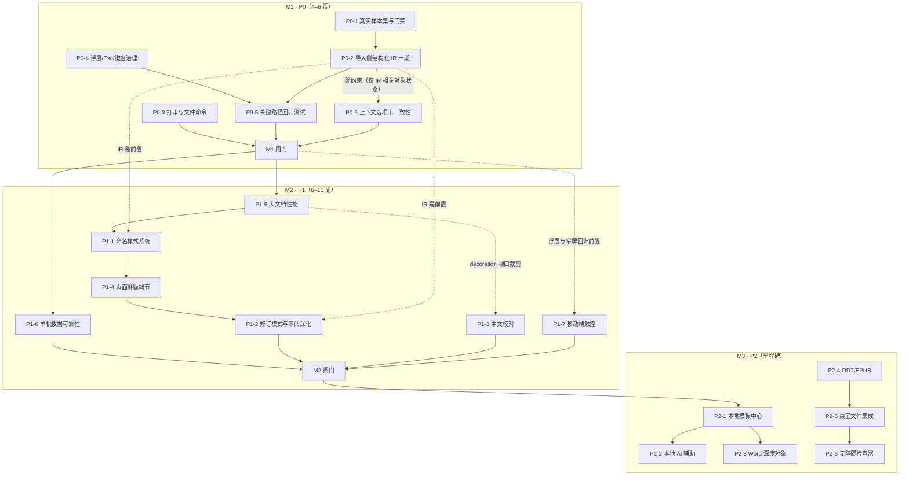

# SynTools 文字处理器完整实施计划

| 项目         | 内容                                                                                            |
| ------------ | ----------------------------------------------------------------------------------------------- |
| 文档版本     | v1.0 · 2026-11-05                                                                               |
| 文档性质     | **执行/排期文档**，不是现状分析；现状论证与竞品对比见依据文档，本文只引用结论                   |
| 唯一交付依据 | `docs/rich-text-editor-roadmap.md`（v1.0 · 2026-11-05，下称「方案」）                           |
| 代码基线     | `55f4278`，工作区除 `docs/` 新增文档外无源码改动                                                |
| 本计划交付物 | 本文件 `docs/rich-text-editor-implementation-plan.md`；实施阶段不新增源码/配置，不执行 git 提交 |
| 状态标记     | `[ ]` 待办 / `[~]` 进行中 / `[x]` 已完成 / `[-]` 已取消；优先级 P0 必须 / P1 重要 / P2 可延后   |
| 编号规则     | 任务编号与方案 §4.2/§4.3/§4.4 的 `P0-x` / `P1-x` / `P2-x` **一一对应**，不另起体系              |

---

## 1. 目标与范围

### 1.1 唯一交付物

把方案中的「P0 六项 / P1 七项 / P2 六项」转化为**可直接排期、可逐项勾选**的任务清单，并补齐依赖、工时、涉及文件、验收项、回退点、阶段闸门与度量基线。本文件自成体系：可以单独评审、拆分给不同执行者，也可以作为 `task_plan.md` 风格工作记忆的入库版本。

### 1.2 输入依据（与方案的引用关系）

| 方案章节                     | 本计划如何使用                                                    |
| ---------------------------- | ----------------------------------------------------------------- |
| §0 执行摘要、§4.1 原则       | 提炼为 §2.2 横向约束与 §9.2 不做边界                              |
| §1 产品定位与硬约束          | 提炼为 §2.2 硬约束表，数值按本轮核验修正                          |
| §2 现状详细分析、§3 竞品对比 | **不重复**；仅在任务卡「背景」一句引用结论                        |
| §4.2 P0 / §4.3 P1 / §4.4 P2  | 逐条转成 §5 / §6 / §7 的任务卡、任务组、里程碑                    |
| §5 路线图与依赖              | 展开为 §3 阶段表、依赖图、关键路径与 §8 闸门                      |
| §6 度量与验收指标            | 展开为 §4 度量基线表与 §8.2 每阶段判定标准                        |
| §7 风险登记                  | 展开为 §9.1 风险与缓解表                                          |
| §8 证据索引                  | 作为 §5/§6 各任务「涉及文件」的核对基准（裸文件名已补全目录前缀） |

### 1.3 本计划不做的事

- 不修改 `docs/rich-text-editor-roadmap.md`，不改动编辑器源码、样式、配置、构建脚本与体积门禁。
- 不新增第三方依赖、不引入框架或 UI 库、不引入服务端与账号体系。
- 不承诺 P2 的排期；P2 只定义里程碑与进入条件。
- 不把「现状分析」「竞品论证」「能力矩阵」再写一遍。

### 1.4 使用方式

1. 评审 §3 阶段表与 §4 基线 → 2. 按 §5 逐项勾选 M1 任务 → 3. 每完成一项按 §8.1 跑对应验证命令 → 4. 到 §8.2 的闸门判定是否进入下一阶段 → 5. 在 §10.1 更新状态。

---

## 2. 依据与硬约束

### 2.1 方案结论（一句话引用）

方案的核心判断是：文字处理器已具备完整编辑能力，主要差距是 **① 交付保真（docx 导出强、导入弱，且缺真实样本与门禁）② 单机可靠性（全量分页/decoration/保存、配额与冲突）③ 工程可达性（浮层 Esc、focus trap、窄屏命令、回归测试）**；战略上不与 Word/Pages 拼全功能与云协作，定位为「浏览器里能把一份 docx 安全改完、原样交回去」。本计划按此排序投入。

### 2.2 横向硬约束（每个任务都适用）

| 约束       | 要求                                                                                                | 证据                                                                                         |
| ---------- | --------------------------------------------------------------------------------------------------- | -------------------------------------------------------------------------------------------- |
| 本地优先   | 默认本机处理、不上传、零账号；任何服务端能力必须显式声明并默认关闭                                  | `PRODUCT.md`、`README.zh-CN.md`                                                              |
| 交付形态   | 静态 SPA + 可选 Tauri，同一套 Web UI                                                                | `PRODUCT.md:Operating Context`                                                               |
| 技术栈     | React 18 + TS + Vite 6 + Tailwind 3 + Tiptap 3.31.3 + i18next；无第三方 UI 库                       | `package.json:68-83,145-147`                                                                 |
| i18n       | 9 语言 `zh / en / zh-TW / ja / fr / de / it / es / pt`；新增文案同步 9 语言并通过 `strings.test.ts` | `src/core/i18n/locales/index.ts:21-42`、`src/tools/rich-text-editor/strings.test.ts:6,31-33` |
| 首屏体积   | gzip ≤ **195 KB**（当前约 191.8 KB），`pnpm size` 为门禁                                            | `scripts/check-bundle-size.mjs:27`                                                           |
| 单 chunk   | gzip ≤ **500 KB**；例外：`vendor-univer` / `vendor-exceljs-` / `SpreadsheetTool-` 放宽至 **12 MB**  | `scripts/check-bundle-size.mjs:28,34-37`                                                     |
| 依赖加载   | 重依赖动态 `import()`，显式分包 vendor-tiptap / docx / mammoth / katex / jspdf                      | `vite.config.ts:70-125`、`src/tools/rich-text-editor/docx.ts:1349`                           |
| 三端一致   | 共享 Ribbon 的改动必须同时回归文字处理器 / 电子表格 / 幻灯片                                        | `src/core/components/ribbon/`、`e2e/office-ribbon.spec.ts`                                   |
| 测试       | 每个任务附对应单测或 e2e；`pnpm test` / `pnpm e2e` 全绿才进闸门                                     | `package.json:42,46`                                                                         |
| 不做的边界 | 实时协作、云同步、账号体系、服务端处理                                                              | 方案 §4.5、`.codebuddy/plans/rich-text-editor-next-roadmap_30481608.md`                      |

### 2.3 核验修正（本计划采用的准确口径）

方案中的现状结论均成立，但以下 5 处表述/注释需在实施阶段按本轮核验结果使用，避免执行失真：

| #   | 方案或源码表述                                              | 准确口径                                                                                                                  | 证据                                        |
| --- | ----------------------------------------------------------- | ------------------------------------------------------------------------------------------------------------------------- | ------------------------------------------- |
| 1   | 方案 §1 只写「单 chunk ≤500KB」                             | 还有 12 MB 重 chunk 白名单（`vendor-univer` / `vendor-exceljs-` / `SpreadsheetTool-`）                                    | `scripts/check-bundle-size.mjs:34-37`       |
| 2   | 脚本头注释「≤185KB」                                        | 实际常量 195 KB；注释过时                                                                                                 | `scripts/check-bundle-size.mjs:4,27`        |
| 3   | `strings.ts` 注释「180KB」「all 10 languages」              | 实际 195 KB / 9 语言；注释过时                                                                                            | `src/tools/rich-text-editor/strings.ts:6,8` |
| 4   | 方案 §0 把 `.codebuddy/` 归入「Internal」                   | `.gitignore` 中 `.codebuddy/` 属 `# AI Tools` 段，`plan/` 属 `# Internal`；忽略效果一致                                   | `.gitignore:51,55`                          |
| 5   | 方案 §6/§8 使用 `spellcheck.ts`、`docxReview.ts` 等裸文件名 | 实际位于 `src/tools/rich-text-editor/`；本计划每条「涉及文件」的首个路径写全路径，同目录后续沿用裸文件名，解析规则见 §8.3 | `src/tools/rich-text-editor/`               |

---

## 3. 分期与依赖

### 3.1 阶段表

| 阶段        | 周期               | 目标                                               | 包含任务    | 出口标准                                                                  |
| ----------- | ------------------ | -------------------------------------------------- | ----------- | ------------------------------------------------------------------------- |
| **M1 · P0** | 4–6 周             | 把「交付保真」变成可验证的事实，并补齐单机体验底线 | P0-1 … P0-6 | §8.2 M1 闸门全绿：真实样本门禁生效、关键路径回归、三端 e2e 与体积门禁通过 |
| **M2 · P1** | 6–10 周            | 能力深度 + 大文档性能 + 数据可靠性                 | P1-1 … P1-7 | §8.2 M2 闸门全绿：200 页性能预算、样式/修订往返、窄屏可达                 |
| **M3 · P2** | 路线图，不承诺排期 | 差异化与生态：模板、本地 AI、开放格式、桌面集成    | P2-1 … P2-6 | 每里程碑单独评审；进入条件见 §7.2                                         |

### 3.2 依赖关系图

### 3.3 关键路径与并行关系

- **关键路径**：`P0-1 → P0-2 → P0-5 → M1 闸门 → P1-5 → P1-1 → P1-4 → P1-2 → M2 闸门`。任一环节延期直接顺延 M1/M2。
- **可并行**：`P0-3`（打印/文件命令）与 `P0-4`（浮层治理）可分别独立开工；M2 中 `P1-6` 仅需 M1 闸门，`P1-3` 需等 `P1-5` 的 decoration 视口裁剪，`P1-7` 的浮层/窄屏前置已在 M1 完成，三者均可插入关键路径空档。
- **先后顺序理由**：`P0-2` 的结构化 IR 是 `P1-1` 命名样式与 `P1-2` 修订深化的前置；`P1-5` 会重构 `EditorToolbar.tsx` 的状态订阅，应先于 M2 的大规模 UI 新增；`P1-2` 的格式修订 `w:pPrChange` 依赖 `P1-4` 补齐的段落属性，故排在 `P1-4` 之后（与方案 §5 一致）。

### 3.4 阶段闸门概览

| 闸门 | 判定要点                                                                                                                                         | 详见       |
| ---- | ------------------------------------------------------------------------------------------------------------------------------------------------ | ---------- |
| M1   | ≥10 份真实第三方 `.docx` 样本、基线成为发布门禁、打印/草稿/撤销/快捷键/窄屏/右键 Esc 有回归、a11y 基础扫描 0 严重违规、195KB 门禁、三端 e2e 全绿 | §8.2       |
| M2   | 200 页输入 P95 <16ms、docx 往返保留样式与修订、窄屏命令可达、配额与多标签页冲突可检测                                                            | §8.2       |
| M3   | 每个里程碑单独评审，隐私叙事与体积门禁不退化                                                                                                     | §7.2、§8.2 |

---

## 4. 度量基线

### 4.1 基线与目标（与方案 §6 逐项对应）

| 指标                    | 当前基线                                     | M1 目标                                       | M2 目标                    | 证据                                                                      |
| ----------------------- | -------------------------------------------- | --------------------------------------------- | -------------------------- | ------------------------------------------------------------------------- |
| 真实第三方 `.docx` 样本 | 0（26 个样本全部 `generated`）               | ≥10，含 Word / WPS / LibreOffice / Pages 产出 | ≥20，按版本回归            | `fixtures/ooxml-baseline/manifest.json`                                   |
| 往返基线性质            | `continue-on-error`、非发布门禁              | 成为发布门禁，逐部件「保留/降级/丢失」可查    | 降级项 ≤ 明确白名单        | `scripts/roundtrip-baseline.mjs:7-8`                                      |
| 50 页分页耗时           | <50ms 预算用例                               | 不退化                                        | 不退化                     | `e2e/office-p2.spec.ts:279-318`                                           |
| 200 页输入延迟          | 无测量                                       | 建立 P95 采集                                 | P95 <16ms                  | 方案 §6（新增指标）                                                       |
| 拼写检查上限            | 200k 字符 / 100 条问题，超限静默             | 超限给可见提示                                | 视口裁剪后取消静默截断     | `src/tools/rich-text-editor/spellcheck.ts:252-253`                        |
| 自动保存                | 600ms 全量 `JSON.stringify` + IndexedDB 写入 | 合并三条链路、按字节计量                      | 增量/图片外置、冲突可检测  | `src/tools/rich-text-editor/RichTextEditorTool.tsx:156`、`draft.ts:52-62` |
| 版本快照                | 20 份完整 HTML                               | 总量上限与配额提示                            | 增量快照                   | `src/tools/rich-text-editor/docStore.ts:47-49`                            |
| 文字处理器测试          | 36 个单测文件 + 约 18 个 e2e 用例            | +打印/草稿/撤销/快捷键/窄屏/右键 Esc          | +大文档交互、样式/修订往返 | `src/tools/rich-text-editor/*.test.ts*`、`e2e/`（11 个 spec）             |
| 可访问性                | 模态无 focus trap、菜单键盘不完整            | `axe` 0 严重违规                              | 检查器规则集               | `src/tools/rich-text-editor/BookmarkDialog.tsx:59-69`                     |
| 体积                    | 约 191.8 KB / 195 KB 预算                    | 不超预算                                      | 不超预算                   | `scripts/check-bundle-size.mjs:27`                                        |
| i18n                    | 9 语言键对齐                                 | 新文案 9 语言同步                             | e2e 覆盖工具内语言切换     | `src/tools/rich-text-editor/strings.test.ts:6,31-33`                      |

### 4.2 门禁例外与记录口径

- `pnpm size` 判定：首屏 ≤195KB、单 chunk ≤500KB；`vendor-univer` / `vendor-exceljs-` / `SpreadsheetTool-` 三类重 chunk ≤12MB（`scripts/check-bundle-size.mjs:34-37`）。
- `pnpm baseline:roundtrip` 当前只做信息性 ratchet 且 `continue-on-error`；M1 的 P0-1 负责升级为发布门禁，在此之前**不得**把它写成已通过条件。
- 所有基线数值以本表为准；历史任务 `task_plan.md` 中的「175KB」与脚本头注释「185KB」均为过时口径，不沿用。

---

## 5. M1 · P0 任务卡（可直接开工）

### 5.0 任务卡模板与横向约束

每个任务卡固定包含：`背景`、`涉及文件`、`前置依赖`、`子任务`、`✅ 验收项`、`回退点`。状态标记与工时沿用 `plan/Tasks.md` 约定。除任务卡内写明的内容外，所有任务一律叠加以下横向约束：

| 横向约束   | 落地动作                                                                                                                                          |
| ---------- | ------------------------------------------------------------------------------------------------------------------------------------------------- |
| 9 语言文案 | 新增/修改 UI 文案同步 `src/tools/rich-text-editor/strings.ts` 等 9 语言，`pnpm exec vitest run src/tools/rich-text-editor/strings.test.ts` 键对齐 |
| 体积门禁   | `pnpm build && pnpm size`；首屏 ≤195KB、单 chunk ≤500KB（12MB 重 chunk 例外见 §2.2）                                                              |
| 三端一致性 | 改到 `src/core/components/ribbon/` 时必须跑 `e2e/office-ribbon.spec.ts` 全量 + 表格/幻灯片各自 e2e                                                |
| 回归验证   | 每个任务在其「✅ 验收项」中指定单测或 e2e 文件，不得只靠手工验证                                                                                  |
| 隐私边界   | 不新增网络请求；新词表/模板/模型资产必须本地或动态加载并显式标注                                                                                  |

### 5.1 P0-1 真实文档保真样本集与门禁

- [x] **P0-1 真实文档保真样本集与门禁**（P0，4d）
- **背景**：方案 §0/§2.3 指出 `fixtures/ooxml-baseline/` 全为 `generated` 样本、基线 `continue-on-error`，等于用自产文档验证自产解析器。
- **涉及文件**：`fixtures/ooxml-baseline/manifest.json`、`report.json`、`report.golden.json`；`scripts/roundtrip-baseline.mjs`；`src/tools/baseline/samples/doc.ts`、[NEW] `external-doc.ts`；CI 配置中与 `baseline:roundtrip` 相关的步骤；`package.json:44`
- **前置依赖**：无（M1 起点）
- **子任务**
  - [x] P0-1.1 用 Word / WPS / LibreOffice / Pages 各导出脱敏样本，覆盖多节、页眉页脚、脚注尾注、TOC/REF 域、修订、批注、浮动图片、公式、形状（0.5d）—— 2026-11-06 收尾：中文 + 英文两套独立内容 ×（源文档 + 4 类工具族）共 10 份；英文集 5 份均含 `word/comments.xml`，补齐中文集缺失的批注覆盖
  - [x] P0-1.2 扩展 `manifest.json` 结构：样本来源、产出工具/版本、期望部件清单；`report.json` 逐部件输出「保留 / 降级 / 丢失」（1d）
  - [x] P0-1.3 把 `.github/workflows/ci.yml` 的 `continue-on-error` 移除，新增漂移阈值判定与 `--informational` 调试开关（当前脚本只有 `--update`）（1d）
  - [x] P0-1.4 修正 `src/tools/baseline/samples/doc.ts:32` 关于「mammoth 丢下划线」的过时 notes（实际 `MAMMOTH_STYLE_MAP` 已有 `u => u`）；`manifest.json` 是生成物，须从源头改（0.5d）
  - [x] P0-1.5 补脚本自身单测与用法说明（0.5d）；回归记录（0.5d）—— `compare.test.ts` 11 例、`roundtrip.test.ts` 登记与字节一致性断言、脚本头与 CI 用法注释已落地；未新增独立 README
- **✅ 验收项**
  - ✅ `pnpm baseline:roundtrip` 可复现，报告含 10 份真实样本且逐部件可查；CI 已启用 `BASELINE_REQUIRE_COVERAGE=1`，同时强制 10 份样本与 4 类工具族覆盖
  - ✅ CI 中该步骤不再 `continue-on-error`，人为制造漂移时步骤失败
  - ✅ `src/tools/rich-text-editor/docxCompat.test.ts` 等既有 docx 单测全绿
- **回退点**：新增 `--informational` 开关并保留旧 `report.golden.json`；若样本无法合法入库，退回「仅本地保存样本 + CI 运行合成样本」并明确标注。

### 5.2 P0-2 导入侧结构化 IR（一期）

- [x] **P0-2 导入侧结构化 IR（一期）**（P0，8d）—— 6/6 子任务落地，flag 默认关闭、主链路零改动
- **背景**：方案 §2.3/§3.3 认定根因是 `mammoth → HTML` 单向降级，多节、脚注尾注、TOC/REF 域、OMML、图片环绕、页眉页脚变体「写得出、读不回」，修订/批注/形状靠文本流严格相等补丁。
- **涉及文件**：新增 [NEW] `src/tools/rich-text-editor/ooxmlIr.ts` + [NEW] `ooxmlIr.test.ts`、[NEW] `ooxmlIrFlag.ts` + [NEW] `ooxmlIrFlag.test.ts`、[NEW] `ooxmlIrSidecar.test.ts`、[NEW] `irLossStrings.ts`；`src/tools/rich-text-editor/docx.ts`、`docxReview.ts`、`docxShapeImport.ts`、`notes.ts`、`mathOmml.ts`、`sections.ts`、`toc.ts`、`xrefs.ts`、`imageLayer.ts`；`src/tools/rich-text-editor/fidelity.ts` + `fidelity.test.ts`、`strings.ts`、`RichTextEditorTool.tsx`
- **前置依赖**：P0-1（无真实样本无法判定「读回」）
- **子任务**
  - [x] P0-2.1 定义 IR 类型与「OOXML part → IR → Tiptap 节点」纯函数边界，产出可单测模块（1d）—— [NEW] `ooxmlIr.ts` + `ooxmlIr.test.ts`（8 例）：`collectPartFacts` 复用基线 14 键口径、`parseOoxmlParts` 返回 `ToolResult<OoxmlIr>`、`irToTiptapDoc` 产出 Tiptap JSON；零 DOM / zip / File 依赖，暂不接入 mammoth 主链路（flag 留 P0-2.6）
  - [x] P0-2.2 补 `footnotes.xml` / `endnotes.xml` 解析并回填编号与汇总（1d）—— IR 层完成：过滤 `separator` / `continuationSeparator`，按正文引用顺序分别编号（重复引用保留首号），`irNoteSummaries` 生成文末汇总，`irToTiptapDoc` 输出 `footnoteRef` / `endnoteRef`；未引用与缺失引用计入 `irLosses`（`ir.unreferencedNotes` / `ir.missingNotes`）
  - [x] P0-2.3 补 TOC / REF 域还原与 OMML → LaTeX 映射（复用 `mathOmml.ts` 反向能力）（1.5d）—— IR 层完成：`scanParagraph` 解析 `fldChar` 域并丢弃缓存结果，`TOC` → `tableOfContents`、`REF` / `PAGEREF` → `xref`（保留 run 位置）；`mathOmml.ts` 新增 `ommlToLatex`（frac / scripts / rad / delimiter / nary / func / acc / bar / eqArr / matrix，未知构造返回 `null` 并记 `ir.math`）；`latexToAst` 的 accent 缺口顺延至 P0-2.5（P0-2.4 未并入）
  - [x] P0-2.4 补 `wp:anchor` 图片环绕/图层、`w:sectPr` 多节与每节页眉页脚（1.5d）—— IR 层完成：`parseRelationships` 归一化 `rId`→part，`IrImage` 补 `target` / `wrap` / `behindDoc` / `offsetX/Y` / `width/height`（anchor + inline），`IrSection` 补 `page` / `margins` / `titlePage` / `headerParts` / `footerParts` / `headerTexts` / `footerTexts`；`latexToAst` accent 未并入，随 P0-2.5 的 `fidelity.ts` 明示处理
  - [x] P0-2.5 修订/批注/形状改用段落或书签锚点定位，替代「可见文本流严格相等」；降级时走 `fidelity.ts` 明示（1.5d）—— IR 层完成：`IrReview` 补 `revisions`（insert / delete / format，删除文本取 `w:delText`）与 `comments`（`parseCommentBodies` 回填正文，缺 `commentRangeStart` 时 `blockIndex = -1` 并记 `ir.unlinkedComments`）；`irBlockAnchors` + `resolveBlockAnchor` 按「块序 → 书签 → 唯一文本」三级定位，索引命中即便文本漂移也保留锚点并标记 `drifted`，仅歧义/缺失返回 `null` 交由调用方上报；`fidelity.ts` 新增 `importLossIssues`，把 13 个原始 `IrLoss` code 聚合为结构 / 审阅 / 字段三条用户可见告警（`detail` 保留原始 `code:count`），配套 `irLossStrings.ts` 9 语言文案与 `fidelity.test.ts` 3 例
  - [x] P0-2.6 增加 feature flag `USE_OOXML_IR`、导出侧回归与 9 语言提示文案（1d）；三端/docx 全量回归（0.5d）—— [NEW] `ooxmlIrFlag.ts` 提供 `isOoxmlIrEnabled(raw = VITE_USE_OOXML_IR)`（`1` / `true` / `on` / `yes` 开启，未设置或 `0` / `false` 关闭）；`importDocx` 新增 `useOoxmlIr` / `onIr` 两个选项，flag 开启且传入回调时，HTML 落定后再按需 `await import('./ooxmlIr')` 读取 `word/document.xml`、`_rels/document.xml.rels`、notes / comments / styles / numbering / people、header / footer 与 media 路径（media 只记路径，不解码像素），任一环节失败只 `console.warn` 并跳过，**返回的 HTML 与关闭时逐字一致**；`RichTextEditorTool` 把 `importLossIssues` 的三条告警送进 `FidelityDialog`（`operation: 'import'`），文案沿用 `irLossStrings.ts` 的 9 语言键（P0-2.5 已落地）。回归：[NEW] `ooxmlIrSidecar.test.ts` 4 例（关闭时不读包、显式 `false` 不读包、开/关 HTML 相同、结构告警 `detail` 保留 `ir.images:1` / `ir.bookmarks:1`）+ [NEW] `ooxmlIrFlag.test.ts` 3 例；全量单测 3468 例 / 368 文件全绿、`pnpm e2e` 197 passed、`pnpm build` + `pnpm size` 首屏 191.89KB（预算 195KB）、`RichTextEditorTool` chunk 143.44KB gzip（预算 500KB）
- **✅ 验收项**
  - ✅ P0-1 样本集中上述部件双向可回读，`report.json` 对应项不再为「丢失」
  - ✅ `docx.test.ts` / `docxCompat.test.ts` / `docxReview.test.ts` / `docxShapeImport.test.ts` / `sections.test.ts` 全绿，新增 [NEW] `ooxmlIr.test.ts` 覆盖每个部件
  - ✅ 关闭 flag 时行为与当前完全一致；`pnpm size` 不超预算 —— `ooxmlIrSidecar.test.ts` 断言开 / 关两次导入的 HTML 严格相等，flag 关闭时 `onIr` 零调用；`ooxmlIr` 走动态 `import()`，默认路径不加载该模块，首屏 191.89KB / 195KB
- **回退点**：不设置 `VITE_USE_OOXML_IR`（或设为 `0` / `false`）即一键回退到 mammoth 主链路；`docx.ts` 保留原导入函数，IR 作为旁路而非替换。启用方式：`VITE_USE_OOXML_IR=1 pnpm build`。
- **已知限制（公式重音）**：`m:acc` 重音**导入可读、导出不可原生写回**。导入侧 `mathOmml.ts` 的 `ommlToLatex` 用 `ACCENT_LATEX` 把 `m:acc` 映射为 `\hat` / `\tilde` / `\bar` / `\overline`（未列出的重音符回落到 `\hat`）；导出侧 `docx` 库的 `MathComponent` 联合类型不含 `MathAccent`，`latexToAst` 也把 `\hat{..}` 一类判为不可表达而返回 `null`，于是 `docx.ts` 的 `buildMathRun` 走 `renderLatexImages` 降级为图片，图片也不可用时按 `$latex$` 源码文本输出，不静默丢内容。若后续 `docx` 补齐 `MathAccent`，只需在 `latexToAst` 增加 accent 节点并在 `latexToOmml` 输出 `m:acc`，降级路径无需改动。

### 5.3 P0-3 打印与文件命令补齐

- [x] **P0-3 打印与文件命令补齐**（P0，3d）—— 4/4 子任务落地，逐平台快捷键 e2e 7/7
- **背景**：方案 §2.2/§4.2 指出无独立打印命令与打印预览，仅 PDF 文本模式触发 `window.print()`；缺 TXT 导出与 HTML/MD/TXT 导入。
- **涉及文件**：`src/tools/rich-text-editor/ribbonTabs.ts`、`RichTextEditorTool.tsx`、`core.ts`、`pdf.ts`、`strings.ts`（9 语言）；`src/core/components/editorChrome.ts`；`e2e/tools.spec.ts`
- **前置依赖**：无（可与 P0-1/P0-4 并行）
- **子任务**
  - [x] P0-3.1 新增「打印 / 打印预览」文件菜单命令与 `Ctrl/⌘+P`，复用 `pdf.ts` 的 `printToPdf` / `printSupported`、`pageSetup.ts` 的 `buildPrintPageCss` 与组件内 `printHtml`（1d）—— `file-print` / `file-print-preview` + 打印预览对话框，预览直接渲染导出 HTML
  - [x] P0-3.2 补 `Ctrl/⌘+S`（本地保存反馈）、`Ctrl/⌘+N`，与浏览器默认行为逐平台验证并 `preventDefault`（0.5d）—— 单次全局 keydown + `fileActionsRef` 防闭包陈旧；`editorChrome.test.ts` 8 例 + `e2e/tools.spec.ts` 逐平台 3 例
  - [x] P0-3.3 `ExportExt` 增加 `txt`，补 TXT 导出；新增 TXT / HTML / Markdown 导入（DOMPurify 消毒、10MB 上限）（1d）—— `core.ts` 的 `textToDocHtml` / `MAX_IMPORT_BYTES`
  - [x] P0-3.4 9 语言文案、`e2e/tools.spec.ts` 打印与 TXT 往返用例（0.5d）
- **✅ 验收项**
  - ✅ **「6 个快捷键」口径复核**：roadmap §5 的 P0-3「6 个快捷键可用」指新增的 3 个应用级快捷键 `Ctrl/⌘+P/S/N` 在 macOS（`⌘`）与 Windows/Linux（`Ctrl`）两种键盘映射下的 6 个组合；连同既有 `Ctrl/⌘+F` 共 4 个应用级快捷键。帮助面板另对 `A/B/I/U/F/S/P/N` 8 个组合统一给出平台感知标签（`modifierShortcut()`），其中 `A/B/I/U` 由 Tiptap StarterKit 处理。
  - ✅ `e2e/tools.spec.ts` 分别以 `Control` 与 `Meta` 触发 P/S/N：断言 `defaultPrevented === true`、`window.print()` 调用 2 次、保存提示可见、新建清空内容且丢弃确认弹两次；`navigator.platform` 打桩 `MacIntel` / `Win32` 时帮助面板分别显示 `⌘N` / `Ctrl+N`，且所有 `<kbd>` 不出现另一平台修饰键。打印预览与导出页面一致、TXT 往返不丢字、导入不引入网络请求，新增 `pnpm test` / `pnpm e2e` 用例通过。
- **回退点**：原计划的 `showPrintCommand` / `enableTextImport` 开关**未落地，记为计划偏差**（全仓无该常量）；当前新增命令与文本导入均为 `RichTextEditorTool.tsx` / `core.ts` 内独立函数与菜单项，可单独摘除并保留原 PDF 文本模式打印链路。P0-2.6 建立统一 feature flag 机制后一并补齐灰度开关。

### 5.4 P0-4 浮层、Esc 与键盘治理

- [x] **P0-4 浮层、Esc 与键盘治理**（P0，5d）—— 6 个子任务全部落地，全量 `pnpm e2e` 193 passed / 0 failed
- **背景**：方案 §2.4/§2.5 记录四类面板范式并存、右键菜单 capture 阶段吞 Esc、6 个模态无 focus trap、ShapeMenu/StyleGallery 菜单键盘不完整、窄屏溢出菜单跳过 `select`/`color`。
- **涉及文件**：`src/core/components/ribbon/Ribbon.tsx`、`RibbonTabStrip.tsx`、`ribbonTheme.ts`、`useRibbonCollapse.ts`、`types.ts`；`src/tools/rich-text-editor/RichTextEditorTool.tsx`、`EditorContextMenu.tsx`、`BookmarkDialog.tsx`、`MathDialog.tsx`、`FootnoteDialog.tsx`、`XrefDialog.tsx`、`PdfModeDialog.tsx`、`ShapeMenu.tsx`、`StyleGallery.tsx`；`src/core/components/editorChrome.ts`；[NEW] `src/core/hooks/useOverlayStack.ts`、`useMenuNavigation.ts`、`src/tools/rich-text-editor/ShortcutHelpDialog.tsx`、`shortcutStrings.ts`、`e2e/a11y-p04.spec.ts`
- **前置依赖**：无（P0-5 依赖本项）
- **子任务**
  - [x] P0-4.1 引入统一浮层栈（`useOverlayStack`）：Esc / 外部点击 / 互斥按「最上层优先」处理（1d）—— 模块级栈 + 5 组单测 + 局部 e2e 已落地；本轮修复 Tab trap 依赖 `isTop` 晚一帧导致首次 Tab 逃逸的竞态
  - [x] P0-4.2 z-index token 化：清除 `z-[60]` 硬编码，收敛到 `ribbonTheme.ts` 常量（0.5d）—— 4 个字面量 token；5 处跨工具任意值、ribbon 4 个下拉与 `RIBBON_FLYOUT` 全部改引用
  - [x] P0-4.3 6 个模态加 focus trap 与返回焦点；`aria-describedby` 补齐（1d）—— 6 个模态补描述 id，axe 对模态 0 违规
  - [x] P0-4.4 ShapeMenu / StyleGallery 补齐方向键、Esc、外部点击；右键菜单支持 `Shift+F10` / `ContextMenu` 键（1d）—— `useMenuNavigation` 共享 hook + 5 组单测 + e2e
  - [x] P0-4.5 快捷键帮助面板 + 平台感知标签，修 `RichTextEditorTool.tsx:1628` 硬编码 `⌘A`；`groupMenuItems` 让窄屏 select/color 可达（1d）—— 9 语言帮助面板 + 溢出控件面板复用 `ItemView` + 窄屏 e2e
  - [x] P0-4.6 共享 Ribbon 改动回归三端 `e2e/office-ribbon.spec.ts`（0.5d）—— 17/17 三端 Ribbon、axe 4/4、组合 125/125
- **✅ 验收项**
  - ✅ 从任意浮层按一次 Esc 只关闭最上层，且选区/查找/绘制状态不被误清；`e2e/tools.spec.ts` 新用例覆盖右键 Esc
  - ✅ 6 个模态 Tab 不逃逸；`Shift+F10` 打开上下文菜单；`axe` 基础扫描 0 严重违规（范围限定 P0-4 治理的共享 Ribbon 与模态表面，全页既有债务归 P2-6）
  - ✅ 窄屏（<640px）下字体/字号/颜色/缩放命令可达；`pnpm e2e` 全绿（193 passed / 0 failed，`office-p2.spec.ts` 的既有 P2 用例定位漂移已一并修正）
- **回退点**：按编辑器分端启用 `useOverlayStack`；`Ribbon.tsx` 保留旧分支一个版本周期，出问题可切回。

### 5.5 P0-5 关键路径回归测试

- [x] **P0-5 关键路径回归测试**（P0，4d）—— 3/3 子任务落地：e2e 7 例 + 单测 33 例，六类关键路径全覆盖
- **背景**：方案 §2.5/§3.3 指出打印、草稿恢复、撤销重做、快捷键、窄屏无 e2e，`find-replace.ts` / `draft.ts` / `pdf.ts` 无单测。
- **涉及文件**：`e2e/tools.spec.ts`（新增 `critical paths` / `collapsed ribbon` 两个 describe）、`e2e/office-ribbon.spec.ts`、`e2e/office-p2.spec.ts`；新增 [NEW] `src/tools/rich-text-editor/find-replace.test.ts`、[NEW] `draft.test.ts`、[NEW] `pdf.test.ts`、[NEW] `formatPainter.test.ts`；`src/tools/rich-text-editor/find-replace.ts`、`draft.ts`、`pdf.ts`（只读或最小修正）
- **前置依赖**：P0-2、P0-4
- **子任务**
  - [x] P0-5.1 e2e：打印、刷新后草稿恢复、撤销/重做（叠加形状/修订/格式刷）、快捷键、窄屏折叠与溢出菜单、右键 Esc（2d）—— `critical paths` 6 例（草稿 reload 恢复、undo/redo 分组、鼠标右键菜单 Esc 不清选区、菜单「打印」直点一次、插入形状后 undo/redo、`track-delete` 标记后 undo/redo）+ `collapsed ribbon` 1 例（600px 折叠态依次从字号 / 颜色 / 字体族控件取值并回读 run 的 `font-size`、`color`、`font-family`；每选一次折叠面板会收起，需重新点「开始」再操作下一个控件）。存量覆盖：打印预览、Ctrl⌘+P·S·N·F、Shift+F10 右键、窄屏字体·字号·颜色·缩放可见性。格式刷的"arm → 选目标"流程依赖焦点时序、e2e 不稳定，改由 `formatPainter.test.ts` 6 例单测覆盖白名单与选区语义
  - [x] P0-5.2 单测：`findMatches` / `replaceAllMatches` / decoration 更新；`writeDraftSafe` 配额降级与恢复；`buildPrintPageCss` / `@page` 注入（1.5d）—— [NEW] `find-replace.test.ts` 11 例（大小写、非重叠位置、不跨文本节点、正反向循环、单条 / 全部替换、空替换删除、编辑后 index clamp、清空搜索、decoration 类）、[NEW] `draft.test.ts` 10 例（v2 往返、超限拒绝、v1→v2 迁移与旧键清理、HTML 派生审阅、配额降级与全失败、审阅者名、`clearDraft` / `clearLegacyDraft`）、[NEW] `pdf.test.ts` 6 例（`printSupported` 含 Tauri、print 一次、清陈旧 `data-page-start`、显式分页换页、多列不动 flow）、[NEW] `formatPainter.test.ts` 6 例（白名单捕获、链接不进快照、光标位捕获、选区绘制、空选区返回 false、链接在重绘后保留）；`buildPrintPageCss` 已由 `pageSetup.test.ts` 覆盖，未重复
  - [x] P0-5.3 回归记录与基线写入 `progress.md`（0.5d）—— 已写 Session N+12（P0-2.6 / P0-5.2 / P0-5.1 首轮）与 Session N+13（P0-5.1 第二轮 6 例 e2e + 格式刷单测，含 typecheck·lint·单测·e2e 数字）；最终基线待 P0-5.1 收口后补一次
- **✅ 验收项**
  - ✅ 上述场景全部有断言，`pnpm test` 与 `pnpm e2e` 全绿；`pnpm typecheck` / `pnpm lint` 通过
  - ✅ 窄屏断言覆盖字体/字号/颜色可选中（与 P0-4.5 联动）
- **回退点**：本项只新增测试与最小修正，回退时删除新增用例即可，不影响产品行为。

### 5.6 P0-6 上下文选项卡一致性

- [x] **P0-6 上下文选项卡一致性**（P0，2d）
- **背景**：方案 §2.4/§4.2 指出表格/图片上下文只是「开始/插入」里追加分组，与 Word「表格工具 / 图片格式」不一致；形状格式已实现可直接复用。
- **涉及文件**：`src/tools/rich-text-editor/ribbonTabs.ts`（`tableGroup` / `imageGroup` / `shapeFormatTab`）、`EditorToolbar.tsx`（受控 `activeTabId`）、`e2e/office-ribbon.spec.ts`
- **前置依赖**：无（本项只改 Ribbon UI 层，复用已实现的 `shapeFormatTab`；IR / 浮层栈无代码耦合）
- **子任务**
  - [x] P0-6.1 「表格工具」「图片格式」独立上下文选项卡，选中自动激活、离开回到原 tab（1d）
  - [x] P0-6.2 分组重排与 9 语言文案；`office-ribbon.spec.ts` 增加断言（0.5d）；三端回归（0.5d）
- **落地证据**：`ribbonTabs.ts` 已有 `tableTools` / `pictureFormat` 两项上下文选项卡配置（`tab.tableTools` / `tab.pictureFormat` 文案键 9 语言齐备），与 `shapeFormatTab` 走同一 `activeTabId` 受控机制；`office-ribbon.spec.ts` 断言在 2026-11-08 的门禁中全绿。本文档 §5.6 的任务标记此前遗漏未勾，2026-11-09 与 §10.1 对齐。
- **✅ 验收项**
  - ✅ 选中表格/图片/形状出现对应上下文选项卡，行为与已实现的 `shape-format` 一致
  - ✅ `e2e/office-ribbon.spec.ts` 全绿，三端无回归
- **回退点**：保留 `tableGroup` / `imageGroup` 追加分组的旧配置，通过 flag 切回。

### 5.7 M1 出口标准

- [x] P0-1 … P0-6 全部 `[x]`，且 §10.1 状态表与 `task_plan.md` 同步 —— 2026-11-07 核对，六项均 `[x]`，`task_plan.md` 已补「M1 闸门核对」表
- [x] §8.2 的 M1 闸门命令全部通过；真实样本往返报告可核查 —— 命令 1/2/3/6/7/8/9 全绿（`baseline:roundtrip` 10/10 样本、4/4 工具族、golden 无漂移）；命令 4/5 因环境 safe-delete 守卫无法清空 `dist`，改跑 `vite build --outDir dist-verify3` + 等价 gzip 复核（首屏 191.89KB、最大 chunk 143.44KB）
- [x] `pnpm build && pnpm size` 通过；9 语言键对齐；三端 e2e 全绿 —— build/size 同上为等价路径；`strings.test.ts` 全绿；`pnpm e2e` 204 passed / 0 failed（含 axe 扫描）
- [x] 本轮产物仅文档与测试/样例，无服务端、账号、外发请求

---

## 6. M2 · P1 任务组（任务组级 + 验收）

> P1 不拆到小时级，但每个任务组固定给出「目标 / 任务清单 / 涉及文件 / 前置 / ✅ 验收 / 回退点」，排期时再按 §3.1 的 6–10 周细分。

### 6.1 P1-1 命名样式系统

- [x] **P1-1 命名样式系统**（P1，8d）—— 两片完成：样式对象模型 + 全局生效 + 样式窗格 + 草稿 v3；`w:styles` / `w:pStyle` 往返 + 目录按样式层级；段落 / 编号字段留在模型与读盘层，UI 随 P1-4 / P1-2（见「计划偏差」）
- **目标**：把 9 个视觉预设升级为可保存/修改的命名样式对象，导出 `w:styles`，目录基于样式层级生成。
- **任务清单**：~~样式对象模型（名称 / 基于 / 字体）~~（第一片）→ ~~样式窗格与样式集~~（第一片）→ ~~`docx.ts` 写 `w:styles`、导入侧 styleMap 增强~~（第二片）→ ~~`toc.ts` 基于样式层级~~（第二片）→ ~~单测 + docx 往返 e2e~~（两片）。样式对象里的段落 / 编号属性只保留模型与读盘，UI 随 P1-4 的段落属性、编号随 P1-2 的编号系统落地，避免两片各写一套 `w:pPr` / `w:numPr`
- **已完成（2026-11-10 · 第一片）**：
  - [NEW] `namedStyles.ts`：`NamedStyle`（`id` / `label`（内置文案 key）/ `name`（重命名覆盖）/ `basedOn` / `headingLevel` / `font` / `paragraph` / `builtin`）纯数据模型 + `resolveStyle`（按 `basedOn` 链接力合并，环与未知父级只丢继承不退化成异常）+ `buildStyleCss`（每条样式一条规则）+ `inlineNamedStyles`（导出前把 `data-rte-style` 展开成内联 CSS）+ `sanitizeStyles`（逐字段校验、去重、缺 `body` 自动补、非法 id 丢弃）+ `upsertStyle` / `removeStyle`（内置不可删，被删样式下的子样式回挂 `body`）/ `resetStyle`（保留用户名称）/ `nextCustomStyleId`
  - 关键设计：**块上只存 `data-rte-style`，外观来自样式表**。改一次「标题 1」的字号，所有引用它的段落立刻重绘，文档本身零改动 —— 这正是验收里「修改标题 1 后全文同步」的可测形态；同时这也让样式定义成为唯一事实来源，`w:styles` 下一片直接由它生成
  - `NamedStyleAttribute`（`extensions.ts` 注册）：给 `paragraph` / `heading` 加 `styleId` 属性，渲染为 `data-rte-style`（不用 class，避免用户自定义 id 与工具类撞名），`parseHTML` 读回，因此 HTML 草稿天然可往返
  - `StyleGallery.tsx` 从「9 个按钮的悬浮画廊」升级为「画廊 + 修改样式」：上排点选即套用（`applyNamedStyle`：标题级转 `heading`，其余转 `paragraph`，再写 styleId；引用 / 代码保留原有 `blockquote` / `codeBlock` 行为），下半区跟随光标编辑当前样式（名称 / 基于 / 字体 / 字号 / 加粗 / 斜体 / 颜色 + 新建 / 重置 / 删除）；`defaultProps` 无、无新依赖
  - 导出链路：`RichTextEditorTool` 的 `printHtml`（打印 / 快照 PDF / 演示 / 单文件 HTML 共用）套上 `inlineNamedStyles`，导出物不依赖页面样式表；样式表本身由一个 `#rte-named-styles` 的 `<style>` 注入 `document.head`，随样式集更新，卸载时移除
  - 持久化：draft schema **v2 → v3**（`styles` 字段）。`migrateDraft` 同时修了一处随版本号而来的坑 —— 原先用「`schemaVersion === CURRENT_SCHEMA_VERSION`」判断是否 v2，升到 v3 后会把 v2 草稿当 v1 处理并从 HTML 重新推导批注（用户删掉的批注会复活）；现在按 `version < 2` 判断
  - `docStore`：`PAYLOAD_FIELDS` 增加 `styles`（否则样式改动不算「内容变化」，文档库副本永远停在旧定义）；`samePayload` 改用 **key 顺序无关** 的 `stableJson` —— 读回的记录会经 `sanitizeStyles` 重建对象、属性顺序与写入时不同，用裸 `JSON.stringify` 比较会把「无变化」误判成「有变化」，让每次重存都推高 `rev`（实现时被这条测试抓到）
  - `strings.ts`：新增 `styleName` / `styleBasedOn` / `styleNew` / `styleDelete` / `styleReset` / `styleNone` 六键 × 9 语言（字体族 / 字号 / 加粗 / 斜体 / 颜色复用既有键），`strings.test.ts` 通过
  - 踩到的坑：`.rte-surface .tiptap h1`（0,2,1）比 `.tiptap [data-rte-style]`（0,2,0）更具体，首版样式规则整条失效（实测标题恒为 1.75rem）。现生成 `.rte-surface .tiptap [data-rte-style="x"], .tiptap [data-rte-style="x"]` 两条同声明选择器，既压过标签默认值，也不强依赖 `.rte-surface` 外壳
  - 测试：[NEW] `namedStyles.test.ts`（25 例：默认集、继承/环/未知父级、CSS 生成、导出内联与内联声明优先、增删改与重置、脏数据净化、光标样式判定）+ `migrate.test.ts` 增补 5 例（v2→v3 默认样式、v3 样式净化、写侧往返、v1/v2 批注推导边界）+ [NEW] `e2e/office-styles.spec.ts`（2 例：改字号后两处标题同时 40px 且刷新保留、重命名持久化；内置不可删 / 自定义可建可删）
- **已完成（2026-11-11 · 第二片 · `.docx` 往返与目录层级）**：
  - **导出**：`exportDocxBlob(html, title, setup, review, namedStyles)` 把样式集写成 `w:styles`（每个 `NamedStyle` 一条 `w:style`：`w:name` = 名称、`w:basedOn` = 基于、`w:rPr` 只写实际设置的 sz/b/i/color/rFonts、`w:pPr` 写 `outlineLvl` 给 Word 导航与目录用），段落侧带 `data-rte-style` 时写 `w:pStyle` 并且**不再写 `Heading n`** —— 两个样式 id 会让 Word 与回读各挑一个
  - **`rte-` 前缀**：`w:styleId` 统一加 `rte-`（`rte-title`）。docx 库总会先写 Word 自带的 `Title` / `Heading1` 等内建样式，它们的 id slug 下来同样是 `title` / `heading1`，不加前缀时我们自己的定义会被内建样式挤掉 —— 回读后拿到的字体是 Word 的 Title（28pt）而不是用户设的 30pt。读回时「带前缀的先读」，让文档自己的定义赢
  - **导入**：[NEW] `namedStyleDocx.ts`。`parseDocxStylesXml` 用 fast-xml-parser 读 `word/styles.xml`（只取 `w:type="paragraph"`），还原 名称 / 基于 / `w:sz`（半磅→pt）/ 加粗 / 斜体 / 颜色 / 字体族 / `outlineLvl`→`headingLevel` / 对齐；`Heading1..6` 这类内建 id 映射到 `title` / `heading2..6`；中文 styleId 没有拉丁 slug，用稳定的 `style-N` 兜底而不是丢弃。`docxStyleMapEntries` 为**本应用写出的样式**生成 mammoth styleMap 条目（`p[style-name='名称'] => p.rte-style-<id>`），`applyStyleClasses` 在净化之后把标记类换成 `data-rte-style`，并把声明了标题层级的 `
` 换成 `<hN>`（否则回读后标题退化成段落，导航与目录都不认）
  - **只收养文档真正用到的样式**：`onStyles` 回调只带 `used` 里的定义，50 条样式的模板不会把画廊灌满；`mergeStyles` 让传入定义覆盖同 id（这正是「往返保留外观」的机制），内置标记仍以本应用为准，`sanitizeStyles` 会丢掉读盘时的临时字段
  - **目录**：`collectHeadings(doc, styleLevel?)` / `buildTocEntries(doc, pageOf, styleLevel?)` 新增层级解析器，`TableOfContents` 增加 `styleLevel` 选项；`RichTextEditorTool` 用 `styleHeadingLevel(样式集, node)` 注入 —— 段落只要套用了带 `headingLevel` 的样式就进目录，改样式的层级后目录随之变化（导出用的 `tocHtml` 走 state 版本，节点视图走 ref 版本，避免每次改样式都重建 extensions）
  - **过程中修掉的三个真实缺陷**：① 内建 `Title` 抢占 `title`（加 `rte-` 前缀 + 前缀优先读取）；② 动态 styleMap 把 mammoth 的 `List Paragraph` 语义顶掉，`.docx` 往返丢列表（`docxCompat.test.ts` 抓到）→ 只为 `owned` 样式生成映射条目；③ 回读的样式标题变成普通段落 → `applyStyleClasses` 按层级替换成 `hN`
  - 测试：[NEW] `namedStyleDocx.test.ts`（10 例：读盘/内建映射/前缀优先/中文 id/畸形输入降级/styleMap 只含自有样式/类转属性/层级替换）`docx.test.ts` +2 例（`w:pStyle` + `w:styles` 内容、无样式文档保持 `Heading n`）、`toc.test.ts` +1 例（样式层级入目录）、`e2e/office-styles.spec.ts` +1 例（导出 → 本地改名 → 导入，名称 / 字号 / 标题层级全部回来）
- **计划偏差（2026-11-11 收尾时登记）**：样式对象的 `paragraph`（对齐 / 行高）与「编号」两项只在模型与 `.docx` 读盘层支持，样式窗格不暴露、导出不写 `w:numPr`。原因：这两块与 P1-4（段落属性）和 P1-2（编号与交叉引用）共用同一套 `w:pPr` / `w:numPr` 生成逻辑，提前在样式层做一遍会产生两份互相漂移的实现
- **闸门证据（2026-11-10 · 第一片）**：typecheck / lint / prettier 通过；全量单测 381 文件 / **3632 例**全绿（较 P1-3 收尾的 3602 例 +30）；全量 e2e **219 passed / 0 failed**（16 个 spec，较 217 增加 2 例样式用例）；体积复核首屏 **191.93KB**（预算 195KB，与上一片持平）、最大普通 chunk 427.33KB（预算 500KB）、`SpreadsheetTool` 1776.81KB 走 12MB 例外、`RichTextEditorTool` chunk 150.82KB（+2.78KB，样式窗格与模型）；未新增依赖 / 资产 / 网络请求；`strings.test.ts` 9 语言键对齐
- **闸门证据（2026-11-11 · 第二片）**：typecheck / lint / prettier 通过；全量单测 382 文件 / **3645 例**全绿（较第一片的 3632 例 +13）；全量 e2e **220 passed / 0 failed**（EXIT=0；其中一次全量跑出现 P0-4「右键 Esc 不清选区」负载敏感失败 1 例，隔离 `--repeat-each=3` 3/3 通过、空载复跑 220/0，与本片改动无关）；体积复核首屏 **191.91KB**（预算 195KB）、最大普通 chunk 427.33KB（预算 500KB）、`RichTextEditorTool` chunk 152.54KB（+1.72KB：docx 样式读写与目录层级）；无新增依赖（`fast-xml-parser` / `jszip` 早已用于 OOXML 解析）
- **涉及文件**：`src/tools/rich-text-editor/namedStyles.ts`（[NEW]）、`namedStyleDocx.ts`（[NEW]）、`StyleGallery.tsx`、`extensions.ts`、`RichTextEditorTool.tsx`、`ribbonTabs.ts`、`migrate.ts`、`docStore.ts`、`strings.ts`、`docx.ts`、`toc.ts`；[DEL] `stylePresets.ts`（9 预设已并入 `createDefaultStyles`，删掉以免两份事实来源）
- **前置**：P0-2（IR）、P1-5（状态分片）
- **✅ 验收**：修改「标题 1」后全文与目录同步；`.docx` 往返保留样式名；`pnpm e2e` 新增用例通过。
- **回退点**：9 个内置样式仍是 `createDefaultStyles()` 的默认集，`sanitizeStyles` 在任何异常输入下回落到它们（草稿 / 文档库都不会出现「没有正文样式」的状态）；不挂 `NamedStyleAttribute` 即回到「块上没有 `data-rte-style`、外观全由样式表标签规则决定」的旧行为，样式定义留在草稿里不参与渲染。

### 6.2 P1-2 修订模式与审阅深化

- [x] **P1-2 修订模式与审阅深化**（P1，7d）—— 三片完成：标记/命令与 `w:pPrChange` 往返、面板线程与作者筛选（早前批次）；修订模式开关与事务改写；版本 diff 结构感知 + 合并稿往返
- **目标**：新增「修订模式」开关自动记录输入/删除/格式变更；补 `w:pPrChange`、作者/时间元数据、按作者筛选、批注线程；版本 diff 从纯文本行级升级为结构感知。
- **任务清单**：~~`marks.ts` 标记与接受/拒绝命令~~（早前批次）→ ~~`docxReview.ts` 导出补 `pPrChange`~~（早前批次）→ ~~`ReviewPanel.tsx` 线程 UI + 按作者筛选 + 上/下一处导航~~（早前批次）→ ~~tracking 状态与事务拦截~~（2026-11-11 第一片）→ ~~版本 diff 结构感知~~（2026-11-11 第二片）→ ~~与 `.docx` 比较的 e2e~~（早前批次；第一片补修订模式用例、第二片补「合并稿导出 → 回导」）
- **已完成（2026-11-11 · 修订模式）**：
  - [NEW] `tracking.ts`：`trackTransaction(state, tr)` 把**即将派发的那一个事务**改写成修订，而不是追加第二个事务 —— 一次按键仍是一步撤销（与「一次比较 = 一步撤销」同口径，撤销不会出现「先撤标记、再撤删除」的两次操作）。规则：插入文本打 `trackedInsert`；删除**保留原文**并打 `trackedDelete`；选中后直接改写时两半共用同一个 `changeId`，所以逐条接受/拒绝它是一次动作；删除「本身仍是待定插入」的文本按抵消处理，不留痕迹（输入后立刻退格不该留下一条修订）；纯文本之外的变更（Enter 拆段、块级粘贴、结构命令）一律不跟踪 —— 宁可不标，也不标错
  - 拦截点用 tiptap 3 的 `dispatchTransaction` 扩展钩子（`{ transaction, next }`，文档化的组合点），不 monkey-patch `view.dispatch`：可与其它扩展组合，view 重建也不会失效（一开始写的 `onCreate` 里替换 `view.dispatch` 既装不上 —— tiptap 的 `create` 事件在 `setTimeout(0)` 里发 —— 也不该由业务扩展去改视图）
  - 位置换算：保留被删内容会让同一批里后续 step 的位置整体右移，因此维护一个只记录「补回的删除长度」的 `Mapping`，用 `Step.map(shifts)` 平移；`Step.map` 返回 `null`（映射非法）时整体放弃改写、直接走原始事务，不留半成品
  - 光标：改写后显式把光标放到新文本之后 —— 否则 ProseMirror 的默认映射会把光标留在被划掉的旧文本之前
  - 守卫：撤销/重做（`isHistoryTransaction`）、接受/拒绝命令与比较事务（`NO_TRACK_META`）、`addToHistory: false` 的装饰性事务都不进入改写；开关通过 getter 读取，切换它不重建编辑器
  - Ribbon：审阅 → 修订组重排为两行三列，第一行首位是**修订模式**开关（新图标 `trackRevisions`，`active` 反映开关态），第二行「与文件比较… / 全部接受 / 全部拒绝」；`trackingMode` / `onToggleTracking` 进 `RichTextRibbonActions`
  - 面板与草稿零改动：修订模式的条目与手动标记同形状（`id` / `kind` / `text` / `author` / `createdAt`），作者筛选、逐条接受/拒绝、上/下一处导航、草稿持久化直接可用。撤销会把标记一起撤掉，此时逐条接受/拒绝因找不到 id 而失败 —— 顺手清掉这条陈旧条目，不留「按了没反应」的按钮
  - 文案：`trackRevisions` × 9 语言（`strings.test.ts` 通过）
  - 测试：[NEW] `tracking.test.ts` 8 例（关闭时不记录、插入可拒绝、删除保留原文可接受、选中改写两半同 id、输入后删除抵消、接受/拒绝不被二次跟踪、撤销不产生删除修订、拆段不半跟踪）+ `e2e/office-p2.spec.ts` +1 例（开启修订模式 → 输入出现在面板 → 全部拒绝回到原文 → 再输入 → 全部接受保留文本）
- **已完成（2026-11-11 · 结构感知版本 diff）**：
  - `versionDiff.ts` 放弃 `diffLines`（HTML 先拍平成纯文本，块类型、标题层级、列表/表格结构全被抹掉），改为复用 `compare.ts` 的 `blocksFromHtml` + `compareBlocks` —— 与「与文件比较」同一个算法，所以版本对比和修订比较不会给出互相矛盾的结论
  - 行模型升级为**块模型**：`DiffRow` 增加 `beforeType` / `afterType`（`p` / `h2` / `li` / `table` …）与 `segments`（块内词级 diff），新增 `kind: 'format'`。于是「标题变成正文」「列表变成段落」这类**文字没变、结构变了**的编辑第一次可见；多行块（列表、表格行）保持一行，不再按行号拆散
  - 块内改写仍是词级高亮：`compareBlocks` 把一次改写配成 `replace` 并带 token diff，左右单元格各取自己那一半（左 `equal` + `delete`，右 `equal` + `insert`），所以「hello world → hello there」只标 `world` / `there`，不是整行变色
  - 统计口径与文案同步：`addedLines` / `removedLines` 现在是**块数**，面板单位从「行」改为新增键 `diffBlocksUnit`（段 / blocks / blocs / Absätze / blocchi / bloques / blocos，9 语言）
  - 空块（`

`）在进入 diff 前丢弃：既不产生空白行，也保持「两侧都没有可比文本 → `EMPTY`」的既有语义
  - 面板：格式变化用紫色行 + `h2 → p` 小标签；改动词用深浅两级底色；行容器带 `data-diff-kind` / 高亮片段带 `data-seg`，让断言不必依赖颜色
  - 合并稿闭环：`office-p2` 的比较用例补上「拒绝一条 + 接受其余 → 导出 .docx → 清空 → 回导」，断言正文与导出前逐字符一致且不残留修订标记 —— 之前只验证了屏幕状态，没验证「合并结果是一份真文档」
  - 测试：`versionDiff.test.ts` 11 → 16 例（块类型变化成 `format` 行、列表算一块、词级 segments、块移动不被当成无变化、format 行在双栏里占两侧）+ [NEW] `VersionDiffPanel.test.tsx` 4 例（format 行与 `h2 → p` 标签、只标改动词、按块计数、两侧一致时的提示）+ `office-p2` 比较用例扩到 4 段
- **剩余**：无（P1-2 的子任务全部落地；后续审阅深化需求按新的评审单独立项）
- **计划偏差（2026-11-11 登记）**：修订模式不跟踪段落拆分/合并与块级粘贴 —— 结构性变更无法用 mark 表达，硬拆会破坏文档模型；开关状态不进草稿（每次会话默认关闭），符合本任务「开关默认关闭」的回退点
- **闸门证据（2026-11-11 · 结构感知版本 diff 收尾）**：typecheck / lint / prettier 通过；全量单测 385 文件 / **3672 例**全绿（较第一片 384 / 3663 增加 1 文件 9 例）；全量 e2e **223 passed / 0 failed**（合并稿用例扩写在同一 test 内，总数不变）；首屏 **192.04KB**（预算 195KB）、最大普通 chunk 427.33KB（预算 500KB）、`RichTextEditorTool` chunk 155.54KB（+0.52KB）；无新增依赖 / 资产 / 网络请求
- **闸门证据（2026-11-11 · 修订模式）**：typecheck / lint / prettier 通过；全量单测 384 文件 / **3663 例**全绿（+1 文件 8 例）；全量 e2e **223 passed / 0 failed**（+1）；首屏 191.92KB、`RichTextEditorTool` chunk 155.02KB（+0.96KB）
- **涉及文件**：`src/tools/rich-text-editor/versionDiff.ts`、`VersionDiffPanel.tsx`、`strings.ts`；[NEW] `VersionDiffPanel.test.tsx`；`e2e/office-p2.spec.ts`；第一片：`tracking.ts`（[NEW]）、`RichTextEditorTool.tsx`、`extensions.ts`、`ribbonTabs.ts`、`marks.ts`、`revisions.ts`、`src/core/components/ribbon/ribbonIcons.tsx`；早前批次：`docx.ts`、`docxReview.ts`、`ReviewPanel.tsx`、`compare.ts`
- **前置**：P0-2（IR）、P1-4（段落属性）、P1-5（状态分片）
- **✅ 验收**：开关打开后连续输入生成可逐条接受/拒绝的修订；比较两文件结果可导出且往返保留；`e2e/office-p2.spec.ts` 修订用例不退化。
- **回退点**：开关默认关闭，关闭时 `trackTransaction` 根本不被调用（等价于旧的手动标记路径）；旧手动标记按钮与原命令全部保留。版本对比退回到纯文本行级只是改 `versionDiff.ts` 一个文件（面板按 `kind` / `segments` 渲染，两者都是可选字段）。

### 6.3 P1-3 中文与多语言校对

- [x] **P1-3 中文与多语言校对**（P1，6d）—— 两轮完成：规则集、分类展示、取消静默截断、词级重复检测；中文分词与多语言词表按实测取消（见「计划偏差」）
- **目标**：本地中文分词 + 规则/词典（标点、重复字、常见错别字），不联网；扩展 `TOKEN_RE` 与建议逻辑。
- **任务清单**：~~规则集~~（已完成）→ ~~词级重复检测~~（已完成）→ ~~`SpellcheckPanel.tsx` 分类展示~~（已完成）→ ~~取消 200k/100 条的静默截断~~（已完成）→ ~~中文分词~~（`[-]` 按实测取消，见「计划偏差」）→ ~~多语言词表按需懒加载~~（`[-]` 无合规离线词表来源，interface 已通用，见「计划偏差」）→ 词表体积与 9 语言提示验证（仅 en 词表 724KB gzip 静态资源、不进首屏；9 语言文案已对齐）
- **已完成（2026-11-08）**：
  - [NEW] `zhRules.ts`：纯函数规则集，不做分词 —— ① 夹在汉字之间的半角标点（`我们,明天` → 建议全角，需两侧都是汉字，`1.2` / `github.com` / `A,B` 不误报）② 重复标点（`，，` `。。`，`……` `——` `！！` 不算）③ 重复虚词（`我们们` `是的的`；虚词表白名单，`人人` `天天` `高高兴兴` 不误报，`的的确确` / `是是非非` 单独豁免）④ 40 条人工核对过的同音错字（`按装`→`安装`、`必竟`→`毕竟`、`装模做样`→`装模作样`，最长匹配优先）。刻意不做 `的/地/得`：上下文相关，误报代价高于漏报
  - `spellcheck.ts`：`SpellIssue` 增加 `kind`（`spelling` / `punctuation` / `duplicate` / `typo`）与 `suggestion`；`checkTextReport` 把英文词表查词与中文规则合并、按文档顺序排序，并回报 `truncated`；`collectDocIssues` 改回报文 `{ issues, capped, truncated }`，两个上限都不再是静默截断
  - `SpellcheckPanel.tsx`：按 `typo → punctuation → duplicate → spelling` 分组，组头带条数；规则命中的建议直接来自规则（不经英文建议索引），点一下即原地替换；底部按需显示「仅列出前 N 条」/「仅检查了前 N 个字符」两条黄色提示
  - `strings.ts`：分类名 + 两条上限提示，9 语言键对齐（`strings.test.ts` 通过）
  - 测试：[NEW] `zhRules.test.ts`（15 例，正负例各半）+ `spellcheck.test.ts` 增补（kind/建议、200k 截断回报、上限回报）+ [NEW] `e2e/office-proofing.spec.ts`（中文三类问题分组展示、点建议原地替换、`的的确确` 不误报）
- **已完成（2026-11-10 · 词级重复）**：
  - `zhRules.ts` 新增 `findWordRepetitions()`（规则 ⑤，「复制粘贴多贴了一次」）：同一汉字单元连续出现两次即报，`kind` 复用 `duplicate`、`suggestion` 为单元本身，面板点一下删掉多余拷贝。2 字单元只在 `REPEAT_NOUNS`（约 110 个不可 ABAB 重叠的办公名词：文档 / 系统 / 项目 / 时间 / 数据 …）命中时报，因为 ABAB 本身是合法动词重叠；3–4 字单元不查词类直接报（`说明书说明书`）；`REPEAT_EXEMPT` 放过口语强调（`怎么样怎么样` / `没关系没关系` / `对了对了` / `不好意思不好意思`）；三次以上合并成一条（`文档文档文档` 一条覆盖全段）
  - **为什么不做分词**：仓库内唯一可离线拿到的中文词典是 `pinyin-pro` 为多音字消歧准备的 `DICT2–5`（合计 4,082 条），用 30 个常用办公词探测只命中 1 个（命中「质量」，缺「我们 / 文档 / 系统 / 进行 / 讨论 / 时间 / 项目 / 数据 / 内容 / 表格 …」），拿它切词等于用错语料的对码本；而词级重复本身不需要分词 —— 用「名词不能 ABAB 重叠」的词类判据即可，且零资产、零请求
  - 测试：`zhRules.test.ts` 15 → 20 例（名词重复、3 字单元、三次以上合并、动词 ABAB / 量词重叠 / 口语强调 / `的的确确` 不误报、自定义词典静音整段）+ `e2e/office-proofing.spec.ts` 新增 1 例（`文档文档` 进「重复字」组、点建议原地改回 `文档请查收`、列表清空后 decoration 归零）
  - 误报复核：对 `docs/` + `src/` 全部 1,484 个 `md`/`ts`/`tsx` 文件跑该规则，命中 15 处且全部是本轮新增文档与测试里的示例字符串（`文档文档` ×8 / `说明书说明书` ×4 / `文档文档文档` ×3），真实正文零命中
- **计划偏差（2026-11-10 收尾时登记）**
  - 中文分词（词典式）取消：见上「为什么不做分词」。引入 jieba / CC-CEDICT 等词库需要 MB 级资产与联网构建，与本任务「不联网、不进首屏」的口径冲突；词级重复改由词类判据实现，规则层仍是纯函数
  - 多语言词表按需懒加载取消（仅保留接口）：`loadDictionary(file)` / `dictionaryUrl(file)` 已按文件名通用（en 词表即走这条路径），但仓库没有 de / fr / es 等词表的合规离线来源，构建期联网取词表违反「无可外发请求、可离线构建」，故本轮只发布 `en-words.txt.gz`；后续有合规词表时按同一接口追加即可，无需改代码
- **闸门证据（2026-11-10）**：typecheck / lint / prettier 通过；全量单测 380 文件 / **3602 例**全绿（较 P1-6 收尾的 3597 例 +5）；全量 e2e **217 passed / 0 failed**（15 个 spec，较 216 增加新的词级重复用例）；体积复核（`vite build --outDir /tmp/syntools-e2e-build` + `check-bundle-size.mjs` 以软链接指向该目录）首屏 **191.93KB**（预算 195KB）、最大普通 chunk 427.33KB（预算 500KB）、`SpreadsheetTool` 1776.81KB 走 12MB 重 chunk 例外、`RichTextEditorTool` chunk 148.04KB；未新增资产 / 依赖 / 网络请求（规则是纯函数）；9 语言键未新增，`strings.test.ts` 通过。中间有一次「构建与 e2e 同机并发」的全量跑出现 1 例失败（`tools.spec.ts` 的 P0-4「右键 Esc 不清选区」，即 §6.6 记录的负载敏感用例），隔离 `--repeat-each=3` 全绿、空载全量复跑 **217 passed / 0 failed**（EXIT=0），与本轮改动无关（未触及选区与上下文菜单）
- **涉及文件**：`src/tools/rich-text-editor/zhRules.ts`、`spellcheck.ts`、`SpellcheckPanel.tsx`、`strings.ts`；`public/dict/en-words.txt.gz`、`scripts/build-wordlist.mjs`；`e2e/office-proofing.spec.ts`
- **前置**：P1-5（decoration 视口裁剪 —— 2026-11-08 已满足，`viewportRange.ts` 落地）
- **✅ 验收**：中文错别字/标点有提示；无任何外发请求；新词表不进首屏；`pnpm size` 通过。
- **回退点**：中文规则整组是纯函数，删掉 `checkChinese` / `findWordRepetitions` 的调用即回到纯英文校验；词表按语言开关隔离，出问题仅保留英文本地词库。

### 6.4 P1-4 页面排版细节

- [~] **P1-4 页面排版细节**（P1，5d）—— 两片完成：分页控制三件套 + `.docx` 往返、标尺缩进标记与拖拽；制表位、页眉页脚可视化编辑、奇偶页不同、行距段落化待做
- **目标**：补 `keepNext` / `keepLines` / `widowControl`、制表位与标尺拖拽缩进、页眉页脚可视化编辑、奇偶/首页不同。
- **任务清单**：~~`blockStyles.ts` / `ParagraphStyle` 扩属性~~（第一片）→ ~~`docx.ts` 映射 `w:keepNext` 等~~（第一片）→ ~~`.docx` 回读 `w:pPr` 分页位~~（第一片）→ ~~`RulerBar.tsx` 缩进标记与拖拽~~（第二片）→ 制表位（待做）→ 页眉页脚双击编辑浮层（待做）→ 奇偶页不同（待做）→ 打印/快照 PDF 一致性验证（两片均复核，无回归）
- **已完成（2026-11-11 · 第一片 · 分页控制）**：
  - `blockStyles.ts`：`ParagraphStyle` 新增 `keepNext` / `keepLines` / `widowControl` 三个段落属性。前两者写 `data-keep-next` / `data-keep-lines`，孤行控制只存「关闭」态（`data-widow-control="off"`）—— 开着是文档默认，存 true 只会让 HTML 变脏。用 `data-*` 而不是 inline style：分页控制是元数据，不是外观，CSS 与 `.docx` 各自决定怎么兑现
  - `BlockStyleCommands.setParagraphPagination(patch)`：只写传入的字段，所以「开段中不分页」不会把「段内不拆页」清掉（与 `setParagraphIndent` 同一套部分更新语义）
  - UI：开始 → 段落组新增三个开关（`keepNext` / `keepLines` / `widowControl` 三个新图标 + 9 语言 tooltip），状态从 `paragraph` 节点属性读、`active` 高亮，与 Word 把这三个放在 ribbon 的习惯一致，不再另开对话框
  - `docx.ts` 导出：`w:pPr` 写 `<w:keepNext/>` / `<w:keepLines/>` / `<w:widowControl w:val="false"/>`，只写用户真正开/关的那一段
  - `.docx` 回读：[NEW] `docxParagraphControls.ts`。mammoth 会把 `w:pPr` 整块丢掉（它只保留样式名），所以导入时直接读 `word/document.xml`：按出现顺序取出每个 `w:p` 的 `w:pPr`，把三个开关还原成同样的 `data-*`。**顺序守卫**：只有「HTML 块数 == Word 段落数」时才落属性，否则原样返回 —— 列表会让 mammoth 用 `<li>` 顶掉段落外壳，位置一旦错位就会把标记盖到相邻段落上，宁可不标
  - 打印与分页一致：`editor.css` 增加 `break-after: avoid` / `break-inside: avoid` / `orphans: 1; widows: 1`（`.tiptap` 与 `.rte-print-flow` 双作用域），页面视图与打印/快照 PDF 读同一份 HTML
  - 测试：[NEW] `docxParagraphControls.test.ts`（6 例：三开关按段落顺序、`w:val="0"` 关闭、只看 `w:pPr` 不看 `w:rPr`、顺序错位不落属性）+ `blockStyles.test.ts` +3 例（`data-*` 往返、只改一个字段、清除后属性消失）+ `docx.test.ts` +1 例（导出只给需要的段落写标记）+ [NEW] `e2e/office-pagination.spec.ts`（ribbon 开关 → 导出 → 本地清除 → 导入后标记回来，且第二段不受影响）
- **已完成（2026-11-11 · 第二片 · 标尺缩进拖拽）**：
  - `RulerBar.tsx` 在水平标尺上新增 Word 那三个缩进标记：首行（上三角）、左缩进（下三角）、右缩进（下三角，锚在内容右缘）。位置来自光标所在段落的 `indentLeft` / `textIndent` / `hangingIndent` / `indentRight`，随光标移动（复用既有的 transaction / selectionUpdate 订阅，不额外建立选择状态）
  - 拖拽：`pointerdown` 时 `setPointerCapture`（指针移出小标记也不断线），移动按 4px 对齐、clamp 0–480，屏幕 px 除以 `zoom` 换算成 CSS px 后直接调 `setParagraphIndent` / `indentParagraph` —— 编辑器始终是唯一事实来源，段落、标记、页面视图一起动，不需要本地预览态
  - 有悬挂缩进时首行标记驱动 `hanging`（并保持左缩进不动），没有悬挂时驱动 `textIndent`，与 Word 的语义一致
  - 无障碍取舍：标尺容器原本是 `aria-hidden` 的纯指示层，标记做成 `tabIndex={-1}` + `aria-hidden` 的指针手柄，键盘用户走 ribbon 上既有的增加/减少缩进命令（同一批命令、同一份状态），不为标尺另造一套键盘模型
  - 两个 CSS 坑（都是实测出来的）：① `.rte-ruler` 是 `pointer-events: none`（避免抢编辑区点击），手柄必须显式 `pointer-events: auto`，否则拖拽完全收不到事件；② `.rte-ruler-track` 有 `overflow: hidden`，右缩进标记若正好落在内容右缘会被裁掉一半、抓不住，因此向内偏移 6px
  - 测试：`e2e/office-pagination.spec.ts` +1 例（拖左标记 → `margin-left: 48px` 且 `data-value` 同步；右标记初始 0，向左拖 → `margin-right` 落在 36–60px）
- **剩余（第二片之后）**：标尺上的制表位（tab stop）与点击设置、页眉页脚双击就地编辑浮层（当前只能在页面设置面板里改文字）、奇偶页不同（只有首页不同）、段落行距的段落化（目前行距挂在 `textStyle` mark 上，导出固定 `w:line=300`）
- **闸门证据（2026-11-11 · 第二片）**：typecheck / lint / prettier 通过；全量单测 383 文件 / **3655 例**全绿（空载一次通过；并发跑 e2e 时有 2 例超时/字节比对失败，隔离复跑均通过，属负载敏感）；全量 e2e **222 passed / 0 failed**（EXIT=0，+1 例标尺拖拽）；体积复核首屏 **191.92KB**（预算 195KB）、`RichTextEditorTool` chunk 154.06KB（+0.46KB）；**第一片闸门证据（2026-11-11 · 分页控制）**：单测 383 文件 / **3655 例**（较 P1-1 收尾 3645 例 +10）、全量 e2e **221 passed / 0 failed**（+1 例分页往返）、打印一致性无回归：`office-p2.spec.ts` 的「page count matches between page view and snapshot PDF」与 `tools.spec.ts` 的打印用例全绿；体积复核首屏 **191.91KB**（预算 195KB）、最大普通 chunk 427.33KB（预算 500KB）、`RichTextEditorTool` chunk 153.60KB（+1.06KB）；无新增依赖
- **涉及文件**：`src/tools/rich-text-editor/blockStyles.ts`、`docxParagraphControls.ts`（[NEW]）、`docx.ts`、`ribbonTabs.ts`、`EditorToolbar.tsx`、`editor.css`、`strings.ts`、`RulerBar.tsx`、`src/core/components/ribbon/ribbonIcons.tsx`；`PageSetupPanel.tsx`、`sections.ts`（待做）、`pdf.ts`（已复核）
- **前置**：P1-1（样式语义）
- **✅ 验收**：docx 往返保留分页控制；打印与快照 PDF 结果一致；`pnpm e2e` 打印用例不退化。
- **回退点**：新增属性为可选字段，旧草稿 `migrate.ts` 归一化时给默认值。

### 6.5 P1-5 大文档性能

- [x] **P1-5 大文档性能**（P1，8d）—— 第二轮完成：门控、页张虚拟化、匹配缓存、200 页采样、块级增量分页与 decoration 视口裁剪全部落地（`ribbonTabs` 拆分经实测取消，见「剩余」）
- **目标**：增量分页、页张虚拟化、decoration 视口裁剪与缓存、工具栏状态分片订阅、`ribbonTabs.ts` 静态配置与动态状态拆分。
- **任务清单**：`PageView.tsx` 只重测变化块 → `RichTextEditorTool.tsx` 只渲染视口附近页张 → `find-replace.ts` / `spellcheck.ts` 视口裁剪 → `EditorToolbar.tsx` 拆分 `useEditorState` selector → 建立 200 页 P95 采集 → 50 页 <50ms 预算不退化。
- **已完成（2026-11-07）**：
  - `PageView.tsx` 调度门控：`update` 只在 `doc !== prevState.doc` 或强制 token 变化时重排；选区 / decoration 事务不再触发全量块测量。pageSetup、zoom 等文档外变化改走新增的 `forcePageRelayout(view)`（显式 `{ force: true }` meta + `token` 计数），不再依赖「空事务」的隐式副作用
  - 页张虚拟化（浏览器级）：`.rte-page-sheet` 加 `content-visibility: auto` + `contain-intrinsic-size: auto <页高>px`，视口外页张跳过布局与绘制（200 页文档即 336 张 sheet）
  - `find-replace.ts`：匹配结果缓存进 plugin state（`SearchConfig.matches`），decoration 查询只做 `Decoration.inline` 映射；每次按键从 2 次全文 `descendants` 扫描降为 1 次，导航 / 单条替换为 0 次（`replaceAllMatches` 主动丢弃过期缓存）
  - `spellcheck.ts`：删除「signature 未变」分支里重复的 `buildSpellDecorations`，每次 docChanged 从 2 次全文扫描降为 1 次
  - `EditorToolbar.tsx`：`useEditorState` selector 加 `rte-toolbar-state` 埋点（与 `rte-page-layout` 同口径），计算量从此可测
  - 200 页 P95 采集：[NEW] `e2e/perf-p15.spec.ts`（8400 段 → 336 张 sheet、5 轮编辑取 P95）+ 纸张切换重排回归用例
  - 实测：200 页布局 P95 **9.8ms**（预算 16ms）、每次编辑的布局 pass 从 11 次降到 5 次、ribbon state 重算 P95 **1.3ms**（30 次）
- **已完成（2026-11-08）**：
  - `PageView.tsx` 块级增量分页（默认关闭，`VITE_INCR_LAYOUT` / `globalThis.__RTE_INCR_LAYOUT__` 开启，见 [NEW] `layoutFlag.ts`）：缓存上一轮的块几何 + 页张几何 / 缩放 / 容器宽度 / 块元素列表作为签名；`dirtyBlockRange` 用 `Node.eq`（未改动子节点命中引用相等）定位被事务触碰的顶层块区间，只重读该区间 ±1 块与末块，其余块沿用缓存、按高度差平移。三道护栏防止「缓存假设失效」：区间前一块必须原地不动（迟到的字体 / 图片加载）、区间后一块给出尾部位移、末块校验预测值；任一不符即回退全量测量。块数变化（回车 / 粘贴 / 合并段落）与 mark / 属性变更导致的整体重排仍走全量
  - 全量路径同时拆分：`collectBlocks`（只读 gap 控件）与 `measureBlockAt`（只读需要几何的块），resize / 字体加载 / `forcePageRelayout` 主动清空缓存，避免跨 ppi、缩放的陈旧几何被复用
  - 增量与全量结果一致性：[NEW] `e2e/perf-p15.spec.ts` 用例（同一构建内用 `__RTE_INCR_LAYOUT__` 切换两条路径，比较页数与每个页间距 widget 高度）+ [NEW] `PageView.test.ts` / `layoutFlag.test.ts` 单测（区间定位、护栏回退、尾部位移）
  - 实测（200 页 / 8400 段，flag 开 vs 关）：布局 pass 中位 **4.4ms vs 9.1ms**、P95 **5.5ms vs 10.7ms**；单次按键只读 4 个块（区间前一块 + 变化块 + 区间后一块 + 末块），其余沿用缓存
  - 顺带修复：`measure` 的延迟 dispatch 会在「测量后、下发前又敲了一个键」时把旧文档的页起点写到新文档里，gap widget 被渲染进 `
` 内部（把该段撑高一整页间距，后续几何全错）。现在计划绑定测量时的 `doc`，文档已变则丢弃；同时 `planLayout` 发现 gap widget 数量与 decoration 数不一致时不再信任缓存几何
- **已完成（2026-11-08 · decoration 视口裁剪）**：
  - [NEW] `viewportRange.ts`：`decorationRange(view, docSize)`（>12 万字符才裁剪，短文档直通、不做任何几何读取）+ `expandRange`（视口两侧各留 3000 字符，钳到文档范围）+ `onViewportSettled`（capture 阶段监听 scroll，150ms 防抖后用空 meta 事务重建 decoration，挂载时立即触发一次，让大文档首屏的整篇 decoration 立刻被裁掉）。坐标 → 文档位置只能用公开的 `view.posAtCoords`（`EditorView.visibleRanges` 是内部字段，不在 `prosemirror-view` 类型里）
  - `spellcheck.ts`：`buildSpellDecorations` 的第三个参数改为 `DocRange | null`，插件 view 改用 `onViewportSettled`，删掉自带的 `VIEWPORT_SCAN_THRESHOLD` / `visibleScanRange`（此前写的 `visibleRanges` 版本无法通过类型检查）
  - `find-replace.ts`：`decorations` 只为可见匹配建 `Decoration.inline`（常用词在 200 页文档里是上万条 inline decoration，几乎全在屏幕外）；`true` meta 表示「只重建 decoration、不动匹配缓存」；`gotoMatch` 顺带把选区移到匹配处 —— `scrollIntoView` 跟随选区，否则视口外的当前匹配既不高亮也滚不到，裁剪后会表现为「按了下一个却什么都没发生」
  - `EditorToolbar.tsx`：新增 `rte-ribbon-tabs` 埋点（与 `rte-toolbar-state` 同口径），用数据判断静态配置拆分是否值得
  - 测试：[NEW] `viewportRange.test.ts`（stub view 覆盖短文档直通、视口裁剪、反向区间、离屏回退；`buildSpellDecorations` 的区间跳过用例保留）+ `e2e/perf-p15.spec.ts` 新增「find highlights cover only the visible slice of a 200-page document」（8400 个匹配 vs 实际 decoration <1000，并验证跳跃后当前匹配被高亮）
  - 实测（200 页，多次采样取区间）：布局 P95 **9.0–9.3ms**（全量路径，预算 16ms）、`rte-toolbar-state` P95 **1.1–1.2ms**、`rte-ribbon-tabs` P95 **0.5–0.6ms**；50 页预算 P95 **2.4ms**（预算 50ms）不退化
- **剩余**：`[-]` `ribbonTabs` 静态配置与动态状态拆分 —— 实测 `rte-ribbon-tabs` P95 **0.5–0.6ms**（1552 行纯数据构建器），收益不足以覆盖重构风险，取消并登记为技术债（若后续 tab 数量翻倍再评估）
- **涉及文件**：`src/tools/rich-text-editor/PageView.tsx`、`RichTextEditorTool.tsx`、`find-replace.ts`、`spellcheck.ts`、`EditorToolbar.tsx`、`ribbonTabs.ts`、新增 [NEW] `layoutFlag.ts` / [NEW] `viewportRange.ts`；`e2e/office-p2.spec.ts`、新增 [NEW] `e2e/perf-p15.spec.ts`
- **前置**：M1 闸门
- **✅ 验收**：200 页文档输入 P95 <16ms、滚动无长帧；`useEditorState` 计算量可测；`e2e/office-p2.spec.ts:279-318` 的 50 页预算不退化。
- **回退点**：增量分页与虚拟化分别加 flag（增量分页 = `VITE_INCR_LAYOUT`，默认关闭即回到全量测量）；旧全量布局保留一个版本周期。

### 6.6 P1-6 单机数据可靠性

- [x] **P1-6 单机数据可靠性**（P1，6d）
- **目标**：按字节计量与配额预警、内嵌图片外置 IndexedDB、版本快照增量或总量上限、`saveDocument` 版本校验 + `BroadcastChannel` 多标签页冲突提示、草稿列表与手动恢复 UI。
- **任务清单**：`draft.ts` 按字节计量 → 图片外置与引用化 → `docStore.ts` 乐观锁 + storage 事件 → 草稿/版本管理面板 → 刷新恢复与冲突 e2e。
- **涉及文件**：`src/tools/rich-text-editor/draft.ts`、`docStore.ts`、`migrate.ts`、`RichTextEditorTool.tsx`；`src/core/components/EditorStatusBar.tsx`；`e2e/tools.spec.ts`
- **前置**：M1 闸门（可与 P1-5 并行）
- **✅ 验收**：图片不再被静默剥离；两个标签页同开同一文档有明确冲突提示；刷新恢复 100% 可继续编辑；`pnpm test` 新增 [NEW] `draft.test.ts` / `docStore.test.ts` 用例通过。
- **回退点**：草稿 schema 走 `migrate.ts` 新增 v3，保留 v2 读回；图片外置失败时回落 base64。
- **已达成的部分（2026-11-09）**
  - [x] `saveDocument` 乐观锁写入校验：`StoredDocument` 新增 `rev`（旧记录按 1 归一化），`saveDocument(id, draft, { baseRev })` 在写入前比对，落后即返回 `{ ok:false, conflict:true }` 并**拒绝写入**（不再只是提示）；签名改为返回 `SaveDocumentResult`。配套两条关键规则：① 内容无实际变化时直接返回当前 `rev`、不写库也不发事件（否则「只是打开一个标签页」就会把其它标签页顶成过期写入方）；② 本标签页收到远端更新提示后暂停写文档（草稿照常写），由用户选择「载入最新版本」后再继续
  - [x] 内嵌图片外置 IndexedDB：[NEW] `assets.ts`（`externalizeImages` / `hydrateImages` / `getAssetDataUrl`，独立 DB `syntools-rich-text-assets`），`docStore` 在写入边界外置、在 `loadDocument` / `listVersions` 读取边界回填，因此编辑器 / 打印 / PDF / 导出仍拿到普通 `src`；同一张图按内容哈希复用一条记录，版本快照与文档记录都不再重复携带 base64；写入失败或 IDB 不可用时原样保留 base64（计划要求的回退点）
  - [x] 按字节计量与配额预警：`draft.ts` 新增 `utf8Bytes()`（UTF-8 字节，中文 3 字节/字，`html.length` 曾低估约 3 倍）、`writeDraft` 改为按序列化后整包字节判限；`writeDraftSafe` 返回 `{ bytes, ratio, tooLarge }`，`draftWarningLevel()` 统一 `DRAFT_WARN_RATIO = 0.8` 阈值，编辑器在 ≥80% 时显示「接近容量上限」提示（`draftNearLimit`，9 语言）
  - [x] 版本快照总量上限：`MAX_VERSIONS = 20` + 事务内裁剪（`putVersionBounded`），超限删最旧
  - [x] 文档库写事务提交语义：`txDone()` 让 `saveDocument` / `deleteDocument` 提交成功后才 resolve，配额与 abort 错误不再被 request promise 掩盖
  - [x] 刷新恢复：`initDocStore` 指针恢复 + v1 草稿迁移，完整恢复标题 / 正文 / 视图 / 页面设置 / 缩放 / PDF 模式 / 批注 / 修订 / 自定义词 / 模板
  - [x] `BroadcastChannel` 多标签页冲突提示：`docStore` 新增 `subscribeDocEvents`（按 tab 过滤自发布事件），编辑器在另一个标签页保存/删除当前文档时给出提示条，保存场景可一键载入对方版本
  - [x] 新增 [NEW] `docStore.idb.test.ts`（17 例，`fake-indexeddb` + 假 `BroadcastChannel`）与 [NEW] `DocLibraryPanel.test.tsx`（10 例），覆盖持久化、版本裁剪、删除清理、惰性 v1 迁移、复制标题本地化、跨标签页事件
- **计划偏差（2026-11-10 收尾时登记）**
  - 「草稿列表与手动恢复 UI」由既有 `DocLibraryPanel`（文档列表 + 打开 / 复制 / 删除）与 `VersionHistoryPanel`（快照列表 + 恢复 / 对比 / 手动快照）承担：每次保存同时写 localStorage 草稿与文档库，草稿退化为崩溃回退通道，独立「草稿列表」会与文档库重复，故不再单独做一层面板
  - localStorage 草稿仍内联 base64（读取路径同步，改异步会影响初始化时序）；超限时继续走「剥离图片」降级，图片可从文档库 / 版本快照恢复，不属于「静默剥离」路径
- **闸门证据（2026-11-10）**：typecheck / lint 通过；单测 380 文件 / **3597 例**全绿；全量 e2e **216 passed / 0 failed**（15 个 spec）；体积等价复核（`vite build --outDir /tmp/syntools-size-check` + 等价 gzip 计算，`dist` 因沙箱批量删除守卫无法原地清空）首屏 **192.31KB**（预算 195KB）、最大普通 chunk 427.33KB（预算 500KB）、`SpreadsheetTool` 1776.81KB 走 12MB 重 chunk 例外；9 语言键对齐（`strings.test.ts`）；未新增网络请求 / 服务端依赖（IndexedDB + BroadcastChannel 均为本地能力）；回退点保留（图片外置失败回落 base64、draft schema 仍可按 v3 演进并保留 v2 读回）

### 6.7 P1-7 移动端与触控可达

- [ ] **P1-7 移动端与触控可达**（P1，4d）
- **目标**：形状绘制/手柄支持 touch 与笔势，溢出菜单提供可弹出的 select/color 面板，窄屏命令可达性清单化。
- **任务清单**：`ShapeDrawLayer.tsx` / `ShapeOverlay.tsx` 指针事件扩展 → `Ribbon.tsx` 溢出面板支持 select/color → 窄屏 e2e 覆盖全部关键命令。
- **涉及文件**：`src/tools/rich-text-editor/ShapeDrawLayer.tsx`、`ShapeOverlay.tsx`、`ImageResizeOverlay.tsx`；`src/core/components/ribbon/Ribbon.tsx`、`useRibbonCollapse.ts`；`e2e/office-ribbon.spec.ts`
- **前置**：P0-4、P0-5
- **✅ 验收**：触屏可完成插入形状与缩放；<640px 下字体/字号/颜色/缩放可达；窄屏 e2e 全绿。
- **回退点**：触控分支独立，桌面指针行为不变。

### 6.8 M2 出口标准

- [ ] P1-1 … P1-7 全部 `[x]`；§8.2 的 M2 闸门命令全部通过
- [ ] 200 页性能预算达标、docx 往返样式/修订保真、窄屏命令可达、配额与冲突可检测
- [ ] `pnpm build && pnpm size` 通过；9 语言键对齐；三端 e2e 全绿

---

## 7. M3 · P2 里程碑（不承诺排期）

### 7.1 里程碑清单

| 里程碑                        | 对应方案 | 交付形态                                                                  | 触发条件                   | ✅ 验收要点                               |
| ----------------------------- | -------- | ------------------------------------------------------------------------- | -------------------------- | ----------------------------------------- |
| P2-1 本地模板中心 + 版面模式  | §4.4     | 公文/简历/报告模板 + 可拖拽对象模式，资产懒加载                           | 用户反馈模板需求明确       | 模板一键套用、体积不超预算、9 语言模板名  |
| P2-2 默认不外发的本地 AI 辅助 | §4.4     | WebLLM/WASM 或用户自备 key，默认关闭                                      | 隐私评审通过且模型资产可控 | 无默认外发、UI 明示数据流向、可一键关闭   |
| P2-3 Word 深度对象选择性补齐  | §4.4     | 题注/图表目录、索引、邮件合并、表格公式排序、图片裁剪、形状布尔、原生图表 | 按用户反馈排序后立项       | 每项独立 docx 往返用例，不破坏 M1/M2 基线 |
| P2-4 ODT / EPUB 等开放格式    | §4.4     | 优先 ODT，EPUB 借鉴 Pages；`.pages` 不入主线                              | 开放格式需求出现           | 导入导出可用、无服务端、体积门禁通过      |
| P2-5 桌面壳文件集成           | §4.4     | Tauri 直接读写本地文件、文件关联、自动备份与崩溃恢复                      | 桌面版发布节奏确定         | 离线可用、与 Web 端草稿模型一致           |
| P2-6 无障碍检查器             | §4.4     | 本地规则扫描（替代文本、标题层级、对比度）                                | P0-4 a11y 基线达标         | 规则可单测、结果可导出、无外发            |

### 7.2 进入 M3 的前置条件

- [ ] M2 闸门全绿；P1-5 的性能与 P1-6 的数据模型稳定
- [ ] 每个 P2 里程碑单独评审：用户价值、隐私影响、体积影响、维护成本
- [ ] `PRODUCT.md` 的隐私叙事与 UI 文案同步更新（尤其 P2-2）
- [ ] 任一里程碑失败不影响 M1/M2 已交付能力（各自可独立回退）

---

## 8. 阶段闸门与验证

### 8.1 验证命令（以 `package.json` 实际脚本为准）

| #   | 命令                                                              | 实际执行                                                                          | 用途                                              | 执行时机                              | 通过标准                               |
| --- | ----------------------------------------------------------------- | --------------------------------------------------------------------------------- | ------------------------------------------------- | ------------------------------------- | -------------------------------------- |
| 1   | `pnpm typecheck`                                                  | `tsc -b --noEmit`                                                                 | TS 类型检查（含项目引用）                         | 每个任务提交前                        | 0 错误                                 |
| 2   | `pnpm lint`                                                       | `eslint . --report-unused-disable-directives --max-warnings 0`                    | 全仓 lint                                         | 每个任务提交前                        | 0 error / 0 warning                    |
| 3   | `pnpm test`                                                       | `vitest run`                                                                      | 全量单测                                          | 每个任务提交前                        | 全绿；新增用例写进任务卡「✅ 验收项」  |
| 4   | `pnpm build`                                                      | `tsc -b && vite build`                                                            | 构建并产出 `dist/`                                | 阶段闸门、体积检查前                  | 构建成功且产出 `dist/`                 |
| 5   | `pnpm size`                                                       | `node scripts/check-bundle-size.mjs`                                              | 首屏 gzip ≤195KB、单 chunk ≤500KB、重 chunk ≤12MB | **必须在命令 4 之后**                 | 全部预算通过，白名单不扩大             |
| 6   | `pnpm baseline:roundtrip`                                         | `node scripts/roundtrip-baseline.mjs`（内部执行 `vitest run src/tools/baseline`） | OOXML 往返保真报告                                | 涉及 docx 的任务 + M1 闸门            | M1 前为信息性；P0-1 后漂移超阈值即失败 |
| 7   | `pnpm e2e`                                                        | `playwright test`                                                                 | 三端与文字处理器交互回归                          | 每个任务 + 阶段闸门                   | 相关 spec 全绿                         |
| 8   | `pnpm exec vitest run src/tools/rich-text-editor/strings.test.ts` | 命令 3 的定向子集                                                                 | 9 语言键对齐                                      | 任何 UI 文案改动后                    | 全绿                                   |
| 9   | `pnpm exec playwright test e2e/office-ribbon.spec.ts`             | 命令 7 的定向子集                                                                 | 共享 Ribbon 三端一致性                            | 改动 `src/core/components/ribbon/` 时 | 全绿，另跑表格与幻灯片各自 spec        |

说明：

- 命令 8 / 9 用于单任务快速回归，**不能替代闸门的全量命令 3 / 7**；闸门判定一律以全量结果为准。
- 命令 6 当前仍是 `continue-on-error` 的信息性 ratchet（§4.2），在 P0-1 完成前不得写成「已通过发布门禁」。
- `pnpm dev` / `pnpm preview`（`vite` / `vite preview`）用于打印预览、窄屏命令可达与触屏绘制的人工核对，属补充证据，不作为闸门判定依据。
- 包管理器为 `pnpm@11.25.0`（`package.json:16`）；所有命令在仓库根执行。

### 8.2 阶段闸门与通过标准

| 闸门   | 必跑命令                                             | 判定条件（全部满足）                                                                                                                                                                                                                             | 否决项（任一即不放行）                                                               |
| ------ | ---------------------------------------------------- | ------------------------------------------------------------------------------------------------------------------------------------------------------------------------------------------------------------------------------------------------ | ------------------------------------------------------------------------------------ |
| **M1** | §8.1 全部 1–9（其中 6 在 P0-1 完成后按门禁口径执行） | P0-1 … P0-6 全部 `[x]`；≥10 份真实第三方 `.docx` 且 `report.json` 逐部件可查；CI 不再 `continue-on-error`；打印/草稿恢复/撤销重做/快捷键/窄屏/右键 Esc 均有断言；`axe` 基础扫描 0 严重违规；9 语言键对齐；195KB 与 500KB 门禁通过；三端 e2e 全绿 | 往返报告出现未列入白名单的「丢失」；首屏超 195KB；任一 spec 红；新增未声明的外发请求 |
| **M2** | §8.1 全部 1–9，外加 200 页输入延迟 P95 采样          | P1-1 … P1-7 全部 `[x]`；200 页 P95 <16ms 且 50 页 <50ms 预算不退化；docx 往返保留命名样式与修订；<640px 字体/字号/颜色/缩放可达；配额预警与多标签页冲突可检测；体积与三端回归通过                                                                | 性能预算退化；往返丢样式或丢修订；窄屏关键命令不可达；任一 spec 红                   |
| **M3** | §8.1 的 1–5、7；涉及隐私的里程碑加隐私评审           | 每个 P2 里程碑单独评审通过（§7.2）；`PRODUCT.md` 隐私叙事与 UI 文案同步；体积门禁与 M1/M2 基线不退化                                                                                                                                             | 出现默认外发或默认开启的自备 key 能力；任一 M1/M2 闸门项退化                         |

判定方式：CI 日志 + 人工评审记录。任一否决项触发时，按对应任务卡的「回退点」回退，并把 M1/M2 已通过项重新跑一遍全量命令再放行。

#### 8.2.1 每个任务的最小回归集

| 改动类型         | 必跑命令（编号见 §8.1） | 额外门槛                                         | 对应任务                     |
| ---------------- | ----------------------- | ------------------------------------------------ | ---------------------------- |
| 通用（所有任务） | 1、2、3、7              | 任务卡「✅ 验收项」中的断言必须落地              | P0-1 … P2-6                  |
| UI 文案          | 8                       | 9 语言键对齐、`strings.test.ts` 全绿             | P0-3、P0-6、P1-1、P1-3       |
| 共享 Ribbon      | 9 + 全量 7              | 表格与幻灯片各自 e2e、三端截图对比               | P0-4、P0-6、P1-7             |
| docx 导入导出    | 6 + 3 中 docx 相关单测  | `report.json` 逐部件对比、不新增未白名单降级     | P0-1、P0-2、P1-1、P1-2、P1-4 |
| 新增资产或依赖   | 4、5                    | 动态 `import()`、独立 chunk、重 chunk 白名单不变 | P1-3、P2-1、P2-2             |

### 8.3 验证方式、证据留存与路径解析约定

- **证据形式**：CI 日志、`fixtures/ooxml-baseline/report.json`、`pnpm size` 输出、Playwright trace/截图、200 页 P95 采样表、9 语言键对齐输出。
- **记录位置**：逐任务命令与结果写入 `progress.md`（工作记忆，`.gitignore` 忽略）；可提交证据为 CI artifact 与 `fixtures/ooxml-baseline/` 报告。**本轮文档交付不生成、不修改任何测试产物。**
- **人工补充**：打印预览与导出页面一致性、<640px 命令可达、触屏形状绘制，用 `pnpm dev` 核对并附截图；只作补充，不替代 §8.2 的自动判定。
- **路径写法约定**：以 `src/`、`e2e/`、`scripts/`、`fixtures/`、`docs/`、`public/` 开头或位于仓库根的路径，按仓库根解析；不带目录的裸文件名按下列基目录解析；`:行号` 后缀仅为定位提示，核验时去掉后缀；`[NEW]` 表示实施期新增文件，当前不存在属预期。

| 写法                                                                                                                                               | 解析基准                      |
| -------------------------------------------------------------------------------------------------------------------------------------------------- | ----------------------------- |
| `src/…`、`e2e/…`、`scripts/…`、`fixtures/…`、`docs/…`、`public/…`、`vite.config.ts`、`package.json`、`PRODUCT.md`、`README.zh-CN.md`、`.gitignore` | 仓库根                        |
| 多数裸文件名（如 `docx.ts`、`ribbonTabs.ts`、`spellcheck.ts`、`draft.ts`、`EditorToolbar.tsx`）                                                    | `src/tools/rich-text-editor/` |
| `Ribbon.tsx`、`RibbonTabStrip.tsx`、`ribbonTheme.ts`、`useRibbonCollapse.ts`、`types.ts`（Ribbon 语境）                                            | `src/core/components/ribbon/` |
| `editorChrome.ts`、`EditorStatusBar.tsx`                                                                                                           | `src/core/components/`        |
| `*.spec.ts`                                                                                                                                        | `e2e/`                        |
| `*.mjs`                                                                                                                                            | `scripts/`                    |
| `manifest.json`、`report.json`、`report.golden.json`                                                                                               | `fixtures/ooxml-baseline/`    |
| `[NEW]` 前缀                                                                                                                                       | 实施期新增，清单见 §10.2      |

---

## 9. 风险、缓解与不做边界

### 9.1 风险与缓解（方案 §7 逐项展开）

| 风险                                    | 触发信号                                                      | 影响 | 缓解措施                                                                       | 对应任务         | 应急 / 回退                                               |
| --------------------------------------- | ------------------------------------------------------------- | ---- | ------------------------------------------------------------------------------ | ---------------- | --------------------------------------------------------- |
| OOXML IR 改造破坏现有导出               | 既有 docx 单测变红或报告出现新「丢失」                        | 高   | 以纯函数新模块旁路实现，保留 mammoth 链路作回退开关；既有单测 + 新样本集双保险 | P0-2             | `USE_OOXML_IR=false` 一键回退（§5.2 回退点）              |
| 真实样本含敏感内容或版权                | 样本来源不明、无法脱敏                                        | 中   | 自建脱敏文档并由外部办公软件导出；仓库只放结构与哈希说明                       | P0-1             | 退回「仅本地样本 + CI 合成样本」并明确标注（§5.1 回退点） |
| 中文词表 / 模板 / AI 资产增大体积       | `pnpm size` 超 195KB 或单 chunk 超 500KB                      | 中   | 动态 `import()` + 独立 chunk；重 chunk 白名单不得扩大                          | P1-3、P2-1、P2-2 | 移除资产或改为按语言懒加载                                |
| 共享 Ribbon 改动波及表格 / 幻灯片       | `e2e/office-ribbon.spec.ts` 或两端各自 spec 变红              | 中   | 同一改动同时跑三端 `office-ribbon.spec.ts` 与各自工具 e2e（§8.1 命令 9）       | P0-4、P0-6、P1-7 | `Ribbon.tsx` 保留旧分支一个版本周期（§5.4 回退点）        |
| 浮层 Esc 语义重构导致回归               | 一次 Esc 关闭多层、选区或查找状态被误清                       | 中   | 统一浮层栈 + 明确「最上层优先」；右键 / 绘制 / 对话框各写一条 e2e              | P0-4、P0-5       | 按编辑器分端启用 `useOverlayStack`                        |
| 新功能与「隐私优先」叙事冲突（尤其 AI） | 出现默认外发请求，或用户自备 key 被默认启用                   | 高   | 默认关闭、UI 明示数据流向、`PRODUCT.md` 同步评审                               | P2-2             | 下线该里程碑，M1/M2 能力不受影响                          |
| 单文件组件继续膨胀                      | `RichTextEditorTool.tsx` 继续同时承担状态、持久化、导出、面板 | 中   | 借 P1-5 把状态订阅与持久化拆成 hooks/模块，静态配置与动态状态分离              | P1-5             | 不阻断 M2 闸门，登记为技术债                              |
| （计划补充）性能预算无法达标            | 200 页 P95 ≥16ms 或 50 页分页 >50ms                           | 中   | 增量分页与页张虚拟化分别加 flag，先测后替换                                    | P1-5             | 旧全量布局保留一个版本周期（§6.5 回退点）                 |

前 7 行与方案 §7 一一对应；最后 1 行为本计划依据 §4 度量基线补充的性能风险。

### 9.2 明确不做（与方案 §4.5、`PRODUCT.md` 一致）

**实时协作、云同步、账号体系、服务端处理一律不做**；任何任务卡若隐含这些能力，视为越界并退回评审。

| 不做                                         | 理由                                             | 替代方案                                             | 对计划的约束                                |
| -------------------------------------------- | ------------------------------------------------ | ---------------------------------------------------- | ------------------------------------------- |
| 实时多人协同（CRDT / WebSocket / 服务端 OT） | 与本地优先、零外发冲突；引入服务端即改变产品性质 | 本地版本历史 + `.docx` 修订/批注往返 + 文件比较/合并 | P1-2 不得引入协同协议                       |
| 云同步、账号、权限分享                       | 同上                                             | 导出文件 / 静态 HTML 交付；可选 P2-5 桌面本地文件    | P1-6 的冲突检测仅限本机多标签页             |
| 服务端文档处理（转换 / 存储 / AI 推理）      | 与 `PRODUCT.md` 的零外发承诺冲突                 | 全部在浏览器或 Tauri 壳内完成；P2-2 默认关闭         | §8.2 三个闸门均设「无未声明外发请求」否决项 |
| 完整 Office 宏与插件生态                     | 体积、安全与沙箱成本远超收益                     | 本地模板 + 规则化自动化                              | P2-1 只做模板与版面模式                     |
| 追赶 Word 全部版式细节                       | 无真实排版引擎，投入产出比低                     | 优先 P0-1/P0-2 保真 + `fidelity.ts` 保真报告透明披露 | P2-3 按用户反馈排序，不承诺「大而全」       |

### 9.3 本轮文档交付的影响面控制

本节约束的是**本轮只写文档**；实施阶段按任务卡正常修改代码。

- [x] 唯一新增可提交文件：`docs/rich-text-editor-implementation-plan.md`；`docs/rich-text-editor-roadmap.md` 只读，不修改。
- [x] 文档交付轮未修改 TS / TSX / CSS / JSON / MJS 源码与配置，未改构建脚本、体积门禁常量与 CI 配置。
- [x] 不新增依赖、不引入框架或 UI 库、不执行 git 提交。
- [x] 工作记忆 `task_plan.md` / `findings.md` / `progress.md` 由 `.gitignore` 忽略，不入库。
- [ ] 实施阶段调整 CI（P0-1 把 `baseline:roundtrip` 升级为门禁）需单独评审，不属于本轮范围。

---

## 10. 追踪清单与自检

### 10.1 任务状态标记清单（可单独评审、排期与逐项勾选）

状态从 `[ ]` 改为 `[~]`（进行中）、`[x]`（已完成）或 `[-]`（已取消）；可直接复制本表到 `task_plan.md` 作为排期视图。估算单位 `d` = 人日，P2 不承诺排期。

| 任务                          | 状态  | 阶段 | 优先级 | 估算   | 前置                | 验收位置 |
| ----------------------------- | ----- | ---- | ------ | ------ | ------------------- | -------- |
| P0-1 真实文档保真样本集与门禁 | `[x]` | M1   | P0     | 4d     | 无                  | §5.1     |
| P0-2 导入侧结构化 IR（一期）  | `[x]` | M1   | P0     | 8d     | P0-1                | §5.2     |
| P0-3 打印与文件命令补齐       | `[x]` | M1   | P0     | 3d     | 无                  | §5.3     |
| P0-4 浮层、Esc 与键盘治理     | `[x]` | M1   | P0     | 5d     | 无                  | §5.4     |
| P0-5 关键路径回归测试         | `[x]` | M1   | P0     | 4d     | P0-2、P0-4          | §5.5     |
| P0-6 上下文选项卡一致性       | `[x]` | M1   | P0     | 2d     | 无（UI 层）         | §5.6     |
| P1-1 命名样式系统             | `[x]` | M2   | P1     | 8d     | P0-2、P1-5          | §6.1     |
| P1-2 修订模式与审阅深化       | `[x]` | M2   | P1     | 7d     | P0-2、P1-4、P1-5    | §6.2     |
| P1-3 中文与多语言校对         | `[x]` | M2   | P1     | 6d     | P1-5（已满足）      | §6.3     |
| P1-4 页面排版细节             | `[~]` | M2   | P1     | 5d     | P1-1                | §6.4     |
| P1-5 大文档性能               | `[x]` | M2   | P1     | 8d     | M1 闸门             | §6.5     |
| P1-6 单机数据可靠性           | `[x]` | M2   | P1     | 6d     | M1 闸门             | §6.6     |
| P1-7 移动端与触控可达         | `[ ]` | M2   | P1     | 4d     | P0-4、P0-5          | §6.7     |
| P2-1 本地模板中心 + 版面模式  | `[ ]` | M3   | P2     | 不排期 | M2 闸门 + 单独评审  | §7.1     |
| P2-2 默认不外发的本地 AI 辅助 | `[ ]` | M3   | P2     | 不排期 | P2-1 + 隐私评审     | §7.1     |
| P2-3 Word 深度对象选择性补齐  | `[ ]` | M3   | P2     | 不排期 | M2 闸门 + 反馈排序  | §7.1     |
| P2-4 ODT / EPUB 等开放格式    | `[ ]` | M3   | P2     | 不排期 | M2 闸门 + 单独评审  | §7.1     |
| P2-5 桌面壳文件集成           | `[ ]` | M3   | P2     | 不排期 | P2-4 + 桌面发布节奏 | §7.1     |
| P2-6 无障碍检查器             | `[ ]` | M3   | P2     | 不排期 | P0-4 a11y 基线      | §7.1     |

进度备注（2026-11-06 下午）：P0-1 已转 `[x]` —— 中文 + 英文两套独立内容共 10 份真实样本、工具族 4 / 4，英文集补齐 `comments` 部件；CI 已启用 `BASELINE_REQUIRE_COVERAGE=1`。P0-2 的前置依赖随之解锁，但仍是 6 个子任务的 8d 实现工作，未开始即不算完成。P0-4 已转 `[x]` —— 六个子任务全部落地，`office-p2.spec.ts` 的 3 例既有 P2 用例定位漂移同步修正，`pnpm e2e` 全量 193 passed / 0 failed。P0-3 已转 `[x]` —— 4 个子任务与验收项完成，「6 个快捷键」口径按 3 个新增快捷键 × 2 种键盘映射复核并写入 §5.3；`editorChrome.test.ts` 8 例、逐平台 e2e 7/7；`showPrintCommand` / `enableTextImport` 开关未落地，已在 §5.3 记为计划偏差。P0-2 已全部转 `[x]`：§5.2 的 P0-2.1（纯函数 IR 边界）、P0-2.2（编号/汇总/ref）、P0-2.3（TOC/REF 域与 OMML 反向）、P0-2.4（rels 归一化、图片环绕、多节页面设置）、P0-2.5（修订/批注结构回填、块序→书签→唯一文本三级锚点定位、`importLossIssues` 聚合为结构/审阅/字段三条告警）、P0-2.6（`VITE_USE_OOXML_IR` flag、`importDocx` 的 `useOoxmlIr` / `onIr` 旁路、按需 `import('./ooxmlIr')`、`FidelityDialog` 导入告警）6/6 落地；`ooxmlIr.test.ts` 32 例、`fidelity.test.ts` 8 例、`ooxmlIrSidecar.test.ts` 4 例、`ooxmlIrFlag.test.ts` 3 例。公式重音 `m:acc` 的导出边界（`docx` 无 `MathAccent`，降级为图片）已记入 §5.2「已知限制」。随后继续 P0-5：P0-5.2 三个单测文件（`find-replace` 11 例 / `draft` 10 例 / `pdf` 6 例）与 P0-5.3 记录落地，P0-5.1 补 3 例关键路径 e2e（草稿 reload、undo/redo 分组、鼠标右键 Esc 不清选区）；P0-5.1 已完成：`critical paths` 6 例（草稿 reload、undo/redo 分组、鼠标右键 Esc、菜单「打印」直点、形状 undo/redo、`track-delete` 修订 undo/redo）+ `collapsed ribbon` 1 例（600px 依次回读字号 / 颜色 / 字体族，每次取值后飞出的折叠面板会收起，需重新点「开始」）。**P0-5 全部转 `[x]`**：主项 3/3 子任务，回归合计 e2e 7 例 + 单测 33 例。全量单测 3501 例 / 372 文件、e2e 204 passed / 0 failed、首屏 191.89KB、`RichTextEditorTool` chunk 143.44KB gzip。

进度备注（2026-11-08）：P0-1…P0-6 保持 `[x]`；**P1-5 转 `[x]`** —— §6.5 的块级增量分页（`layoutFlag.ts`，默认关闭，实测 200 页布局中位 4.4ms / P95 5.5ms，全量 9.1ms / 10.7ms）与 decoration 视口裁剪（[NEW] `viewportRange.ts`：>12 万字符的文档只装饰视口 ±3000 字符，滚动停止 150ms 后重建；`spellcheck.ts` / `find-replace.ts` 共用；`gotoMatch` 补选区移动，否则裁剪后视口外的当前匹配既不高亮也滚不到）均已落地，200 页布局 P95 9.0ms（预算 16ms）、50 页 P95 2.4ms（预算 50ms）、`rte-toolbar-state` P95 1.1ms、`rte-ribbon-tabs` P95 0.5ms；`ribbonTabs` 静态配置拆分按实测取消（登记为技术债）。顺带修复 `spellcheck.ts` 的 `EditorView.visibleRanges` 类型错误（该字段是内部 API，不在 typings 里）——`pnpm build` 重新可用。P1-3 的前置（decoration 视口裁剪）已满足，可开工。

进度备注（2026-11-11 · P1-2 第二片）：**P1-2 转 `[x]`** —— 版本对比从「HTML 拍平成纯文本 + `diffLines`」换成块级 diff，直接复用「与文件比较」的 `blocksFromHtml` + `compareBlocks`，两条路径从此不会给出互相矛盾的结论。收益都是行级做不到的：标题降级为正文、列表改段落这类**文字没变结构变了**的编辑第一次可见（新行类型 `format` + `beforeType → afterType` 小标签）；多行块（列表 / 表格行）保持一块，不再按行号拆散；块内改写仍只标改动词（`replace` 自带 token diff，左右单元格各取一半）。统计口径随之从「行」改为「块」，新增 `diffBlocksUnit` × 9 语言。空块在进 diff 前丢弃，保住「两侧都没有可比文本 → `EMPTY`」的既有语义。顺手补上合并闭环：`office-p2` 的比较用例扩到「拒绝一条 + 接受其余 → 导出 .docx → 清空 → 回导」，断言正文与导出前逐字符一致且不残留修订标记 —— 以前只验证屏幕状态，没验证合并稿是一份真文档。闸门：typecheck / lint / prettier 通过，单测 385 文件 / **3672 例**全绿（+1 文件 +9 例），e2e **223 passed / 0 failed**，首屏 192.04KB、`RichTextEditorTool` 155.54KB（+0.52KB）。M2 闸门仍为 `[ ]`，剩余 P1-4 余项（制表位、页眉页脚双击编辑、奇偶页不同、行距段落化）与 P1-7。

进度备注（2026-11-11 · P1-2 第一片）：**P1-2 转 `[~]`** —— 补上这块唯一缺的「开关」能力：修订模式（审阅 → 修订组首位）打开后，输入自动成为 `trackedInsert`、删除**保留原文**并标 `trackedDelete`，选中改写时两半共用同一个 `changeId`（所以逐条接受/拒绝仍是一次动作）。改写发生在**即将派发的那一个事务**上（tiptap 的 `dispatchTransaction` 钩子），不是追加第二个事务 —— 一次按键 = 一步撤销，避免「先撤标记、再撤删除」的两次撤销。删除「本身还是待定插入」的文本按抵消处理，输入后立刻退格不留痕。位置换算与结构守卫是两块硬骨头：保留删除内容会让同批后续 step 右移（用只含补回长度的 `Mapping` + `Step.map` 平移，映射非法就整体放弃），Enter 拆段 / 块级粘贴 / 结构命令一律不跟踪（mark 表达不了，硬拆会毁模型）。撤销与接受/拒绝命令、比较事务分别用 `isHistoryTransaction` / `NO_TRACK_META` 挡住，不会被二次包装；撤销把标记撤掉后，逐条按钮因找不到 id 失败时顺手清掉陈旧条目。面板、作者筛选、草稿持久化零改动（条目形状与手动标记一致）。闸门：typecheck / lint / prettier 通过，单测 384 文件 / **3663 例**全绿（+1 文件 +8 例），e2e **223 passed / 0 failed**（+1 用例），首屏 191.92KB、`RichTextEditorTool` 155.02KB（+0.96KB）。P1-2 剩余：`versionDiff` 的结构感知 diff、比较后「只接受一部分再导出合并稿」的专门 e2e。M2 闸门仍为 `[ ]`，剩余 P1-2 余项 / P1-4 余项 / P1-7。

进度备注（2026-11-11 · P1-4 第二片）：**P1-4 仍为 `[~]`** —— 标尺从"纯刻度指示层"变成可操作的排版工具：水平标尺上多了 Word 的三个缩进标记（首行 / 左 / 右），位置跟着光标所在段落走，拖拽按 4px 对齐、按 `zoom` 换算，直接调既有命令，所以段落、标记、页面视图同步。有悬挂缩进时首行标记驱动 `hanging`，否则驱动 `textIndent`。键盘用户仍走 ribbon 的缩进按钮（标尺容器本来 `aria-hidden`，不为它另造键盘模型）。两个坑：`.rte-ruler` 的 `pointer-events: none` 会让手柄收不到事件（手柄需 `auto`）；`.rte-ruler-track` 的 `overflow: hidden` 会把落在内容右缘的右缩进标记裁掉一半（向内偏移 6px）。闸门：typecheck / lint / prettier 通过，单测 383 文件 / **3655 例**（空载一次通过），e2e **222 passed / 0 failed**（+1 拖拽用例；并发跑时出现过 2 例负载敏感失败，隔离复跑通过），首屏 191.92KB、`RichTextEditorTool` 154.06KB。P1-4 剩余：制表位、页眉页脚双击编辑、奇偶页不同、行距段落化。M2 闸门仍为 `[ ]`，剩余 P1-2 / P1-4 余项 / P1-7。

进度备注（2026-11-11 · P1-4 第一片）：**P1-4 转 `[~]`** —— 分页控制打通 ribbon → 属性 → `.docx` → 回读：段落新增 `keepNext` / `keepLines` / `widowControl`（`data-keep-next` / `data-keep-lines` / `data-widow-control="off"`，孤行控制只存关闭态），命令按字段部分更新，开始 → 段落组三个开关带 9 语言 tooltip 与新图标。导出写 `w:keepNext` / `w:keepLines` / `w:widowControl`；导入新增 `docxParagraphControls.ts` 直读 `word/document.xml` 的 `w:pPr`（mammoth 会把这块丢掉），带「块数相等才落属性」的顺序守卫，避免列表导致的错位。`editor.css` 让页面视图/打印/快照 PDF 都遵守同一份 `break-*` / `orphans` 规则。剩余：标尺制表位与拖拽缩进、页眉页脚双击编辑、奇偶页不同、行距段落化。闸门：typecheck / lint / prettier 通过，单测 383 文件 / **3655 例**全绿（+10），e2e **221 passed / 0 failed**（+1），首屏 191.91KB、`RichTextEditorTool` 153.60KB。M2 闸门仍为 `[ ]`，剩余 P1-2 / P1-4 余项 / P1-7。

进度备注（2026-11-11 · P1-1 第二片收尾）：**P1-1 转 `[x]`** —— 关键路径的第一环闭合。导出侧把样式集写成真正的 `w:styles`（名称 / 基于 / 字号 / 加粗 / 斜体 / 颜色 / 字体族 / `outlineLvl`），带样式的段落写 `w:pStyle` 且不再写 `Heading n`；导入侧 [NEW] `namedStyleDocx.ts` 读 `word/styles.xml` 还原样式对象，用 mammoth styleMap 把名称映射回 `data-rte-style`，声明了层级的样式再换回 `<hN>`，只收养文档真正用到的定义。目录也接上了样式层级：段落套用带 `headingLevel` 的样式即进大纲，改层级目录随之变化。三个坑都是回读实测出来的：Word 内建 `Title` 会挤掉我们同名的 `title`（改用 `rte-` 前缀 + 前缀优先读取）；动态 styleMap 顶掉 mammoth 的 `List Paragraph` 导致往返丢列表（`docxCompat.test.ts` 抓到，改为只映射自有样式）；回读的样式标题退化成段落（按层级换 `hN`）。**计划偏差**：样式的段落（对齐 / 行高）与编号只在模型和读盘层支持，UI 与导出留给 P1-4 / P1-2，避免与那两片的 `w:pPr` / `w:numPr` 各写一套。闸门：typecheck / lint / prettier 通过，单测 382 文件 / **3645 例**全绿（+13），e2e **220 passed / 0 failed**，首屏 191.91KB、最大普通 chunk 427.33KB、`RichTextEditorTool` 152.54KB。M2 闸门仍为 `[ ]`，剩余 P1-2 / P1-4 / P1-7。

进度备注（2026-11-10 · P1-1 第一片）：**P1-1 转 `[~]`** —— 关键路径开工。样式从「组合命令 + 标签默认样式」变为 **样式对象**：[NEW] `namedStyles.ts` 定义 `NamedStyle`（名称 / 基于 / 字体 / 层级 / 内置标记），块上只存 `data-rte-style`（`NamedStyleAttribute`，`parseHTML` 读回，HTML 草稿天然往返），外观统一由 `buildStyleCss` 生成的一条样式表决定 —— 改一次「标题 1」的字号，所有引用它的标题立刻重绘、文档零改动（验收里「修改标题 1 后全文同步」的可测形态）。`StyleGallery` 升级为「画廊 + 修改样式」：上排点选即套用，下半区跟随光标编辑名称 / 基于 / 字体 / 字号 / 加粗 / 斜体 / 颜色并可新建 / 重置 / 删除（内置不可删）。导出侧 `printHtml`（打印 / 快照 PDF / 演示 / 单文件 HTML）先 `inlineNamedStyles` 展开内联 CSS，导出物不依赖页面样式表。持久化升到 **draft v3**（`styles`），顺带修掉两处会被这个字段撞出来的问题：① `migrateDraft` 原先按 `schemaVersion === CURRENT` 判断 v2，升版后会把 v2 当 v1 从 HTML 重推批注（删掉的批注会复活），改按 `version < 2`；② `docStore.samePayload` 用裸 `JSON.stringify` 比较，而读回记录经 `sanitizeStyles` 重建对象、属性顺序不同，会把「无变化」误判为变化并推高 `rev`，改用 key 顺序无关的 `stableJson`。还踩到一个纯 CSS 坑：`.rte-surface .tiptap h1`（0,2,1）比 `.tiptap [data-rte-style]`（0,2,0）更具体，首版规则整条失效，现同时输出 `.rte-surface .tiptap …` 与 `.tiptap …` 两条同声明选择器。[DEL] `stylePresets.ts`。测试：`namedStyles.test.ts` 25 例、`migrate.test.ts` +5 例、`e2e/office-styles.spec.ts` 2 例。闸门：typecheck / lint / prettier 通过，单测 381 文件 / **3632 例**全绿（+30），e2e **219 passed / 0 failed**（+2），首屏 191.93KB、最大普通 chunk 427.33KB、`RichTextEditorTool` chunk 150.82KB（+2.78KB）。剩余：`docx.ts` 的 `w:styles` / `w:pStyle`、`toc.ts` 基于样式层级、docx 往返 e2e；段落 / 编号属性随 P1-4。

进度备注（2026-11-10 · P1-3 收尾）：**P1-3 转 `[x]`** —— 第二片落地「词级重复检测」：`zhRules.ts` 新增 `findWordRepetitions()`（规则 ⑤），同一汉字单元连续出现两次即报（`文档文档`），2 字单元只在约 110 个不可 ABAB 重叠的办公名词命中时报（动词重叠 / 量词重叠 / 口语强调 / `的的确确` 均不误报），3–4 字单元直接报，三次以上合并成一条，`kind` 复用 `duplicate`、建议即单元本身，面板点一下删掉多余拷贝（零新文案，9 语言键不变）。**中文分词按实测取消并登记偏差**：仓库内唯一可离线取用的中文词典是 `pinyin-pro` 的 `DICT2–5`（4,082 条，为多音字消歧而建），30 个常用办公词只命中 1 个，不足以支撑切词；引入 jieba / CC-CEDICT 需 MB 级资产与联网构建，与「不联网、不进首屏」冲突，且词级重复用词类判据即可、无需分词。**多语言词表懒加载同样登记偏差**：`loadDictionary(file)` / `dictionaryUrl(file)` 已是通用接口，缺的是 de / fr / es 的合规离线词表，本轮只发布 en。误报复核：对 `docs/` + `src/` 的 1,484 个 `md`/`ts`/`tsx` 跑规则，15 处命中全部是本轮新增的示例字符串，正文零命中。闸门：typecheck / lint / prettier 通过，单测 380 文件 / **3602 例**全绿（+5），e2e **217 passed / 0 failed**（+1；中间一次「构建与 e2e 同机并发」跑出现 P0-4「右键 Esc 不清选区」负载敏感失败 1 例，隔离 3/3 与空载全量复跑均全绿），首屏 **191.93KB**、最大普通 chunk 427.33KB。M2 闸门仍为 `[ ]`，剩余 P1-1 / P1-2 / P1-4 / P1-7。

进度备注（2026-11-10 · P1-6 收尾）：**P1-6 转 `[x]`** —— 六项任务清单全部落地或登记偏差：按字节计量与配额预警、图片外置 IndexedDB、版本快照总量上限、`saveDocument` 乐观锁 + `BroadcastChannel` 冲突提示、刷新恢复（已在更早批次完成）、草稿/版本面板（由 `DocLibraryPanel` + `VersionHistoryPanel` 承担，见 §6.6 计划偏差）。验收四条逐项核对：图片不再被静默剥离（文档库与快照外置，草稿超限仍降级但可从库恢复）、两标签页同开有明确冲突提示且过期写入被拒绝、刷新恢复覆盖全部文档状态（标题/正文/视图/页面设置/缩放/PDF 模式/批注/修订/自定义词/模板）、新增 `draft.test.ts`（14 例）/ `docStore.idb.test.ts`（22 例）/ `assets.test.ts`（4 例）/ `DocLibraryPanel.test.tsx`（10 例）全绿。闸门复核：全量单测 **380 文件 / 3597 例**、全量 e2e **216 passed / 0 failed**、首屏 **192.31KB**（较上次记录的 191.89KB 增加 0.42KB，预算 195KB 内）、最大普通 chunk 427.33KB（预算 500KB）。M2 闸门仍为 `[ ]`：P1-1 / P1-2 / P1-3（剩余中文分词与多语言词表）/ P1-4 / P1-7 未完成。

进度备注（2026-11-10 · P1-6 第四片）：完成「`saveDocument` 乐观锁写入校验」。`StoredDocument` 增加 `rev`，`saveDocument(id, draft, { baseRev })` 冲突时返回 `{ ok:false, rev, conflict:true }` 且不写库（返回类型由 `void` 改为 `SaveDocumentResult`）；编辑器用 `docRevRef` 记录载入时的修订号，`loadDocument` / `initDocStore` / 切文档 / 载入对方版本 / 新建分别同步或重置。实现中发现并修掉一个**由锁本身引入的回归**：每次打开标签页的首次保存都会无意义地推高 `rev`，把其它已打开的标签页顶成过期写入方（e2e 直接暴露：B 打开后 A 的保存被判冲突）。修法两条：① `saveDocument` 在 `samePayload()`（title/html/view/zoom/pdfMode/pageSetup/comments/changes/userWords/templateId 全等）时直接返回当前 `rev`，不写库也不发事件；② 收到远端更新提示后本标签页暂停写文档（草稿照常写），UI 显示冲突/远端提示并提供「载入最新版本」。文案 `saveConflict` × 9 语言。测试：`docStore.idb.test.ts` 21 → 22 例（过期 `baseRev` 被拒且新内容未被覆盖、无 `baseRev` 时仍自增、首次保存 `baseRev: 0`、无变化不推高 `rev` 且不产生快照），e2e 新增「旧修订标签页不得覆盖新内容」（直接读 IndexedDB 断言 A 的内容仍在、B 的内容未写入）。验证：typecheck / lint 通过，单测 380 文件 / **3597 例**全绿，e2e `rich-text-docs` **6 passed**、`tools + office-p1/p2/ribbon` **146 passed**。

进度备注（2026-11-10 · P1-6 第三片）：完成「内嵌图片外置 IndexedDB」。新增 [NEW] `assets.ts` 与独立数据库 `syntools-rich-text-assets`（object store `assets`，`onupgradeneeded` 只建缺失 store，不重写旧记录）；`docStore.saveDocument` 在写入前把 `src="data:image/..."` 换成 `syntools-asset:<内容哈希>`，`loadDocument` / `listVersions` 在读取边界回填 data URL，`saveManualVersion` 与版本裁剪改走 `readRawDocument` / `readRawVersions` 以避免把 base64 再写回快照。效果：同一张图只存一份（内容哈希去重）、文档记录与每个版本快照都不再携带 base64、编辑器 / 打印 / PDF / 导出的行为零改动；IDB 不可用或写入失败时原样保留 base64（回退点）。测试：[NEW] `assets.test.ts` 4 例（外置-回填往返、同图去重、外部图片与未知引用不动、写入被拒时保留 base64），`docStore.idb.test.ts` 17 → 18 例（原始记录里只有引用、快照里也只有引用、读回是 data URL），[NEW] e2e「图片不进文档 payload 且刷新后仍在」（直接读 IndexedDB 断言 `syntools-asset:` 且无 `data:image`，重载后 `src` 恢复为 data URL）。验证：typecheck / lint 通过，单测 380 文件 / **3593 例**全绿，e2e `rich-text-docs` **5 passed**、`tools + office-p1/p2/ribbon` **146 passed**。边界：localStorage 草稿仍是 base64（读取路径同步，暂未改异步），超限时继续走「剥离图片」降级。

进度备注（2026-11-09 · P1-6 第二片）：完成「按字节计量与配额预警」。`draft.ts` 新增 `utf8Bytes()` 与 `DRAFT_WARN_RATIO = 0.8`；`writeDraft` 改为「序列化整包后按 UTF-8 字节判限」（此前按 `html.length` 判断，中文字符实际占 3 字节但只计 1，配额被低估约 3 倍，且未计入批注/修订/自定义词）；`writeDraftSafe` 返回 `{ ok, degraded, bytes, ratio, tooLarge }`，`draftWarningLevel()` 作为「正常 / 接近上限 / 失败」的唯一判定入口，编辑器在 ≥80% 时显示「本地草稿已接近容量上限」（`draftNearLimit`，9 语言）。测试：`draft.test.ts` 10 → 14 例（UTF-8 计量、字符数达标但字节超限被拒、三档阈值、超限时 `tooLarge` 与 `ratio > 1`），并同步 `docStore.test.ts` 的两处严格相等断言。验证：typecheck / lint 通过，单测 379 文件 / **3588 例**全绿，e2e `rich-text-docs` + `tools` **119 passed**（含 P0-4/P0-5 那两条此前负载敏感的「Esc 不清选区」用例，本轮全绿）。

进度备注（2026-11-09 · P1-6 第一片）：P1-6 转 `[~]` —— 已落地「版本快照上限」（`MAX_VERSIONS` 20 + 事务内裁剪）、「文档库写事务提交语义」（`txDone()` 让 `saveDocument` / `deleteDocument` 提交后才 resolve，配额与 abort 错误可观测）、「刷新恢复」（`initDocStore` 指针恢复 + v1 草稿迁移，标题 / 正文 / 视图 / 页面设置 / 缩放 / PDF 模式 / 批注 / 修订 / 自定义词 / 模板全部还原）、「`BroadcastChannel` 多标签页冲突提示」（[NEW] `subscribeDocEvents` 按 tab 过滤自发布事件；另一个标签页保存当前文档时编辑器出现提示条，可一键载入对方版本；删除则只提示不载入）。新增 [NEW] `docStore.idb.test.ts`（17 例，`fake-indexeddb` + 假 `BroadcastChannel`）、[NEW] `DocLibraryPanel.test.tsx`（10 例）、[NEW] `e2e/rich-text-docs.spec.ts`（4 例，含跨标签页提示与载入）。文案 4 键 × 9 语言（`fileStrings.ts`），`strings.test.ts` 通过。验证：typecheck / lint 通过，单测 379 文件 / 3584 例全绿，`rich-text-docs.spec.ts` 4 passed；`tools + office-p1/p2/p3/ribbon/proofing/a11y` 全量跑 150 passed / 2 failed —— 失败的仍是 P0-4/P0-5 那两条「Esc 不清选区」用例（并发负载下 `window.getSelection()` 为空，单文件 6 worker × 8 次重复全绿，浏览器探测显示无负载时选区始终保留），已定位为负载敏感而非本轮改动引入，处理方式待定（候选：改断言 ProseMirror 选区状态 / 这两条串行执行）。**未完成**：`draft.ts` 按字节计量与配额预警、内嵌图片外置 IndexedDB、`saveDocument` 乐观锁写入校验、草稿/版本批量恢复 UI。

进度备注（2026-11-08 · P1-3）：P1-3 转 `[~]` —— 第一轮落地中文规则集（[NEW] `zhRules.ts`：半角标点 / 重复标点 / 重复虚词 / 40 条人工核对同音错字，纯函数、零词表、零请求）、`SpellcheckPanel` 按 `typo → punctuation → duplicate → spelling` 分类展示（组头条数、规则自带建议一键替换）、`collectDocIssues` 改回报 `{ issues, capped, truncated }` 取消 200k / 100 条的静默截断，分类名与两条上限提示已补 9 语言（`strings.test.ts` 通过）。新增 `zhRules.test.ts` 15 例与 `e2e/office-proofing.spec.ts`（分组 + 原地替换 + `的的确确` 不误报）。剩余：中文分词（词典式，需中文词表）与多语言词表按需懒加载。

阶段闸门勾选：

- [x] M1 闸门通过（§8.2 全部判定条件、无否决项）—— 2026-11-07：P0-1…P0-6 全 `[x]`；typecheck / lint / 单测 3501 / 往返门禁 10-10 无漂移 / e2e 204 全绿；首屏 191.89KB、最大 chunk 143.44KB（build/size 走 `--outDir dist-verify3` 等价路径，`dist` 待常规构建重建）
- [ ] M2 闸门通过（§8.2 全部判定条件、无否决项）
- [ ] M3 各里程碑单独评审通过（§7.2）

**每项任务标记 `[x]` 前必勾**：

- [ ] 新增/修改 UI 文案已同步 9 语言，`strings.test.ts` 通过
- [ ] `pnpm build && pnpm size` 通过（195KB / 500KB / 12MB 例外）
- [ ] 共享 Ribbon 改动已跑三端 e2e
- [ ] 任务卡「✅ 验收项」的单测或 e2e 已落地且全绿
- [ ] 回退点仍可用，且未新增网络请求 / 服务端依赖

### 10.2 一致性自检结果

自检时间：2026-11-05；对象：本文档 v1.0（579 行）。本轮为文档交付，**未运行构建、测试或 lint 命令**，只做静态一致性核验。

| 自检项                 | 方法                                                                             | 结果                                                                                                                                                                               |
| ---------------------- | -------------------------------------------------------------------------------- | ---------------------------------------------------------------------------------------------------------------------------------------------------------------------------------- |
| 章节编号连续           | 提取 `## x.` 与 `### x.y` 标题序号                                               | H2 = 1…10 连续；H3 = §1(1-4)、§2(1-3)、§3(1-4)、§4(1-2)、§5(0-7)、§6(1-8)、§7(1-2)、§8(1-3)、§9(1-3)、§10(1-3)。§5.0 为任务卡模板节，`8.2.1` 为四级标题，均为有意编号              |
| 表格列数一致           | 逐表比对每行的分隔符数量                                                         | 18 张表，0 张不一致                                                                                                                                                                |
| 任务编号与方案一一对应 | 比对本文档与 `docs/rich-text-editor-roadmap.md` 的 `P0-*` / `P1-*` / `P2-*` 集合 | P0 6/6、P1 7/7、P2 6/6，全部一致，无自造编号                                                                                                                                       |
| 引用路径有效           | 按 §8.3 基目录解析全部路径候选（去掉 `:行号` 后缀）                              | 0 个无法解析；`EditorStatusBar.tsx` 已补全为 `src/core/components/EditorStatusBar.tsx`                                                                                             |
| 计划新增文件           | 检查 `[NEW]` 标记与实际不存在的文件                                              | 5 个，均为实施期产物且已显式标注：[NEW] `src/tools/rich-text-editor/ooxmlIr.ts`、[NEW] `ooxmlIr.test.ts`、[NEW] `find-replace.test.ts`、[NEW] `draft.test.ts`、[NEW] `pdf.test.ts` |
| 验证命令真实可用       | 与 `package.json:21-46` 逐条比对                                                 | 9 条命令全部存在；`pnpm size` 明确排在 `pnpm build` 之后；`baseline:roundtrip` 保持 §4.2 的信息性口径，未写成已通过门禁                                                            |
| 依赖与前置一致         | 比对 §3.2 依赖图、§3.3 关键路径、§5/§6 任务卡前置、§10.1 清单                    | M2 采用方案 §5 的 `P1-5 → P1-1 → P1-4 → P1-2` 链；`P1-3` 依赖 `P1-5` 的 decoration 裁剪，`P1-7` 前置在 M1 完成，四处口径一致                                                       |
| 术语与口径统一         | 抽查 IR、degraded、上下文选项卡、三端、195KB / 500KB / 12MB、9 语言              | 与方案附录 A 及 §1 一致；5 处过时表述已在 §2.3 显式修正                                                                                                                            |
| 不重复现状论证         | 人工核对 §1–§2                                                                   | 只引用方案章节与证据索引，未复刻竞品矩阵与现状分析表                                                                                                                               |
| 工作记忆处于忽略范围   | `git check-ignore -q`                                                            | `task_plan.md` / `findings.md` / `progress.md` 均为 IGNORED；两份 `docs/` 文档均为 TRACKABLE                                                                                       |
| 工作区无源码改动       | `git status --short`、`git diff --stat`                                          | 仅 `?? docs/`；已跟踪文件 diff 为空，无源码/配置/构建脚本改动，未执行 git 提交                                                                                                     |

### 10.3 落盘与评审说明

| 文件                                           | 角色                         | 入库状态                  |
| ---------------------------------------------- | ---------------------------- | ------------------------- |
| `docs/rich-text-editor-implementation-plan.md` | **本轮唯一新增交付物**       | 可提交                    |
| `docs/rich-text-editor-roadmap.md`             | 唯一权威输入，本轮只读       | 已存在，未改动            |
| `task_plan.md` / `findings.md` / `progress.md` | 阶段进度、核验结论、完成记录 | `.gitignore` 忽略，不入库 |

评审入口：§3 阶段表 → §4 度量基线 → §10.1 状态清单；任务级内容在 §5，任务组级在 §6，里程碑级在 §7。每条任务可单独评审、单独排期、单独勾选，验收命令统一在 §8.1、判定统一在 §8.2。

维护规则：

- 状态只在 §10.1 与 `task_plan.md` 两处同步更新；任务卡正文保持为「开工说明」，不随进度反复改写。
- 新增或取消任务必须先在方案 §4.2/§4.3/§4.4 更新编号，再同步本文档，避免破坏「一一对应」；新增路径务必标 `[NEW]` 或补全真实路径。
- 验证脚本或门禁常量变化时，先按 §10.2 的方法重跑路径/命令核验，再发布新版计划。
- 实施阶段的证据（CI 日志、往返报告、体积输出、e2e trace）按 §8.3 留存；本文档不承载执行期产物。
