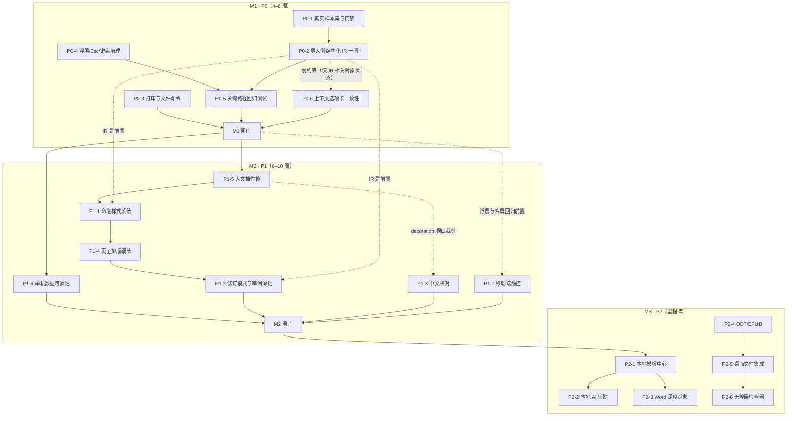

# SynTools 文字处理器完整实施计划

| 项目         | 内容                                                                                            |
| ------------ | ----------------------------------------------------------------------------------------------- |
| 文档版本     | v1.0 · 2026-11-05                                                                               |
| 文档性质     | **执行/排期文档**，不是现状分析；现状论证与竞品对比见依据文档，本文只引用结论                   |
| 唯一交付依据 | `docs/rich-text-editor-roadmap.md`（v1.0 · 2026-11-05，下称「方案」）                           |
| 代码基线     | `55f4278`，工作区除 `docs/` 新增文档外无源码改动                                                |
| 本计划交付物 | 本文件 `docs/rich-text-editor-implementation-plan.md`；实施阶段不新增源码/配置，不执行 git 提交 |
| 状态标记     | `[ ]` 待办 / `[~]` 进行中 / `[x]` 已完成 / `[-]` 已取消；优先级 P0 必须 / P1 重要 / P2 可延后   |
| 编号规则     | 任务编号与方案 §4.2/§4.3/§4.4 的 `P0-x` / `P1-x` / `P2-x` **一一对应**，不另起体系              |

---

## 1. 目标与范围

### 1.1 唯一交付物

把方案中的「P0 六项 / P1 七项 / P2 六项」转化为**可直接排期、可逐项勾选**的任务清单，并补齐依赖、工时、涉及文件、验收项、回退点、阶段闸门与度量基线。本文件自成体系：可以单独评审、拆分给不同执行者，也可以作为 `task_plan.md` 风格工作记忆的入库版本。

### 1.2 输入依据（与方案的引用关系）

| 方案章节                     | 本计划如何使用                                                    |
| ---------------------------- | ----------------------------------------------------------------- |
| §0 执行摘要、§4.1 原则       | 提炼为 §2.2 横向约束与 §9.2 不做边界                              |
| §1 产品定位与硬约束          | 提炼为 §2.2 硬约束表，数值按本轮核验修正                          |
| §2 现状详细分析、§3 竞品对比 | **不重复**；仅在任务卡「背景」一句引用结论                        |
| §4.2 P0 / §4.3 P1 / §4.4 P2  | 逐条转成 §5 / §6 / §7 的任务卡、任务组、里程碑                    |
| §5 路线图与依赖              | 展开为 §3 阶段表、依赖图、关键路径与 §8 闸门                      |
| §6 度量与验收指标            | 展开为 §4 度量基线表与 §8.2 每阶段判定标准                        |
| §7 风险登记                  | 展开为 §9.1 风险与缓解表                                          |
| §8 证据索引                  | 作为 §5/§6 各任务「涉及文件」的核对基准（裸文件名已补全目录前缀） |

### 1.3 本计划不做的事

- 不修改 `docs/rich-text-editor-roadmap.md`，不改动编辑器源码、样式、配置、构建脚本与体积门禁。
- 不新增第三方依赖、不引入框架或 UI 库、不引入服务端与账号体系。
- 不承诺 P2 的排期；P2 只定义里程碑与进入条件。
- 不把「现状分析」「竞品论证」「能力矩阵」再写一遍。

### 1.4 使用方式

1. 评审 §3 阶段表与 §4 基线 → 2. 按 §5 逐项勾选 M1 任务 → 3. 每完成一项按 §8.1 跑对应验证命令 → 4. 到 §8.2 的闸门判定是否进入下一阶段 → 5. 在 §10.1 更新状态。

---

## 2. 依据与硬约束

### 2.1 方案结论（一句话引用）

方案的核心判断是：文字处理器已具备完整编辑能力，主要差距是 **① 交付保真（docx 导出强、导入弱，且缺真实样本与门禁）② 单机可靠性（全量分页/decoration/保存、配额与冲突）③ 工程可达性（浮层 Esc、focus trap、窄屏命令、回归测试）**；战略上不与 Word/Pages 拼全功能与云协作，定位为「浏览器里能把一份 docx 安全改完、原样交回去」。本计划按此排序投入。

### 2.2 横向硬约束（每个任务都适用）

| 约束       | 要求                                                                                                | 证据                                                                                         |
| ---------- | --------------------------------------------------------------------------------------------------- | -------------------------------------------------------------------------------------------- |
| 本地优先   | 默认本机处理、不上传、零账号；任何服务端能力必须显式声明并默认关闭                                  | `PRODUCT.md`、`README.zh-CN.md`                                                              |
| 交付形态   | 静态 SPA + 可选 Tauri，同一套 Web UI                                                                | `PRODUCT.md:Operating Context`                                                               |
| 技术栈     | React 18 + TS + Vite 6 + Tailwind 3 + Tiptap 3.31.3 + i18next；无第三方 UI 库                       | `package.json:68-83,145-147`                                                                 |
| i18n       | 9 语言 `zh / en / zh-TW / ja / fr / de / it / es / pt`；新增文案同步 9 语言并通过 `strings.test.ts` | `src/core/i18n/locales/index.ts:21-42`、`src/tools/rich-text-editor/strings.test.ts:6,31-33` |
| 首屏体积   | gzip ≤ **195 KB**（当前约 191.8 KB），`pnpm size` 为门禁                                            | `scripts/check-bundle-size.mjs:27`                                                           |
| 单 chunk   | gzip ≤ **500 KB**；例外：`vendor-univer` / `vendor-exceljs-` / `SpreadsheetTool-` 放宽至 **12 MB**  | `scripts/check-bundle-size.mjs:28,34-37`                                                     |
| 依赖加载   | 重依赖动态 `import()`，显式分包 vendor-tiptap / docx / mammoth / katex / jspdf                      | `vite.config.ts:70-125`、`src/tools/rich-text-editor/docx.ts:1349`                           |
| 三端一致   | 共享 Ribbon 的改动必须同时回归文字处理器 / 电子表格 / 幻灯片                                        | `src/core/components/ribbon/`、`e2e/office-ribbon.spec.ts`                                   |
| 测试       | 每个任务附对应单测或 e2e；`pnpm test` / `pnpm e2e` 全绿才进闸门                                     | `package.json:42,46`                                                                         |
| 不做的边界 | 实时协作、云同步、账号体系、服务端处理                                                              | 方案 §4.5、`.codebuddy/plans/rich-text-editor-next-roadmap_30481608.md`                      |

### 2.3 核验修正（本计划采用的准确口径）

方案中的现状结论均成立，但以下 5 处表述/注释需在实施阶段按本轮核验结果使用，避免执行失真：

| #   | 方案或源码表述                                              | 准确口径                                                                                                                  | 证据                                        |
| --- | ----------------------------------------------------------- | ------------------------------------------------------------------------------------------------------------------------- | ------------------------------------------- |
| 1   | 方案 §1 只写「单 chunk ≤500KB」                             | 还有 12 MB 重 chunk 白名单（`vendor-univer` / `vendor-exceljs-` / `SpreadsheetTool-`）                                    | `scripts/check-bundle-size.mjs:34-37`       |
| 2   | 脚本头注释「≤185KB」                                        | 实际常量 195 KB；注释过时                                                                                                 | `scripts/check-bundle-size.mjs:4,27`        |
| 3   | `strings.ts` 注释「180KB」「all 10 languages」              | 实际 195 KB / 9 语言；注释过时                                                                                            | `src/tools/rich-text-editor/strings.ts:6,8` |
| 4   | 方案 §0 把 `.codebuddy/` 归入「Internal」                   | `.gitignore` 中 `.codebuddy/` 属 `# AI Tools` 段，`plan/` 属 `# Internal`；忽略效果一致                                   | `.gitignore:51,55`                          |
| 5   | 方案 §6/§8 使用 `spellcheck.ts`、`docxReview.ts` 等裸文件名 | 实际位于 `src/tools/rich-text-editor/`；本计划每条「涉及文件」的首个路径写全路径，同目录后续沿用裸文件名，解析规则见 §8.3 | `src/tools/rich-text-editor/`               |

---

## 3. 分期与依赖

### 3.1 阶段表

| 阶段        | 周期               | 目标                                               | 包含任务    | 出口标准                                                                  |
| ----------- | ------------------ | -------------------------------------------------- | ----------- | ------------------------------------------------------------------------- |
| **M1 · P0** | 4–6 周             | 把「交付保真」变成可验证的事实，并补齐单机体验底线 | P0-1 … P0-6 | §8.2 M1 闸门全绿：真实样本门禁生效、关键路径回归、三端 e2e 与体积门禁通过 |
| **M2 · P1** | 6–10 周            | 能力深度 + 大文档性能 + 数据可靠性                 | P1-1 … P1-7 | §8.2 M2 闸门全绿：200 页性能预算、样式/修订往返、窄屏可达                 |
| **M3 · P2** | 路线图，不承诺排期 | 差异化与生态：模板、本地 AI、开放格式、桌面集成    | P2-1 … P2-6 | 每里程碑单独评审；进入条件见 §7.2                                         |

### 3.2 依赖关系图

### 3.3 关键路径与并行关系

- **关键路径**：`P0-1 → P0-2 → P0-5 → M1 闸门 → P1-5 → P1-1 → P1-4 → P1-2 → M2 闸门`。任一环节延期直接顺延 M1/M2。
- **可并行**：`P0-3`（打印/文件命令）与 `P0-4`（浮层治理）可分别独立开工；M2 中 `P1-6` 仅需 M1 闸门，`P1-3` 需等 `P1-5` 的 decoration 视口裁剪，`P1-7` 的浮层/窄屏前置已在 M1 完成，三者均可插入关键路径空档。
- **先后顺序理由**：`P0-2` 的结构化 IR 是 `P1-1` 命名样式与 `P1-2` 修订深化的前置；`P1-5` 会重构 `EditorToolbar.tsx` 的状态订阅，应先于 M2 的大规模 UI 新增；`P1-2` 的格式修订 `w:pPrChange` 依赖 `P1-4` 补齐的段落属性，故排在 `P1-4` 之后（与方案 §5 一致）。

### 3.4 阶段闸门概览

| 闸门 | 判定要点                                                                                                                                         | 详见       |
| ---- | ------------------------------------------------------------------------------------------------------------------------------------------------ | ---------- |
| M1   | ≥10 份真实第三方 `.docx` 样本、基线成为发布门禁、打印/草稿/撤销/快捷键/窄屏/右键 Esc 有回归、a11y 基础扫描 0 严重违规、195KB 门禁、三端 e2e 全绿 | §8.2       |
| M2   | 200 页输入 P95 <16ms、docx 往返保留样式与修订、窄屏命令可达、配额与多标签页冲突可检测                                                            | §8.2       |
| M3   | 每个里程碑单独评审，隐私叙事与体积门禁不退化                                                                                                     | §7.2、§8.2 |

---

## 4. 度量基线

### 4.1 基线与目标（与方案 §6 逐项对应）

| 指标                    | 当前基线                                     | M1 目标                                       | M2 目标                    | 证据                                                                      |
| ----------------------- | -------------------------------------------- | --------------------------------------------- | -------------------------- | ------------------------------------------------------------------------- |
| 真实第三方 `.docx` 样本 | 0（26 个样本全部 `generated`）               | ≥10，含 Word / WPS / LibreOffice / Pages 产出 | ≥20，按版本回归            | `fixtures/ooxml-baseline/manifest.json`                                   |
| 往返基线性质            | `continue-on-error`、非发布门禁              | 成为发布门禁，逐部件「保留/降级/丢失」可查    | 降级项 ≤ 明确白名单        | `scripts/roundtrip-baseline.mjs:7-8`                                      |
| 50 页分页耗时           | <50ms 预算用例                               | 不退化                                        | 不退化                     | `e2e/office-p2.spec.ts:279-318`                                           |
| 200 页输入延迟          | 无测量                                       | 建立 P95 采集                                 | P95 <16ms                  | 方案 §6（新增指标）                                                       |
| 拼写检查上限            | 200k 字符 / 100 条问题，超限静默             | 超限给可见提示                                | 视口裁剪后取消静默截断     | `src/tools/rich-text-editor/spellcheck.ts:252-253`                        |
| 自动保存                | 600ms 全量 `JSON.stringify` + IndexedDB 写入 | 合并三条链路、按字节计量                      | 增量/图片外置、冲突可检测  | `src/tools/rich-text-editor/RichTextEditorTool.tsx:156`、`draft.ts:52-62` |
| 版本快照                | 20 份完整 HTML                               | 总量上限与配额提示                            | 增量快照                   | `src/tools/rich-text-editor/docStore.ts:47-49`                            |
| 文字处理器测试          | 36 个单测文件 + 约 18 个 e2e 用例            | +打印/草稿/撤销/快捷键/窄屏/右键 Esc          | +大文档交互、样式/修订往返 | `src/tools/rich-text-editor/*.test.ts*`、`e2e/`（11 个 spec）             |
| 可访问性                | 模态无 focus trap、菜单键盘不完整            | `axe` 0 严重违规                              | 检查器规则集               | `src/tools/rich-text-editor/BookmarkDialog.tsx:59-69`                     |
| 体积                    | 约 191.8 KB / 195 KB 预算                    | 不超预算                                      | 不超预算                   | `scripts/check-bundle-size.mjs:27`                                        |
| i18n                    | 9 语言键对齐                                 | 新文案 9 语言同步                             | e2e 覆盖工具内语言切换     | `src/tools/rich-text-editor/strings.test.ts:6,31-33`                      |

### 4.2 门禁例外与记录口径

- `pnpm size` 判定：首屏 ≤195KB、单 chunk ≤500KB；`vendor-univer` / `vendor-exceljs-` / `SpreadsheetTool-` 三类重 chunk ≤12MB（`scripts/check-bundle-size.mjs:34-37`）。
- `pnpm baseline:roundtrip` 当前只做信息性 ratchet 且 `continue-on-error`；M1 的 P0-1 负责升级为发布门禁，在此之前**不得**把它写成已通过条件。
- 所有基线数值以本表为准；历史任务 `task_plan.md` 中的「175KB」与脚本头注释「185KB」均为过时口径，不沿用。

---

## 5. M1 · P0 任务卡（可直接开工）

### 5.0 任务卡模板与横向约束

每个任务卡固定包含：`背景`、`涉及文件`、`前置依赖`、`子任务`、`✅ 验收项`、`回退点`。状态标记与工时沿用 `plan/Tasks.md` 约定。除任务卡内写明的内容外，所有任务一律叠加以下横向约束：

| 横向约束   | 落地动作                                                                                                                                          |
| ---------- | ------------------------------------------------------------------------------------------------------------------------------------------------- |
| 9 语言文案 | 新增/修改 UI 文案同步 `src/tools/rich-text-editor/strings.ts` 等 9 语言，`pnpm exec vitest run src/tools/rich-text-editor/strings.test.ts` 键对齐 |
| 体积门禁   | `pnpm build && pnpm size`；首屏 ≤195KB、单 chunk ≤500KB（12MB 重 chunk 例外见 §2.2）                                                              |
| 三端一致性 | 改到 `src/core/components/ribbon/` 时必须跑 `e2e/office-ribbon.spec.ts` 全量 + 表格/幻灯片各自 e2e                                                |
| 回归验证   | 每个任务在其「✅ 验收项」中指定单测或 e2e 文件，不得只靠手工验证                                                                                  |
| 隐私边界   | 不新增网络请求；新词表/模板/模型资产必须本地或动态加载并显式标注                                                                                  |

### 5.1 P0-1 真实文档保真样本集与门禁

- [x] **P0-1 真实文档保真样本集与门禁**（P0，4d）
- **背景**：方案 §0/§2.3 指出 `fixtures/ooxml-baseline/` 全为 `generated` 样本、基线 `continue-on-error`，等于用自产文档验证自产解析器。
- **涉及文件**：`fixtures/ooxml-baseline/manifest.json`、`report.json`、`report.golden.json`；`scripts/roundtrip-baseline.mjs`；`src/tools/baseline/samples/doc.ts`、[NEW] `external-doc.ts`；CI 配置中与 `baseline:roundtrip` 相关的步骤；`package.json:44`
- **前置依赖**：无（M1 起点）
- **子任务**
  - [x] P0-1.1 用 Word / WPS / LibreOffice / Pages 各导出脱敏样本，覆盖多节、页眉页脚、脚注尾注、TOC/REF 域、修订、批注、浮动图片、公式、形状（0.5d）—— 2026-11-06 收尾：中文 + 英文两套独立内容 ×（源文档 + 4 类工具族）共 10 份；英文集 5 份均含 `word/comments.xml`，补齐中文集缺失的批注覆盖
  - [x] P0-1.2 扩展 `manifest.json` 结构：样本来源、产出工具/版本、期望部件清单；`report.json` 逐部件输出「保留 / 降级 / 丢失」（1d）
  - [x] P0-1.3 把 `.github/workflows/ci.yml` 的 `continue-on-error` 移除，新增漂移阈值判定与 `--informational` 调试开关（当前脚本只有 `--update`）（1d）
  - [x] P0-1.4 修正 `src/tools/baseline/samples/doc.ts:32` 关于「mammoth 丢下划线」的过时 notes（实际 `MAMMOTH_STYLE_MAP` 已有 `u => u`）；`manifest.json` 是生成物，须从源头改（0.5d）
  - [x] P0-1.5 补脚本自身单测与用法说明（0.5d）；回归记录（0.5d）—— `compare.test.ts` 11 例、`roundtrip.test.ts` 登记与字节一致性断言、脚本头与 CI 用法注释已落地；未新增独立 README
- **✅ 验收项**
  - ✅ `pnpm baseline:roundtrip` 可复现，报告含 10 份真实样本且逐部件可查；CI 已启用 `BASELINE_REQUIRE_COVERAGE=1`，同时强制 10 份样本与 4 类工具族覆盖
  - ✅ CI 中该步骤不再 `continue-on-error`，人为制造漂移时步骤失败
  - ✅ `src/tools/rich-text-editor/docxCompat.test.ts` 等既有 docx 单测全绿
- **回退点**：新增 `--informational` 开关并保留旧 `report.golden.json`；若样本无法合法入库，退回「仅本地保存样本 + CI 运行合成样本」并明确标注。

### 5.2 P0-2 导入侧结构化 IR（一期）

- [ ] **P0-2 导入侧结构化 IR（一期）**（P0，8d）
- **背景**：方案 §2.3/§3.3 认定根因是 `mammoth → HTML` 单向降级，多节、脚注尾注、TOC/REF 域、OMML、图片环绕、页眉页脚变体「写得出、读不回」，修订/批注/形状靠文本流严格相等补丁。
- **涉及文件**：新增 [NEW] `src/tools/rich-text-editor/ooxmlIr.ts` + [NEW] `ooxmlIr.test.ts`；`src/tools/rich-text-editor/docx.ts`、`docxReview.ts`、`docxShapeImport.ts`、`notes.ts`、`mathOmml.ts`、`sections.ts`、`toc.ts`、`xrefs.ts`、`imageLayer.ts`；`src/tools/rich-text-editor/fidelity.ts`
- **前置依赖**：P0-1（无真实样本无法判定「读回」）
- **子任务**
  - [ ] P0-2.1 定义 IR 类型与「OOXML part → IR → Tiptap 节点」纯函数边界，产出可单测模块（1d）
  - [ ] P0-2.2 补 `footnotes.xml` / `endnotes.xml` 解析并回填编号与汇总（1d）
  - [ ] P0-2.3 补 TOC / REF 域还原与 OMML → LaTeX 映射（复用 `mathOmml.ts` 反向能力）（1.5d）
  - [ ] P0-2.4 补 `wp:anchor` 图片环绕/图层、`w:sectPr` 多节与每节页眉页脚（1.5d）
  - [ ] P0-2.5 修订/批注/形状改用段落或书签锚点定位，替代「可见文本流严格相等」；降级时走 `fidelity.ts` 明示（1.5d）
  - [ ] P0-2.6 增加 feature flag `USE_OOXML_IR`、导出侧回归与 9 语言提示文案（1d）；三端/docx 全量回归（0.5d）
- **✅ 验收项**
  - ✅ P0-1 样本集中上述部件双向可回读，`report.json` 对应项不再为「丢失」
  - ✅ `docx.test.ts` / `docxCompat.test.ts` / `docxReview.test.ts` / `docxShapeImport.test.ts` / `sections.test.ts` 全绿，新增 [NEW] `ooxmlIr.test.ts` 覆盖每个部件
  - ✅ 关闭 flag 时行为与当前完全一致；`pnpm size` 不超预算
- **回退点**：`USE_OOXML_IR=false` 一键回退到 mammoth 主链路；`docx.ts` 保留原导入函数，IR 作为旁路而非替换。

### 5.3 P0-3 打印与文件命令补齐

- [ ] **P0-3 打印与文件命令补齐**（P0，3d）
- **背景**：方案 §2.2/§4.2 指出无独立打印命令与打印预览，仅 PDF 文本模式触发 `window.print()`；缺 TXT 导出与 HTML/MD/TXT 导入。
- **涉及文件**：`src/tools/rich-text-editor/ribbonTabs.ts`、`RichTextEditorTool.tsx`、`core.ts`、`pdf.ts`、`strings.ts`（9 语言）；`src/core/components/editorChrome.ts`；`e2e/tools.spec.ts`
- **前置依赖**：无（可与 P0-1/P0-4 并行）
- **子任务**
  - [ ] P0-3.1 新增「打印 / 打印预览」文件菜单命令与 `Ctrl/⌘+P`，复用 `pdf.ts` 的 `printToPdf` / `printSupported`、`pageSetup.ts` 的 `buildPrintPageCss` 与组件内 `printHtml`（1d）
  - [ ] P0-3.2 补 `Ctrl/⌘+S`（本地保存反馈）、`Ctrl/⌘+N`，与浏览器默认行为逐平台验证并 `preventDefault`（0.5d）
  - [ ] P0-3.3 `ExportExt` 增加 `txt`，补 TXT 导出；新增 TXT / HTML / Markdown 导入（DOMPurify 消毒、10MB 上限）（1d）
  - [ ] P0-3.4 9 语言文案、`e2e/tools.spec.ts` 打印与 TXT 往返用例（0.5d）
- **✅ 验收项**
  - ✅ 6 个快捷键在 macOS / Windows 键盘映射下均生效，打印预览与导出页面一致
  - ✅ TXT 往返不丢字；导入不引入网络请求；`pnpm test` / `pnpm e2e` 的新增用例通过
- **回退点**：新增命令以 `showPrintCommand` / `enableTextImport` 开关隔离；失败时保留原 PDF 文本模式打印链路。

### 5.4 P0-4 浮层、Esc 与键盘治理

- [x] **P0-4 浮层、Esc 与键盘治理**（P0，5d）—— 6 个子任务全部落地，全量 `pnpm e2e` 193 passed / 0 failed
- **背景**：方案 §2.4/§2.5 记录四类面板范式并存、右键菜单 capture 阶段吞 Esc、6 个模态无 focus trap、ShapeMenu/StyleGallery 菜单键盘不完整、窄屏溢出菜单跳过 `select`/`color`。
- **涉及文件**：`src/core/components/ribbon/Ribbon.tsx`、`RibbonTabStrip.tsx`、`ribbonTheme.ts`、`useRibbonCollapse.ts`、`types.ts`；`src/tools/rich-text-editor/RichTextEditorTool.tsx`、`EditorContextMenu.tsx`、`BookmarkDialog.tsx`、`MathDialog.tsx`、`FootnoteDialog.tsx`、`XrefDialog.tsx`、`PdfModeDialog.tsx`、`ShapeMenu.tsx`、`StyleGallery.tsx`；`src/core/components/editorChrome.ts`；[NEW] `src/core/hooks/useOverlayStack.ts`、`useMenuNavigation.ts`、`src/tools/rich-text-editor/ShortcutHelpDialog.tsx`、`shortcutStrings.ts`、`e2e/a11y-p04.spec.ts`
- **前置依赖**：无（P0-5 依赖本项）
- **子任务**
  - [x] P0-4.1 引入统一浮层栈（`useOverlayStack`）：Esc / 外部点击 / 互斥按「最上层优先」处理（1d）—— 模块级栈 + 5 组单测 + 局部 e2e 已落地；本轮修复 Tab trap 依赖 `isTop` 晚一帧导致首次 Tab 逃逸的竞态
  - [x] P0-4.2 z-index token 化：清除 `z-[60]` 硬编码，收敛到 `ribbonTheme.ts` 常量（0.5d）—— 4 个字面量 token；5 处跨工具任意值、ribbon 4 个下拉与 `RIBBON_FLYOUT` 全部改引用
  - [x] P0-4.3 6 个模态加 focus trap 与返回焦点；`aria-describedby` 补齐（1d）—— 6 个模态补描述 id，axe 对模态 0 违规
  - [x] P0-4.4 ShapeMenu / StyleGallery 补齐方向键、Esc、外部点击；右键菜单支持 `Shift+F10` / `ContextMenu` 键（1d）—— `useMenuNavigation` 共享 hook + 5 组单测 + e2e
  - [x] P0-4.5 快捷键帮助面板 + 平台感知标签，修 `RichTextEditorTool.tsx:1628` 硬编码 `⌘A`；`groupMenuItems` 让窄屏 select/color 可达（1d）—— 9 语言帮助面板 + 溢出控件面板复用 `ItemView` + 窄屏 e2e
  - [x] P0-4.6 共享 Ribbon 改动回归三端 `e2e/office-ribbon.spec.ts`（0.5d）—— 17/17 三端 Ribbon、axe 4/4、组合 125/125
- **✅ 验收项**
  - ✅ 从任意浮层按一次 Esc 只关闭最上层，且选区/查找/绘制状态不被误清；`e2e/tools.spec.ts` 新用例覆盖右键 Esc
  - ✅ 6 个模态 Tab 不逃逸；`Shift+F10` 打开上下文菜单；`axe` 基础扫描 0 严重违规（范围限定 P0-4 治理的共享 Ribbon 与模态表面，全页既有债务归 P2-6）
  - ✅ 窄屏（<640px）下字体/字号/颜色/缩放命令可达；`pnpm e2e` 全绿（193 passed / 0 failed，`office-p2.spec.ts` 的既有 P2 用例定位漂移已一并修正）
- **回退点**：按编辑器分端启用 `useOverlayStack`；`Ribbon.tsx` 保留旧分支一个版本周期，出问题可切回。

### 5.5 P0-5 关键路径回归测试

- [ ] **P0-5 关键路径回归测试**（P0，4d）
- **背景**：方案 §2.5/§3.3 指出打印、草稿恢复、撤销重做、快捷键、窄屏无 e2e，`find-replace.ts` / `draft.ts` / `pdf.ts` 无单测。
- **涉及文件**：`e2e/tools.spec.ts`、`e2e/office-ribbon.spec.ts`、`e2e/office-p2.spec.ts`；新增 [NEW] `src/tools/rich-text-editor/find-replace.test.ts`、[NEW] `draft.test.ts`、[NEW] `pdf.test.ts`；`src/tools/rich-text-editor/find-replace.ts`、`draft.ts`、`pdf.ts`（只读或最小修正）
- **前置依赖**：P0-2、P0-4
- **子任务**
  - [ ] P0-5.1 e2e：打印、刷新后草稿恢复、撤销/重做（叠加形状/修订/格式刷）、快捷键、窄屏折叠与溢出菜单、右键 Esc（2d）
  - [ ] P0-5.2 单测：`findMatches` / `replaceAllMatches` / decoration 更新；`writeDraftSafe` 配额降级与恢复；`buildPrintPageCss` / `@page` 注入（1.5d）
  - [ ] P0-5.3 回归记录与基线写入 `progress.md`（0.5d）
- **✅ 验收项**
  - ✅ 上述场景全部有断言，`pnpm test` 与 `pnpm e2e` 全绿；`pnpm typecheck` / `pnpm lint` 通过
  - ✅ 窄屏断言覆盖字体/字号/颜色可选中（与 P0-4.5 联动）
- **回退点**：本项只新增测试与最小修正，回退时删除新增用例即可，不影响产品行为。

### 5.6 P0-6 上下文选项卡一致性

- [ ] **P0-6 上下文选项卡一致性**（P0，2d）
- **背景**：方案 §2.4/§4.2 指出表格/图片上下文只是「开始/插入」里追加分组，与 Word「表格工具 / 图片格式」不一致；形状格式已实现可直接复用。
- **涉及文件**：`src/tools/rich-text-editor/ribbonTabs.ts`（`tableGroup` / `imageGroup` / `shapeFormatTab`）、`EditorToolbar.tsx`（受控 `activeTabId`）、`e2e/office-ribbon.spec.ts`
- **前置依赖**：无（本项只改 Ribbon UI 层，复用已实现的 `shapeFormatTab`；IR / 浮层栈无代码耦合）
- **子任务**
  - [ ] P0-6.1 「表格工具」「图片格式」独立上下文选项卡，选中自动激活、离开回到原 tab（1d）
  - [ ] P0-6.2 分组重排与 9 语言文案；`office-ribbon.spec.ts` 增加断言（0.5d）；三端回归（0.5d）
- **✅ 验收项**
  - ✅ 选中表格/图片/形状出现对应上下文选项卡，行为与已实现的 `shape-format` 一致
  - ✅ `e2e/office-ribbon.spec.ts` 全绿，三端无回归
- **回退点**：保留 `tableGroup` / `imageGroup` 追加分组的旧配置，通过 flag 切回。

### 5.7 M1 出口标准

- [ ] P0-1 … P0-6 全部 `[x]`，且 §10.1 状态表与 `task_plan.md` 同步
- [ ] §8.2 的 M1 闸门命令全部通过；真实样本往返报告可核查
- [ ] `pnpm build && pnpm size` 通过；9 语言键对齐；三端 e2e 全绿
- [ ] 本轮产物仅文档与测试/样例，无服务端、账号、外发请求

---

## 6. M2 · P1 任务组（任务组级 + 验收）

> P1 不拆到小时级，但每个任务组固定给出「目标 / 任务清单 / 涉及文件 / 前置 / ✅ 验收 / 回退点」，排期时再按 §3.1 的 6–10 周细分。

### 6.1 P1-1 命名样式系统

- [ ] **P1-1 命名样式系统**（P1，8d）
- **目标**：把 9 个视觉预设升级为可保存/修改的命名样式对象，导出 `w:styles`，目录基于样式层级生成。
- **任务清单**：样式对象模型（名称 / 基于 / 字体 / 段落 / 编号）→ 样式窗格与样式集 → `docx.ts` 写 `w:styles`、导入侧 styleMap 增强 → `toc.ts` 基于样式层级 → 单测 + docx 往返 e2e。
- **涉及文件**：`src/tools/rich-text-editor/stylePresets.ts`、`StyleGallery.tsx`、`docx.ts`、`toc.ts`、`extensions.ts`、`strings.ts`
- **前置**：P0-2（IR）、P1-5（状态分片）
- **✅ 验收**：修改「标题 1」后全文与目录同步；`.docx` 往返保留样式名；`pnpm e2e` 新增用例通过。
- **回退点**：保留 9 预设作为默认 `stylePresets`，新增样式层可整体禁用。

### 6.2 P1-2 修订模式与审阅深化

- [ ] **P1-2 修订模式与审阅深化**（P1，7d）
- **目标**：新增「修订模式」开关自动记录输入/删除/格式变更；补 `w:pPrChange`、作者/时间元数据、按作者筛选、批注线程；版本 diff 从纯文本行级升级为结构感知。
- **任务清单**：tracking 状态与事务拦截 → `marks.ts` 扩展 → `docxReview.ts` 导出补 `pPrChange` → `ReviewPanel.tsx` 线程 UI → `versionDiff.ts` 结构感知 diff → 与 `.docx` 比较/合并的 e2e。
- **涉及文件**：`src/tools/rich-text-editor/marks.ts`、`docx.ts`、`docxReview.ts`、`ReviewPanel.tsx`、`versionDiff.ts`、`compare.ts`、`revisions.ts`
- **前置**：P0-2（IR）、P1-4（段落属性）、P1-5（状态分片）
- **✅ 验收**：开关打开后连续输入生成可逐条接受/拒绝的修订；比较两文件结果可导出且往返保留；`e2e/office-p2.spec.ts` 修订用例不退化。
- **回退点**：开关默认关闭；旧手动标记路径保留。

### 6.3 P1-3 中文与多语言校对

- [ ] **P1-3 中文与多语言校对**（P1，6d）
- **目标**：本地中文分词 + 规则/词典（标点、重复字、常见错别字），不联网；扩展 `TOKEN_RE` 与建议逻辑。
- **任务清单**：中文分词与规则集 → 多语言词表按需懒加载 → `SpellcheckPanel.tsx` 分类展示 → 取消 200k/100 条的静默截断（改为可见提示）→ 词表体积与 9 语言提示验证。
- **涉及文件**：`src/tools/rich-text-editor/spellcheck.ts`、`SpellcheckPanel.tsx`、`strings.ts`；`public/dict/`、`scripts/build-wordlist.mjs`
- **前置**：P1-5（decoration 视口裁剪）
- **✅ 验收**：中文错别字/标点有提示；无任何外发请求；新词表不进首屏；`pnpm size` 通过。
- **回退点**：中文词表按语言开关隔离，出问题仅保留英文本地词库。

### 6.4 P1-4 页面排版细节

- [ ] **P1-4 页面排版细节**（P1，5d）
- **目标**：补 `keepNext` / `keepLines` / `widowControl`、制表位与标尺拖拽缩进、页眉页脚可视化编辑、奇偶/首页不同。
- **任务清单**：`blockStyles.ts` / `ParagraphStyle` 扩属性 → `docx.ts` 映射 `w:keepNext` 等 → `RulerBar.tsx` 制表位与拖拽 → 页眉页脚双击编辑浮层 → 打印/快照 PDF 一致性验证。
- **涉及文件**：`src/tools/rich-text-editor/blockStyles.ts`、`docx.ts`、`RulerBar.tsx`、`PageSetupPanel.tsx`、`pageSetup.ts`、`sections.ts`、`pdf.ts`
- **前置**：P1-1（样式语义）
- **✅ 验收**：docx 往返保留分页控制；打印与快照 PDF 结果一致；`pnpm e2e` 打印用例不退化。
- **回退点**：新增属性为可选字段，旧草稿 `migrate.ts` 归一化时给默认值。

### 6.5 P1-5 大文档性能

- [ ] **P1-5 大文档性能**（P1，8d）
- **目标**：增量分页、页张虚拟化、decoration 视口裁剪与缓存、工具栏状态分片订阅、`ribbonTabs.ts` 静态配置与动态状态拆分。
- **任务清单**：`PageView.tsx` 只重测变化块 → `RichTextEditorTool.tsx` 只渲染视口附近页张 → `find-replace.ts` / `spellcheck.ts` 视口裁剪 → `EditorToolbar.tsx` 拆分 `useEditorState` selector → 建立 200 页 P95 采集 → 50 页 <50ms 预算不退化。
- **涉及文件**：`src/tools/rich-text-editor/PageView.tsx`、`RichTextEditorTool.tsx`、`find-replace.ts`、`spellcheck.ts`、`EditorToolbar.tsx`、`ribbonTabs.ts`；`e2e/office-p2.spec.ts`
- **前置**：M1 闸门
- **✅ 验收**：200 页文档输入 P95 <16ms、滚动无长帧；`useEditorState` 计算量可测；`e2e/office-p2.spec.ts:279-318` 的 50 页预算不退化。
- **回退点**：增量分页与虚拟化分别加 flag；旧全量布局保留一个版本周期。

### 6.6 P1-6 单机数据可靠性

- [ ] **P1-6 单机数据可靠性**（P1，6d）
- **目标**：按字节计量与配额预警、内嵌图片外置 IndexedDB、版本快照增量或总量上限、`saveDocument` 版本校验 + `BroadcastChannel` 多标签页冲突提示、草稿列表与手动恢复 UI。
- **任务清单**：`draft.ts` 按字节计量 → 图片外置与引用化 → `docStore.ts` 乐观锁 + storage 事件 → 草稿/版本管理面板 → 刷新恢复与冲突 e2e。
- **涉及文件**：`src/tools/rich-text-editor/draft.ts`、`docStore.ts`、`migrate.ts`、`RichTextEditorTool.tsx`；`src/core/components/EditorStatusBar.tsx`；`e2e/tools.spec.ts`
- **前置**：M1 闸门（可与 P1-5 并行）
- **✅ 验收**：图片不再被静默剥离；两个标签页同开同一文档有明确冲突提示；刷新恢复 100% 可继续编辑；`pnpm test` 新增 [NEW] `draft.test.ts` / `docStore.test.ts` 用例通过。
- **回退点**：草稿 schema 走 `migrate.ts` 新增 v3，保留 v2 读回；图片外置失败时回落 base64。

### 6.7 P1-7 移动端与触控可达

- [ ] **P1-7 移动端与触控可达**（P1，4d）
- **目标**：形状绘制/手柄支持 touch 与笔势，溢出菜单提供可弹出的 select/color 面板，窄屏命令可达性清单化。
- **任务清单**：`ShapeDrawLayer.tsx` / `ShapeOverlay.tsx` 指针事件扩展 → `Ribbon.tsx` 溢出面板支持 select/color → 窄屏 e2e 覆盖全部关键命令。
- **涉及文件**：`src/tools/rich-text-editor/ShapeDrawLayer.tsx`、`ShapeOverlay.tsx`、`ImageResizeOverlay.tsx`；`src/core/components/ribbon/Ribbon.tsx`、`useRibbonCollapse.ts`；`e2e/office-ribbon.spec.ts`
- **前置**：P0-4、P0-5
- **✅ 验收**：触屏可完成插入形状与缩放；<640px 下字体/字号/颜色/缩放可达；窄屏 e2e 全绿。
- **回退点**：触控分支独立，桌面指针行为不变。

### 6.8 M2 出口标准

- [ ] P1-1 … P1-7 全部 `[x]`；§8.2 的 M2 闸门命令全部通过
- [ ] 200 页性能预算达标、docx 往返样式/修订保真、窄屏命令可达、配额与冲突可检测
- [ ] `pnpm build && pnpm size` 通过；9 语言键对齐；三端 e2e 全绿

---

## 7. M3 · P2 里程碑（不承诺排期）

### 7.1 里程碑清单

| 里程碑                        | 对应方案 | 交付形态                                                                  | 触发条件                   | ✅ 验收要点                               |
| ----------------------------- | -------- | ------------------------------------------------------------------------- | -------------------------- | ----------------------------------------- |
| P2-1 本地模板中心 + 版面模式  | §4.4     | 公文/简历/报告模板 + 可拖拽对象模式，资产懒加载                           | 用户反馈模板需求明确       | 模板一键套用、体积不超预算、9 语言模板名  |
| P2-2 默认不外发的本地 AI 辅助 | §4.4     | WebLLM/WASM 或用户自备 key，默认关闭                                      | 隐私评审通过且模型资产可控 | 无默认外发、UI 明示数据流向、可一键关闭   |
| P2-3 Word 深度对象选择性补齐  | §4.4     | 题注/图表目录、索引、邮件合并、表格公式排序、图片裁剪、形状布尔、原生图表 | 按用户反馈排序后立项       | 每项独立 docx 往返用例，不破坏 M1/M2 基线 |
| P2-4 ODT / EPUB 等开放格式    | §4.4     | 优先 ODT，EPUB 借鉴 Pages；`.pages` 不入主线                              | 开放格式需求出现           | 导入导出可用、无服务端、体积门禁通过      |
| P2-5 桌面壳文件集成           | §4.4     | Tauri 直接读写本地文件、文件关联、自动备份与崩溃恢复                      | 桌面版发布节奏确定         | 离线可用、与 Web 端草稿模型一致           |
| P2-6 无障碍检查器             | §4.4     | 本地规则扫描（替代文本、标题层级、对比度）                                | P0-4 a11y 基线达标         | 规则可单测、结果可导出、无外发            |

### 7.2 进入 M3 的前置条件

- [ ] M2 闸门全绿；P1-5 的性能与 P1-6 的数据模型稳定
- [ ] 每个 P2 里程碑单独评审：用户价值、隐私影响、体积影响、维护成本
- [ ] `PRODUCT.md` 的隐私叙事与 UI 文案同步更新（尤其 P2-2）
- [ ] 任一里程碑失败不影响 M1/M2 已交付能力（各自可独立回退）

---

## 8. 阶段闸门与验证

### 8.1 验证命令（以 `package.json` 实际脚本为准）

| #   | 命令                                                              | 实际执行                                                                          | 用途                                              | 执行时机                              | 通过标准                               |
| --- | ----------------------------------------------------------------- | --------------------------------------------------------------------------------- | ------------------------------------------------- | ------------------------------------- | -------------------------------------- |
| 1   | `pnpm typecheck`                                                  | `tsc -b --noEmit`                                                                 | TS 类型检查（含项目引用）                         | 每个任务提交前                        | 0 错误                                 |
| 2   | `pnpm lint`                                                       | `eslint . --report-unused-disable-directives --max-warnings 0`                    | 全仓 lint                                         | 每个任务提交前                        | 0 error / 0 warning                    |
| 3   | `pnpm test`                                                       | `vitest run`                                                                      | 全量单测                                          | 每个任务提交前                        | 全绿；新增用例写进任务卡「✅ 验收项」  |
| 4   | `pnpm build`                                                      | `tsc -b && vite build`                                                            | 构建并产出 `dist/`                                | 阶段闸门、体积检查前                  | 构建成功且产出 `dist/`                 |
| 5   | `pnpm size`                                                       | `node scripts/check-bundle-size.mjs`                                              | 首屏 gzip ≤195KB、单 chunk ≤500KB、重 chunk ≤12MB | **必须在命令 4 之后**                 | 全部预算通过，白名单不扩大             |
| 6   | `pnpm baseline:roundtrip`                                         | `node scripts/roundtrip-baseline.mjs`（内部执行 `vitest run src/tools/baseline`） | OOXML 往返保真报告                                | 涉及 docx 的任务 + M1 闸门            | M1 前为信息性；P0-1 后漂移超阈值即失败 |
| 7   | `pnpm e2e`                                                        | `playwright test`                                                                 | 三端与文字处理器交互回归                          | 每个任务 + 阶段闸门                   | 相关 spec 全绿                         |
| 8   | `pnpm exec vitest run src/tools/rich-text-editor/strings.test.ts` | 命令 3 的定向子集                                                                 | 9 语言键对齐                                      | 任何 UI 文案改动后                    | 全绿                                   |
| 9   | `pnpm exec playwright test e2e/office-ribbon.spec.ts`             | 命令 7 的定向子集                                                                 | 共享 Ribbon 三端一致性                            | 改动 `src/core/components/ribbon/` 时 | 全绿，另跑表格与幻灯片各自 spec        |

说明：

- 命令 8 / 9 用于单任务快速回归，**不能替代闸门的全量命令 3 / 7**；闸门判定一律以全量结果为准。
- 命令 6 当前仍是 `continue-on-error` 的信息性 ratchet（§4.2），在 P0-1 完成前不得写成「已通过发布门禁」。
- `pnpm dev` / `pnpm preview`（`vite` / `vite preview`）用于打印预览、窄屏命令可达与触屏绘制的人工核对，属补充证据，不作为闸门判定依据。
- 包管理器为 `pnpm@11.25.0`（`package.json:16`）；所有命令在仓库根执行。

### 8.2 阶段闸门与通过标准

| 闸门   | 必跑命令                                             | 判定条件（全部满足）                                                                                                                                                                                                                             | 否决项（任一即不放行）                                                               |
| ------ | ---------------------------------------------------- | ------------------------------------------------------------------------------------------------------------------------------------------------------------------------------------------------------------------------------------------------ | ------------------------------------------------------------------------------------ |
| **M1** | §8.1 全部 1–9（其中 6 在 P0-1 完成后按门禁口径执行） | P0-1 … P0-6 全部 `[x]`；≥10 份真实第三方 `.docx` 且 `report.json` 逐部件可查；CI 不再 `continue-on-error`；打印/草稿恢复/撤销重做/快捷键/窄屏/右键 Esc 均有断言；`axe` 基础扫描 0 严重违规；9 语言键对齐；195KB 与 500KB 门禁通过；三端 e2e 全绿 | 往返报告出现未列入白名单的「丢失」；首屏超 195KB；任一 spec 红；新增未声明的外发请求 |
| **M2** | §8.1 全部 1–9，外加 200 页输入延迟 P95 采样          | P1-1 … P1-7 全部 `[x]`；200 页 P95 <16ms 且 50 页 <50ms 预算不退化；docx 往返保留命名样式与修订；<640px 字体/字号/颜色/缩放可达；配额预警与多标签页冲突可检测；体积与三端回归通过                                                                | 性能预算退化；往返丢样式或丢修订；窄屏关键命令不可达；任一 spec 红                   |
| **M3** | §8.1 的 1–5、7；涉及隐私的里程碑加隐私评审           | 每个 P2 里程碑单独评审通过（§7.2）；`PRODUCT.md` 隐私叙事与 UI 文案同步；体积门禁与 M1/M2 基线不退化                                                                                                                                             | 出现默认外发或默认开启的自备 key 能力；任一 M1/M2 闸门项退化                         |

判定方式：CI 日志 + 人工评审记录。任一否决项触发时，按对应任务卡的「回退点」回退，并把 M1/M2 已通过项重新跑一遍全量命令再放行。

#### 8.2.1 每个任务的最小回归集

| 改动类型         | 必跑命令（编号见 §8.1） | 额外门槛                                         | 对应任务                     |
| ---------------- | ----------------------- | ------------------------------------------------ | ---------------------------- |
| 通用（所有任务） | 1、2、3、7              | 任务卡「✅ 验收项」中的断言必须落地              | P0-1 … P2-6                  |
| UI 文案          | 8                       | 9 语言键对齐、`strings.test.ts` 全绿             | P0-3、P0-6、P1-1、P1-3       |
| 共享 Ribbon      | 9 + 全量 7              | 表格与幻灯片各自 e2e、三端截图对比               | P0-4、P0-6、P1-7             |
| docx 导入导出    | 6 + 3 中 docx 相关单测  | `report.json` 逐部件对比、不新增未白名单降级     | P0-1、P0-2、P1-1、P1-2、P1-4 |
| 新增资产或依赖   | 4、5                    | 动态 `import()`、独立 chunk、重 chunk 白名单不变 | P1-3、P2-1、P2-2             |

### 8.3 验证方式、证据留存与路径解析约定

- **证据形式**：CI 日志、`fixtures/ooxml-baseline/report.json`、`pnpm size` 输出、Playwright trace/截图、200 页 P95 采样表、9 语言键对齐输出。
- **记录位置**：逐任务命令与结果写入 `progress.md`（工作记忆，`.gitignore` 忽略）；可提交证据为 CI artifact 与 `fixtures/ooxml-baseline/` 报告。**本轮文档交付不生成、不修改任何测试产物。**
- **人工补充**：打印预览与导出页面一致性、<640px 命令可达、触屏形状绘制，用 `pnpm dev` 核对并附截图；只作补充，不替代 §8.2 的自动判定。
- **路径写法约定**：以 `src/`、`e2e/`、`scripts/`、`fixtures/`、`docs/`、`public/` 开头或位于仓库根的路径，按仓库根解析；不带目录的裸文件名按下列基目录解析；`:行号` 后缀仅为定位提示，核验时去掉后缀；`[NEW]` 表示实施期新增文件，当前不存在属预期。

| 写法                                                                                                                                               | 解析基准                      |
| -------------------------------------------------------------------------------------------------------------------------------------------------- | ----------------------------- |
| `src/…`、`e2e/…`、`scripts/…`、`fixtures/…`、`docs/…`、`public/…`、`vite.config.ts`、`package.json`、`PRODUCT.md`、`README.zh-CN.md`、`.gitignore` | 仓库根                        |
| 多数裸文件名（如 `docx.ts`、`ribbonTabs.ts`、`spellcheck.ts`、`draft.ts`、`EditorToolbar.tsx`）                                                    | `src/tools/rich-text-editor/` |
| `Ribbon.tsx`、`RibbonTabStrip.tsx`、`ribbonTheme.ts`、`useRibbonCollapse.ts`、`types.ts`（Ribbon 语境）                                            | `src/core/components/ribbon/` |
| `editorChrome.ts`、`EditorStatusBar.tsx`                                                                                                           | `src/core/components/`        |
| `*.spec.ts`                                                                                                                                        | `e2e/`                        |
| `*.mjs`                                                                                                                                            | `scripts/`                    |
| `manifest.json`、`report.json`、`report.golden.json`                                                                                               | `fixtures/ooxml-baseline/`    |
| `[NEW]` 前缀                                                                                                                                       | 实施期新增，清单见 §10.2      |

---

## 9. 风险、缓解与不做边界

### 9.1 风险与缓解（方案 §7 逐项展开）

| 风险                                    | 触发信号                                                      | 影响 | 缓解措施                                                                       | 对应任务         | 应急 / 回退                                               |
| --------------------------------------- | ------------------------------------------------------------- | ---- | ------------------------------------------------------------------------------ | ---------------- | --------------------------------------------------------- |
| OOXML IR 改造破坏现有导出               | 既有 docx 单测变红或报告出现新「丢失」                        | 高   | 以纯函数新模块旁路实现，保留 mammoth 链路作回退开关；既有单测 + 新样本集双保险 | P0-2             | `USE_OOXML_IR=false` 一键回退（§5.2 回退点）              |
| 真实样本含敏感内容或版权                | 样本来源不明、无法脱敏                                        | 中   | 自建脱敏文档并由外部办公软件导出；仓库只放结构与哈希说明                       | P0-1             | 退回「仅本地样本 + CI 合成样本」并明确标注（§5.1 回退点） |
| 中文词表 / 模板 / AI 资产增大体积       | `pnpm size` 超 195KB 或单 chunk 超 500KB                      | 中   | 动态 `import()` + 独立 chunk；重 chunk 白名单不得扩大                          | P1-3、P2-1、P2-2 | 移除资产或改为按语言懒加载                                |
| 共享 Ribbon 改动波及表格 / 幻灯片       | `e2e/office-ribbon.spec.ts` 或两端各自 spec 变红              | 中   | 同一改动同时跑三端 `office-ribbon.spec.ts` 与各自工具 e2e（§8.1 命令 9）       | P0-4、P0-6、P1-7 | `Ribbon.tsx` 保留旧分支一个版本周期（§5.4 回退点）        |
| 浮层 Esc 语义重构导致回归               | 一次 Esc 关闭多层、选区或查找状态被误清                       | 中   | 统一浮层栈 + 明确「最上层优先」；右键 / 绘制 / 对话框各写一条 e2e              | P0-4、P0-5       | 按编辑器分端启用 `useOverlayStack`                        |
| 新功能与「隐私优先」叙事冲突（尤其 AI） | 出现默认外发请求，或用户自备 key 被默认启用                   | 高   | 默认关闭、UI 明示数据流向、`PRODUCT.md` 同步评审                               | P2-2             | 下线该里程碑，M1/M2 能力不受影响                          |
| 单文件组件继续膨胀                      | `RichTextEditorTool.tsx` 继续同时承担状态、持久化、导出、面板 | 中   | 借 P1-5 把状态订阅与持久化拆成 hooks/模块，静态配置与动态状态分离              | P1-5             | 不阻断 M2 闸门，登记为技术债                              |
| （计划补充）性能预算无法达标            | 200 页 P95 ≥16ms 或 50 页分页 >50ms                           | 中   | 增量分页与页张虚拟化分别加 flag，先测后替换                                    | P1-5             | 旧全量布局保留一个版本周期（§6.5 回退点）                 |

前 7 行与方案 §7 一一对应；最后 1 行为本计划依据 §4 度量基线补充的性能风险。

### 9.2 明确不做（与方案 §4.5、`PRODUCT.md` 一致）

**实时协作、云同步、账号体系、服务端处理一律不做**；任何任务卡若隐含这些能力，视为越界并退回评审。

| 不做                                         | 理由                                             | 替代方案                                             | 对计划的约束                                |
| -------------------------------------------- | ------------------------------------------------ | ---------------------------------------------------- | ------------------------------------------- |
| 实时多人协同（CRDT / WebSocket / 服务端 OT） | 与本地优先、零外发冲突；引入服务端即改变产品性质 | 本地版本历史 + `.docx` 修订/批注往返 + 文件比较/合并 | P1-2 不得引入协同协议                       |
| 云同步、账号、权限分享                       | 同上                                             | 导出文件 / 静态 HTML 交付；可选 P2-5 桌面本地文件    | P1-6 的冲突检测仅限本机多标签页             |
| 服务端文档处理（转换 / 存储 / AI 推理）      | 与 `PRODUCT.md` 的零外发承诺冲突                 | 全部在浏览器或 Tauri 壳内完成；P2-2 默认关闭         | §8.2 三个闸门均设「无未声明外发请求」否决项 |
| 完整 Office 宏与插件生态                     | 体积、安全与沙箱成本远超收益                     | 本地模板 + 规则化自动化                              | P2-1 只做模板与版面模式                     |
| 追赶 Word 全部版式细节                       | 无真实排版引擎，投入产出比低                     | 优先 P0-1/P0-2 保真 + `fidelity.ts` 保真报告透明披露 | P2-3 按用户反馈排序，不承诺「大而全」       |

### 9.3 本轮文档交付的影响面控制

本节约束的是**本轮只写文档**；实施阶段按任务卡正常修改代码。

- [x] 唯一新增可提交文件：`docs/rich-text-editor-implementation-plan.md`；`docs/rich-text-editor-roadmap.md` 只读，不修改。
- [x] 文档交付轮未修改 TS / TSX / CSS / JSON / MJS 源码与配置，未改构建脚本、体积门禁常量与 CI 配置。
- [x] 不新增依赖、不引入框架或 UI 库、不执行 git 提交。
- [x] 工作记忆 `task_plan.md` / `findings.md` / `progress.md` 由 `.gitignore` 忽略，不入库。
- [ ] 实施阶段调整 CI（P0-1 把 `baseline:roundtrip` 升级为门禁）需单独评审，不属于本轮范围。

---

## 10. 追踪清单与自检

### 10.1 任务状态标记清单（可单独评审、排期与逐项勾选）

状态从 `[ ]` 改为 `[~]`（进行中）、`[x]`（已完成）或 `[-]`（已取消）；可直接复制本表到 `task_plan.md` 作为排期视图。估算单位 `d` = 人日，P2 不承诺排期。

| 任务                          | 状态  | 阶段 | 优先级 | 估算   | 前置                | 验收位置 |
| ----------------------------- | ----- | ---- | ------ | ------ | ------------------- | -------- |
| P0-1 真实文档保真样本集与门禁 | `[x]` | M1   | P0     | 4d     | 无                  | §5.1     |
| P0-2 导入侧结构化 IR（一期）  | `[ ]` | M1   | P0     | 8d     | P0-1                | §5.2     |
| P0-3 打印与文件命令补齐       | `[~]` | M1   | P0     | 3d     | 无                  | §5.3     |
| P0-4 浮层、Esc 与键盘治理     | `[x]` | M1   | P0     | 5d     | 无                  | §5.4     |
| P0-5 关键路径回归测试         | `[ ]` | M1   | P0     | 4d     | P0-2、P0-4          | §5.5     |
| P0-6 上下文选项卡一致性       | `[x]` | M1   | P0     | 2d     | 无（UI 层）         | §5.6     |
| P1-1 命名样式系统             | `[ ]` | M2   | P1     | 8d     | P0-2、P1-5          | §6.1     |
| P1-2 修订模式与审阅深化       | `[ ]` | M2   | P1     | 7d     | P0-2、P1-4、P1-5    | §6.2     |
| P1-3 中文与多语言校对         | `[ ]` | M2   | P1     | 6d     | P1-5                | §6.3     |
| P1-4 页面排版细节             | `[ ]` | M2   | P1     | 5d     | P1-1                | §6.4     |
| P1-5 大文档性能               | `[ ]` | M2   | P1     | 8d     | M1 闸门             | §6.5     |
| P1-6 单机数据可靠性           | `[ ]` | M2   | P1     | 6d     | M1 闸门             | §6.6     |
| P1-7 移动端与触控可达         | `[ ]` | M2   | P1     | 4d     | P0-4、P0-5          | §6.7     |
| P2-1 本地模板中心 + 版面模式  | `[ ]` | M3   | P2     | 不排期 | M2 闸门 + 单独评审  | §7.1     |
| P2-2 默认不外发的本地 AI 辅助 | `[ ]` | M3   | P2     | 不排期 | P2-1 + 隐私评审     | §7.1     |
| P2-3 Word 深度对象选择性补齐  | `[ ]` | M3   | P2     | 不排期 | M2 闸门 + 反馈排序  | §7.1     |
| P2-4 ODT / EPUB 等开放格式    | `[ ]` | M3   | P2     | 不排期 | M2 闸门 + 单独评审  | §7.1     |
| P2-5 桌面壳文件集成           | `[ ]` | M3   | P2     | 不排期 | P2-4 + 桌面发布节奏 | §7.1     |
| P2-6 无障碍检查器             | `[ ]` | M3   | P2     | 不排期 | P0-4 a11y 基线      | §7.1     |

进度备注（2026-11-06 下午）：P0-1 已转 `[x]` —— 中文 + 英文两套独立内容共 10 份真实样本、工具族 4 / 4，英文集补齐 `comments` 部件；CI 已启用 `BASELINE_REQUIRE_COVERAGE=1`。P0-2 的前置依赖随之解锁，但仍是 6 个子任务的 8d 实现工作，未开始即不算完成。P0-4 已转 `[x]` —— 六个子任务全部落地，`office-p2.spec.ts` 的 3 例既有 P2 用例定位漂移同步修正，`pnpm e2e` 全量 193 passed / 0 failed。

阶段闸门勾选：

- [ ] M1 闸门通过（§8.2 全部判定条件、无否决项）
- [ ] M2 闸门通过（§8.2 全部判定条件、无否决项）
- [ ] M3 各里程碑单独评审通过（§7.2）

**每项任务标记 `[x]` 前必勾**：

- [ ] 新增/修改 UI 文案已同步 9 语言，`strings.test.ts` 通过
- [ ] `pnpm build && pnpm size` 通过（195KB / 500KB / 12MB 例外）
- [ ] 共享 Ribbon 改动已跑三端 e2e
- [ ] 任务卡「✅ 验收项」的单测或 e2e 已落地且全绿
- [ ] 回退点仍可用，且未新增网络请求 / 服务端依赖

### 10.2 一致性自检结果

自检时间：2026-11-05；对象：本文档 v1.0（579 行）。本轮为文档交付，**未运行构建、测试或 lint 命令**，只做静态一致性核验。

| 自检项                 | 方法                                                                             | 结果                                                                                                                                                                               |
| ---------------------- | -------------------------------------------------------------------------------- | ---------------------------------------------------------------------------------------------------------------------------------------------------------------------------------- |
| 章节编号连续           | 提取 `## x.` 与 `### x.y` 标题序号                                               | H2 = 1…10 连续；H3 = §1(1-4)、§2(1-3)、§3(1-4)、§4(1-2)、§5(0-7)、§6(1-8)、§7(1-2)、§8(1-3)、§9(1-3)、§10(1-3)。§5.0 为任务卡模板节，`8.2.1` 为四级标题，均为有意编号              |
| 表格列数一致           | 逐表比对每行的分隔符数量                                                         | 18 张表，0 张不一致                                                                                                                                                                |
| 任务编号与方案一一对应 | 比对本文档与 `docs/rich-text-editor-roadmap.md` 的 `P0-*` / `P1-*` / `P2-*` 集合 | P0 6/6、P1 7/7、P2 6/6，全部一致，无自造编号                                                                                                                                       |
| 引用路径有效           | 按 §8.3 基目录解析全部路径候选（去掉 `:行号` 后缀）                              | 0 个无法解析；`EditorStatusBar.tsx` 已补全为 `src/core/components/EditorStatusBar.tsx`                                                                                             |
| 计划新增文件           | 检查 `[NEW]` 标记与实际不存在的文件                                              | 5 个，均为实施期产物且已显式标注：[NEW] `src/tools/rich-text-editor/ooxmlIr.ts`、[NEW] `ooxmlIr.test.ts`、[NEW] `find-replace.test.ts`、[NEW] `draft.test.ts`、[NEW] `pdf.test.ts` |
| 验证命令真实可用       | 与 `package.json:21-46` 逐条比对                                                 | 9 条命令全部存在；`pnpm size` 明确排在 `pnpm build` 之后；`baseline:roundtrip` 保持 §4.2 的信息性口径，未写成已通过门禁                                                            |
| 依赖与前置一致         | 比对 §3.2 依赖图、§3.3 关键路径、§5/§6 任务卡前置、§10.1 清单                    | M2 采用方案 §5 的 `P1-5 → P1-1 → P1-4 → P1-2` 链；`P1-3` 依赖 `P1-5` 的 decoration 裁剪，`P1-7` 前置在 M1 完成，四处口径一致                                                       |
| 术语与口径统一         | 抽查 IR、degraded、上下文选项卡、三端、195KB / 500KB / 12MB、9 语言              | 与方案附录 A 及 §1 一致；5 处过时表述已在 §2.3 显式修正                                                                                                                            |
| 不重复现状论证         | 人工核对 §1–§2                                                                   | 只引用方案章节与证据索引，未复刻竞品矩阵与现状分析表                                                                                                                               |
| 工作记忆处于忽略范围   | `git check-ignore -q`                                                            | `task_plan.md` / `findings.md` / `progress.md` 均为 IGNORED；两份 `docs/` 文档均为 TRACKABLE                                                                                       |
| 工作区无源码改动       | `git status --short`、`git diff --stat`                                          | 仅 `?? docs/`；已跟踪文件 diff 为空，无源码/配置/构建脚本改动，未执行 git 提交                                                                                                     |

### 10.3 落盘与评审说明

| 文件                                           | 角色                         | 入库状态                  |
| ---------------------------------------------- | ---------------------------- | ------------------------- |
| `docs/rich-text-editor-implementation-plan.md` | **本轮唯一新增交付物**       | 可提交                    |
| `docs/rich-text-editor-roadmap.md`             | 唯一权威输入，本轮只读       | 已存在，未改动            |
| `task_plan.md` / `findings.md` / `progress.md` | 阶段进度、核验结论、完成记录 | `.gitignore` 忽略，不入库 |

评审入口：§3 阶段表 → §4 度量基线 → §10.1 状态清单；任务级内容在 §5，任务组级在 §6，里程碑级在 §7。每条任务可单独评审、单独排期、单独勾选，验收命令统一在 §8.1、判定统一在 §8.2。

维护规则：

- 状态只在 §10.1 与 `task_plan.md` 两处同步更新；任务卡正文保持为「开工说明」，不随进度反复改写。
- 新增或取消任务必须先在方案 §4.2/§4.3/§4.4 更新编号，再同步本文档，避免破坏「一一对应」；新增路径务必标 `[NEW]` 或补全真实路径。
- 验证脚本或门禁常量变化时，先按 §10.2 的方法重跑路径/命令核验，再发布新版计划。
- 实施阶段的证据（CI 日志、往返报告、体积输出、e2e trace）按 §8.3 留存；本文档不承载执行期产物。
